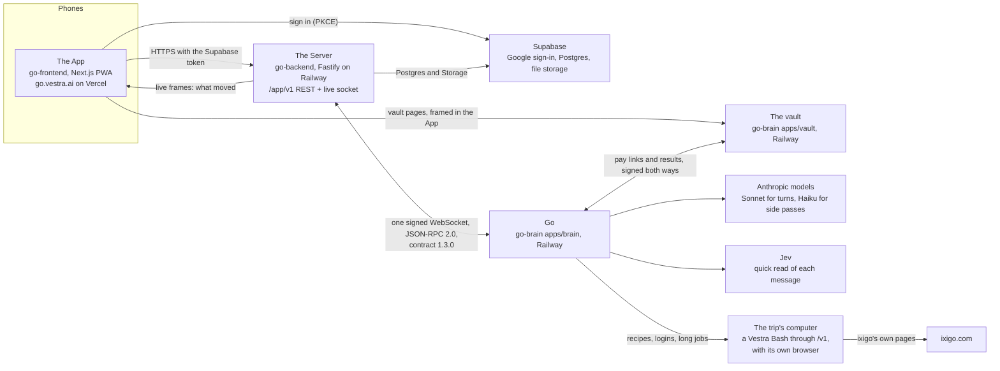

# Go: the whole system

Go is the AI member of a trip group's chat. It is built by three teams in three repos:

| Part | Repo | Team | What it is |
|---|---|---|---|
| **The App** | [vestra-ai/go-frontend](https://github.com/vestra-ai/go-frontend) | Saket's team | What people hold: an installable web app at https://go.vestra.ai |
| **The Server** | [vestra-ai/go-backend](https://github.com/vestra-ai/go-backend) | Rahul and Nishanth | Every trip's records, the App's API, and the one link to Go |
| **Go** | [vestra-ai/go-brain](https://github.com/vestra-ai/go-brain) (this repo) | Keshav's team | The AI member, the vault that guards payments, and the contract |

This page shows how the three fit together. Every claim links to the file that does it, on each repo's `main`. Go's inside is described in more depth in [docs/architecture.md](docs/architecture.md), and the claims with their tests and numbers are in [SUBMISSION.md](SUBMISSION.md).

## 1. The picture

- **The App talks only to the Server**, over HTTPS for every read and write and one WebSocket that says what moved. The socket is a hint, never the data: a frame makes the App re-read, so a missed frame can delay a screen but never leave it wrong ([App ARCHITECTURE.md §4](https://github.com/vestra-ai/go-frontend/blob/main/ARCHITECTURE.md#4-live-updates), [`src/api/live.ts`](https://github.com/vestra-ai/go-frontend/blob/main/src/api/live.ts)). The one exception is a vault page, which the App frames in a sheet.
- **The Server and Go share one WebSocket.** The Server dials Go at `GET /v1/socket` and signs the opening request; Go checks the signature before it accepts ([Server `src/go/go-socket.ts`](https://github.com/vestra-ai/go-backend/blob/main/src/go/go-socket.ts), [Go `apps/brain/src/door/door.ts`](https://github.com/vestra-ai/go-brain/blob/main/apps/brain/src/door/door.ts)). Both sides send requests on it: the Server sends Go each event in a trip, and Go asks the Server to post, react, open a vote, save a booking and so on.
- **Go never pays and never holds a card.** Payments go through the vault, or for tonight's demo through the Server's simulated payment (section 7).
- **Go works on ixigo.com in the trip's own browser.** Each trip has its own computer, a Vestra Bash reached through `/v1`, logged in to the trip's ixigo account. Recipe files say which ixigo page and filters answer each ask, and the engine fills them and reads the answer ([`apps/brain/src/travel/book/engine.ts`](https://github.com/vestra-ai/go-brain/blob/main/apps/brain/src/travel/book/engine.ts)).

## 2. Who owns what, and where it runs

| | Owns | Stack | Hosting |
|---|---|---|---|
| **App** | Nothing of its own: every field is a copy of a Server answer, replaced when the Server says it moved, never written to disk ([App §3](https://github.com/vestra-ai/go-frontend/blob/main/ARCHITECTURE.md#3-layers)) | Next.js 16, React 19, TypeScript, Tailwind 4, zustand, Serwist for the PWA ([App §2](https://github.com/vestra-ai/go-frontend/blob/main/ARCHITECTURE.md#2-stack)) | Vercel |
| **Server** | **The source of truth for every trip**: people, messages, votes, bookings, expenses, the trip record, the itinerary, files ([README](https://github.com/vestra-ai/go-backend/blob/main/README.md)) | TypeScript, Fastify, Postgres, Supabase Auth and Storage | Railway, US East (Virginia), next to its Supabase Postgres in us-east-1 ([`docs/DEPLOY.md`](https://github.com/vestra-ai/go-backend/blob/main/docs/DEPLOY.md)) |
| **Go** | Only its working memory, derived from the Server: facts with the message that proves each, the turn log, the cards it posted, jobs, and the lease that keeps one turn per trip. Most of it can be rebuilt by reading the trip again ([`apps/brain/src/trips/pack.ts`](https://github.com/vestra-ai/go-brain/blob/main/apps/brain/src/trips/pack.ts)) | TypeScript, Node 22, its own Postgres | Railway project `go`, US East ([docs/architecture.md](docs/architecture.md#architecture-decisions)) |
| **Vault** | Cards (as Stripe tokens) and passkeys, isolated from chat and AI data | TypeScript, its own Postgres | Railway project `go`, beside Go, never sharing its database |

Neither side reads the other's tables: everything between the Server and Go goes over the socket.

## 3. The contract

- **Written once, in Go's repo.** The Server and Go contract is zod in [`packages/contract`](https://github.com/vestra-ai/go-brain/tree/main/packages/contract). The OpenAPI and AsyncAPI files and a Python copy ([`packages/contract-py`](https://github.com/vestra-ai/go-brain/tree/main/packages/contract-py)) are generated from it, and CI fails if any of them drifts ([`.github/workflows/ci.yml`](https://github.com/vestra-ai/go-brain/blob/main/.github/workflows/ci.yml)). People read it at https://vestrago.vercel.app/docs, and coding agents at https://vestrago.vercel.app/llms-full.txt.
- **Versioned.** It is 1.3.0 ([`packages/contract/src/index.ts`](https://github.com/vestra-ai/go-brain/blob/main/packages/contract/src/index.ts)), and Go's health check says so: https://brain-production-6b68.up.railway.app/v1/health answers `{"ok":true,"contract":"1.3.0"}`.
- **The Server's overlay.** What the Server accepts beyond 1.3.0 is laid over it additively in [`contract/extensions-1.1.json`](https://github.com/vestra-ai/go-backend/blob/main/contract/extensions-1.1.json): the web check-in requests (`get_checkin`, `submit_checkin`), the demo's `payment.completed` event, and `update_expense` (Go re-splits an expense in place).
- **The App's contract** is the Server's own: [`docs/API.md`](https://github.com/vestra-ai/go-backend/blob/main/docs/API.md) and [`docs/CONTRACT-APP.md`](https://github.com/vestra-ai/go-backend/blob/main/docs/CONTRACT-APP.md). The App types every wire shape in [`src/api/contract.ts`](https://github.com/vestra-ai/go-frontend/blob/main/src/api/contract.ts) and calls only through [`src/api/endpoints.ts`](https://github.com/vestra-ai/go-frontend/blob/main/src/api/endpoints.ts).

## 4. Two journeys, end to end

### (a) A message, Go reading the room, and its answer

1. Someone types in the trip room. The App posts it with a `client_message_id`, so a retry never posts twice ([App §4](https://github.com/vestra-ai/go-frontend/blob/main/ARCHITECTURE.md#4-live-updates)).
2. The Server stores it with the trip's next change number, and in the same transaction a note for Go. Its sender delivers the notes to Go one at a time per trip, in order, retrying while Go is busy ([`src/outbox/sender.ts`](https://github.com/vestra-ai/go-backend/blob/main/src/outbox/sender.ts)). The phones hear a `message` frame.
3. Go answers `accepted` at once and keeps the event once by its id. Card numbers and one-time codes are hidden before anything is stored ([`apps/brain/src/trips/intake.ts`](https://github.com/vestra-ai/go-brain/blob/main/apps/brain/src/trips/intake.ts)). A message that names Go shows "Go is typing..." at once.
4. Jev reads the message once: eleven closed questions in 450 ms, such as "is this for Go" and "is the ask finished" ([`apps/brain/src/reflex`](https://github.com/vestra-ai/go-brain/tree/main/apps/brain/src/reflex)). Chatter between friends wakes no model.
5. The desk runs one turn per trip for everything due, so a burst gets one answer ([`apps/brain/src/desk/desk.ts`](https://github.com/vestra-ai/go-brain/blob/main/apps/brain/src/desk/desk.ts)). The composer builds the prompt cache first and runs a short tool loop on the model, with tools such as `search_flights`, `suggest_places`, `open_vote` and `recall` ([`apps/brain/src/composer`](https://github.com/vestra-ai/go-brain/tree/main/apps/brain/src/composer)).
6. Go posts one message, often with **cards**: options, votes, a pay card, a ticket. The Server stores them and the App draws each card kind with its own component ([`src/components/chat/CardView.tsx`](https://github.com/vestra-ai/go-frontend/blob/main/src/components/chat/CardView.tsx)). A tap is one `POST …/cards/:id/actions`; the Server passes it to Go as `card_tap`.
7. After it speaks, a small side model proposes facts and record lines from the new messages, and code keeps only what checks out against the message it came from ([`apps/brain/src/memory/notes.ts`](https://github.com/vestra-ai/go-brain/blob/main/apps/brain/src/memory/notes.ts)).

### (b) The group trip, from "where should we go" to everyone's tickets

1. **Where.** Go puts up a place card of places it picks itself, each with a real photo from Wikipedia, as the group's vote (`suggest_places` in [`apps/brain/src/travel/tools.ts`](https://github.com/vestra-ai/go-brain/blob/main/apps/brain/src/travel/tools.ts), [`wiki-photo.ts`](https://github.com/vestra-ai/go-brain/blob/main/apps/brain/src/travel/wiki-photo.ts)). When the vote closes, the trip takes the place.
2. **When.** Dates someone proposes open a dates vote in the same turn, and Go searches stays for them at once ([`apps/brain/src/composer/rules.ts`](https://github.com/vestra-ai/go-brain/blob/main/apps/brain/src/composer/rules.ts)).
3. **Where to stay.** Go searches ixigo.com in the trip's browser. The stays card is itself the vote, and See more adds the next ten.
4. **Yes, book it.** When the stays vote closes, the payer confirms the mandate. Go asks the Server for a spend approval: the Server checks its own records (vote closed, within the cap, the payer confirmed) and signs a one-use approval for that trip, payer and amount ([Server `src/domain/spend.ts`](https://github.com/vestra-ai/go-backend/blob/main/src/domain/spend.ts)).
5. **On ixigo.** Go opens the stay's own ixigo page, reads ixigo's price for the whole stay, and posts the pay card, "Pay with ixigo money" ([`apps/brain/src/money/cards.ts`](https://github.com/vestra-ai/go-brain/blob/main/apps/brain/src/money/cards.ts)).
6. **Paid, for the demo.** The payer's tap goes to the Server, which takes it as paid: it marks the card paid and writes the booking (its reference reads `DEMO-…`) and the expense, split across the people the stay covers. Then it renders a hotel voucher PDF and sends Go `payment.completed` ([Server `src/domain/demo-payment.ts`](https://github.com/vestra-ai/go-backend/blob/main/src/domain/demo-payment.ts), [`src/demo`](https://github.com/vestra-ai/go-backend/tree/main/src/demo)). The booking fills the trip's empty place and stay ([`src/domain/trip-from-booking.ts`](https://github.com/vestra-ai/go-backend/blob/main/src/domain/trip-from-booking.ts)).
7. **Next step.** Go books nothing more for that payment. It posts the ticket card and the next step, each person's flights now that the stay is booked ([`apps/brain/src/money/engine.ts`](https://github.com/vestra-ai/go-brain/blob/main/apps/brain/src/money/engine.ts)). It writes the trip's itinerary from its dates and bookings, so the App's Itinerary tab shows the stay ([`apps/brain/src/travel/itinerary.ts`](https://github.com/vestra-ai/go-brain/blob/main/apps/brain/src/travel/itinerary.ts)).
8. **Each person's flights.** Each person gets their own flights from their home city, on a card only they see. When they pick, Go books on ixigo's own pages in the trip's browser while they can watch. It chooses the fare, types each traveller into ixigo's form (a saved traveller or a new one), and stops at ixigo's pay button ([`booking/flight-booking.ts`](https://github.com/vestra-ai/go-brain/blob/main/apps/brain/src/travel/booking/flight-booking.ts), [`booking/travellers.ts`](https://github.com/vestra-ai/go-brain/blob/main/apps/brain/src/travel/booking/travellers.ts)). Their own pay card, the Server's demo payment, and their ticket follow, for them alone. Buses are booked the same way.
9. **A late joiner.** Someone who joins by invite link after the stay was paid is not in its `for_person_ids`, so the Server does not show them that booking ([Server `src/domain/bookings.ts`](https://github.com/vestra-ai/go-backend/blob/main/src/domain/bookings.ts)). Once the stay's expense is split with them, by Go's "split it evenly" (`update_expense`) or by a person, the Server adds them to the booking, and they see it and open its voucher ([Server `src/domain/expenses.ts`](https://github.com/vestra-ai/go-backend/blob/main/src/domain/expenses.ts)). Go hears them join and they are in its next turn's picture of the trip.

## 5. Sign-in and security

- **Sign-in is Supabase Auth with Google and PKCE.** The Server checks Supabase's token on every call and issues no tokens of its own. The App's live socket opens with a one-use ticket, so the token never goes into a URL ([`src/lib/auth.ts`](https://github.com/vestra-ai/go-frontend/blob/main/src/lib/auth.ts), [App §4 and §6](https://github.com/vestra-ai/go-frontend/blob/main/ARCHITECTURE.md#6-sign-in-invites-and-security)).
- **The socket is signed.** The Server signs each opening of the WebSocket with a shared secret, and Go accepts each signature once ([`packages/contract/src/signing.ts`](https://github.com/vestra-ai/go-brain/blob/main/packages/contract/src/signing.ts)).
- **Paying needs two keys.** The Server's spend approval is an Ed25519-signed token for one trip, payer, amount and currency, valid at most 10 minutes and usable once ([`packages/contract/src/spend-approval.ts`](https://github.com/vestra-ai/go-brain/blob/main/packages/contract/src/spend-approval.ts)). The vault also needs the payer's own passkey, and checks both in order before any charge ([`apps/vault/src/pay.ts`](https://github.com/vestra-ai/go-brain/blob/main/apps/vault/src/pay.ts)). The model has no tool that reaches a payment.
- **Framing.** A vault page may be framed only by the App's own origins (`VAULT_FRAME_ORIGINS`); every other page says `DENY` ([`apps/vault/src/http/security.ts`](https://github.com/vestra-ai/go-brain/blob/main/apps/vault/src/http/security.ts), [`env.ts`](https://github.com/vestra-ai/go-brain/blob/main/apps/vault/src/env.ts)). The ixigo login happens on the Watch view, a live view of the trip's browser that the App opens.
- **Private by person.** A booking is shown only to the people it covers and its payer. Someone's own flight is theirs alone, as are Go's cards for it ([Server `src/domain/bookings.ts`](https://github.com/vestra-ai/go-backend/blob/main/src/domain/bookings.ts)). Go never sees phone numbers, emails or UPI ids ([README](https://github.com/vestra-ai/go-backend/blob/main/README.md)).
- **Forget me.** It runs in each owner's store. The Server clears its part and sends Go `forget_person`. Go deletes its facts about the person, and checks that none are left before it answers ([`apps/brain/src/memory/people.ts`](https://github.com/vestra-ai/go-brain/blob/main/apps/brain/src/memory/people.ts)).

## 6. When things go wrong

- **A dropped phone connection.** The App reconnects with backoff, re-reads on a change-number gap, and re-reads everything when it comes back to the front ([App §4](https://github.com/vestra-ai/go-frontend/blob/main/ARCHITECTURE.md#4-live-updates)).
- **Go away, or a redeploy.** The Server keeps each trip's notes for Go and delivers them in order once Go is back. A request repeated with the same id is done once ([`src/db/once.ts`](https://github.com/vestra-ai/go-backend/blob/main/src/db/once.ts)). Go catches up on what it missed with `read_trip` and `read_messages` ([`apps/brain/src/trips/pack.ts`](https://github.com/vestra-ai/go-brain/blob/main/apps/brain/src/trips/pack.ts)).
- **The Server away while Go is answering.** Go parks the turn and tries again, sooner at first, then every few minutes for up to 6 hours. Asks that came in meanwhile are answered together, the oldest first ([`apps/brain/src/desk/desk.ts`](https://github.com/vestra-ai/go-brain/blob/main/apps/brain/src/desk/desk.ts)).
- **A turn that crashes** runs again under the same ids, so nothing is posted twice ([`apps/brain/src/composer/turn.ts`](https://github.com/vestra-ai/go-brain/blob/main/apps/brain/src/composer/turn.ts)).
- **ixigo has no flights.** Go says so, then offers the nearest airport with flights (one tap) or a bus. For a place without one of the airports it already knows, the side model names the nearest airport ([`apps/brain/src/travel/flights-each.ts`](https://github.com/vestra-ai/go-brain/blob/main/apps/brain/src/travel/flights-each.ts), [`nearest-airport.ts`](https://github.com/vestra-ai/go-brain/blob/main/apps/brain/src/travel/nearest-airport.ts)).
- **The trip's ixigo login.** A booking that needs it waits on the one login card. The person logs in on the Watch view, and Go sees the login land by itself and carries on ([`apps/brain/src/travel/login.ts`](https://github.com/vestra-ai/go-brain/blob/main/apps/brain/src/travel/login.ts)).

## 7. Live tonight, and simulated

| | Tonight on production |
|---|---|
| The App, the Server, Go | Live: https://go.vestra.ai, the Server team's production Server, and Go's production service, all connected |
| The models | Live: Anthropic's Sonnet writes Go's turns, Haiku runs the side passes; Jev's quick read acts on nine of its eleven questions |
| Search on ixigo | Live on ixigo.com, in each trip's own browser |
| Booking on ixigo | Live up to ixigo's pay button for flights, buses and the group's stay, and never past it. **Trains are parked:** ixigo needs each traveller's IRCTC login |
| Paying | **Simulated.** "Pay with ixigo money" is the Server's demo payment (`payment.completed`). Its booking and ticket say DEMO, and no money moves. The vault's two-key path is built and tested, but not on the demo's path |
| Phone calls | Off (`CALLS_MODE` is `off`) |
