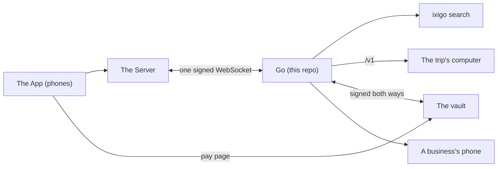

# Go: the submission

Every claim on this page links to its proof in this repo: a file and line, a test by its name, a CI run, or a measured number with how it was measured. Where something is simulated, this page says so.

## What Go is

Go is the AI member of a trip group. Friends plan a trip in a group chat, and Go is in that chat with them as one more member. It reads every message, stays quiet through the chatter, and answers when someone asks it something: "Go is typing..." shows at once, and the answer follows. It keeps track of what each person said and what the group agreed, with a link to the message that proves it, and it forgets a person exactly when they ask.

Go also does the work a trip needs. It searches flights and stays, puts the options to a vote, and books what the group voted for, but only with two keys: the Server's signed approval and the payer's own passkey on their phone. The model never holds a card and has no way to pay. Big jobs, like finding and comparing villas, run on the trip's own computer while Go keeps talking in the chat. Go can also phone a business for the group, after saying who it will call and why and waiting 30 seconds for anyone to say stop.

## The three parts and the one socket

| Part | Built by | What it does |
|---|---|---|
| **The App** | Saket's team | What people hold: the trip room (the group chat), the trip screens, joining by link. It talks only to the Server, except for the vault's pay page. |
| **The Server** | Nishanth's team | Every trip's records: people, messages, votes, bookings, expenses, the trip record and the spend check. It opens one signed WebSocket to Go and keeps it open. |
| **Go** (this repo) | Keshav's team | The AI member: reading the room, deciding when to speak, memory with proof, travel search and booking, jobs on the trip's computer, speaking first when it helps, phone calls, and the vault that holds cards and pays. |



Everything between the Server and Go travels on that one socket: the Server sends Go each event in a trip (a message, a vote, a booking) and each tap on one of Go's cards, and Go sends the Server its requests (post a message, open a vote, react). The Server signs the socket's opening request, and Go checks the signature before it accepts the socket ([`apps/brain/src/door/door.ts:103`](apps/brain/src/door/door.ts#L103), with the signing itself in [`packages/contract/src/signing.ts:48`](packages/contract/src/signing.ts#L48)). The contract is written once in zod in [`packages/contract`](packages/contract), with OpenAPI and AsyncAPI files generated from it and a Python copy in [`packages/contract-py`](packages/contract-py). It is explained in plain words in [`docs/guide`](docs/guide), also live and readable by coding agents at https://vestrago.vercel.app/docs and https://vestrago.vercel.app/llms.txt. How the pieces fit inside Go is in [`docs/architecture.md`](docs/architecture.md).

Go's composer and the bench use a few helpers from Vestra's agent loop, [`packages/agent-sdk`](packages/agent-sdk): model capabilities, token usage, cost and error kinds. That package was brought in from our product Bash on 4 October, before this week ([its `PROVENANCE.md`](packages/agent-sdk/PROVENANCE.md) says what was copied); everything else in this repo was built this week.

## Try it in five minutes

**1. The dev room: no keys at all, and no database.** This is the fastest way in. The simulator plays the Server and a one-page App in the browser, and the fake Go answers over the real signed socket. You need only Node 22 and pnpm 10.

```bash
pnpm install
pnpm --filter "@go/fake-go..." build
export GO_SIGNING_SECRET=$(openssl rand -hex 32) FAKE_GO_ADMIN_TOKEN=$(openssl rand -hex 16)
node apps/fake-go/dist/main.js &
pnpm --filter @go/sim room -- --go http://localhost:8080 --secret "$GO_SIGNING_SECRET"
```

Open the address it prints and type `@Go hello` as anyone in the room. The [README](README.md) shows how to point the same room at the real Go.

**2. The demo test, the whole five-minute demo against the real Go.** It plays the run sheet beat by beat with every lane registered, every outside service faked, and a scripted model, and checks what reaches the room. It needs Postgres 16.

```bash
docker run -d -e POSTGRES_USER=go -e POSTGRES_PASSWORD=go -e POSTGRES_DB=go -p 5432:5432 postgres:16
export DATABASE_URL=postgres://go:go@localhost:5432/go
pnpm install && pnpm build
pnpm --filter @go/bench exec vitest run src/scenarios/__tests__/demo.test.ts
```

What it puts in the room, line by line, is in [`docs/demo/transcript.md`](docs/demo/transcript.md), generated by that test.

**3. The live smoke, against a deployed Go.** The stage Go answers at https://brain-production-6b68.up.railway.app/v1/health. The live smoke connects to a deployed Go as the Server does and times two asks; it needs that Go's signing secret, so the team runs it ([`docs/operations.md`](docs/operations.md), "Run the live smoke").

## Claims and their evidence

The tests named below all passed in [CI run 37425497279](https://github.com/vestra-ai/go-brain/actions/runs/37425497279), a run of `build` at `a195f10` with this pull request on top. What was built this week: `apps/brain` 120 test files and 1,041 tests, `packages/bench` 15 and 137, `apps/vault` 11 and 133, `packages/sim` 9 and 83, `apps/fake-go` 4 and 42, `packages/contract` 4 and 35, and the Python contract 13. Brought in from Bash before this week, and counted apart: `packages/agent-sdk`, 588 test files and 7,851 tests, which passed in the same run. In that run the demo test also checked that [`docs/demo/transcript.md`](docs/demo/transcript.md) still matches what it plays. The bench numbers below come from [`docs/demo/evidence/bench-2026-10-06.json`](docs/demo/evidence/bench-2026-10-06.json), the report of one CI run, unedited, and [its README](docs/demo/evidence/README.md), which explains every number, how it was measured and the bar it is held to. Values are given for the three recorded chats in the order 50 / 300 / 2,000 messages. The bars are in [`packages/bench/bars.json`](packages/bench/bars.json), and CI fails a run that misses one. In the bench and the demo test the model is scripted, so their reply times are Go's own time, not a model's.

| Claim | Evidence |
|---|---|
| "Go is typing..." shows the moment a message names Go, before anything else runs. | Code: [`apps/brain/src/trips/intake.ts:77`](apps/brain/src/trips/intake.ts#L77). Test: [`demo.test.ts`](packages/bench/src/scenarios/__tests__/demo.test.ts), "0:30 flights: typing in under half a second, then a flights card, every flight after 6 pm". Bench: typing p90 of 6 / 4 / 3 ms, against a bar of under 500 ms ([evidence README](docs/demo/evidence/README.md), "Typing p90"). |
| Go stays quiet through chatter without asking the model, with labelled reads; Jev runs in shadow until its test sets are recorded. Go also puts a quiet ✅ under a fact. | Code: [`apps/brain/src/memory/register.ts:141`](apps/brain/src/memory/register.ts#L141) (the instant ✅); no question acts on Jev's read until its test set passes on recorded answers, and none has yet ([`apps/brain/src/reflex/live-gate.ts:6`](apps/brain/src/reflex/live-gate.ts#L6)). Test: [`demo.test.ts`](packages/bench/src/scenarios/__tests__/demo.test.ts), "0:15 the chatter: Go says nothing and the model is not even asked, and a quiet ✅ lands under "I'm veg btw" at once". Bench, with the quick read taken from the labels in the chat files (`reflexSource: "labels"`), not from Jev: the model woke for 20.0% / 17.0% / 9.9% of people's messages, against a bar of under 25% ([evidence README](docs/demo/evidence/README.md), "Woke the model"). |
| Go's own time from an ask to its answer is small. | Bench: Go's own reply time at p90 of 32 / 24 / 26 ms with a scripted model, against a bar of under 1,500 ms ([evidence README](docs/demo/evidence/README.md), "Go's own time to reply"). A real model adds its own time, which these numbers do not include. |
| The prompt is built cache first, so most of each request would be read from the provider's cache. | Code: Go's rules cached for an hour at [`apps/brain/src/composer/context.ts:205`](apps/brain/src/composer/context.ts#L205), and the chat cached up to its last full block at [`context.ts:183`](apps/brain/src/composer/context.ts#L183). Bench, estimated from the request bodies by the provider's caching rules (no provider was called): 87.1% / 81.6% / 87.0% of each prompt read from the cache; the bar of 85% or more applies to the 2,000 message chat ([evidence README](docs/demo/evidence/README.md), "Cache hit"). |
| One turn per trip at a time: a burst of messages becomes one turn, and a crashed turn runs again without posting twice. | Code: [`apps/brain/src/desk/desk.ts:72`](apps/brain/src/desk/desk.ts#L72). Tests: [`desk.test.ts`](apps/brain/src/desk/__tests__/desk.test.ts), "a burst of five gets one turn, and the wait never passes 6 s after the first message" and "a message that lands while a failed turn waits for its retry joins the retry, so nothing is answered twice"; [`turn.test.ts`](apps/brain/src/composer/__tests__/turn.test.ts), "a crash before posting: the rerun repeats the same request ids, so nothing is done twice". |
| People's words reach the model as data, and nobody in the chat can pose as Go. | Code: [`apps/brain/src/composer/fence.ts:20`](apps/brain/src/composer/fence.ts#L20) and [`fence.ts:6`](apps/brain/src/composer/fence.ts#L6). Tests: [`context.test.ts`](apps/brain/src/composer/__tests__/context.test.ts), "the fence: people's text is data and nobody can pose as Go". |
| A big job runs on the trip's own computer while Go keeps answering in the chat. | Code: the `start_task` tool at [`apps/brain/src/tasks/tools.ts:50`](apps/brain/src/tasks/tools.ts#L50). Tests: [`demo.test.ts`](packages/bench/src/scenarios/__tests__/demo.test.ts), "0:45 the villa job" and "1:10 the weather is answered at once, while the job browses and the call waits out its 30 seconds". In the test the trip's computer is a fake of Vestra's `/v1` that streams events like the real one. |
| Go remembers with proof and forgets a person exactly. | Code: recall at [`apps/brain/src/memory/recall.ts:82`](apps/brain/src/memory/recall.ts#L82), forget at [`apps/brain/src/memory/people.ts:110`](apps/brain/src/memory/people.ts#L110). Tests: [`demo.test.ts`](packages/bench/src/scenarios/__tests__/demo.test.ts), "4:10 memory: what Meher can't eat, linked to the message where she said it, and who hasn't paid yet" and "4:20 Meher taps "Forget me in this trip" in the App", which checks with database queries that nothing of hers is left. Bench: every recall question answered with the right message, 5 of 5 / 7 of 7 / 10 of 10 ([evidence README](docs/demo/evidence/README.md), "Recall"). |
| A long chat folds into a story that cites its messages, so the prompt stays small and Go still recalls what was folded. | Code: the fold runs right after Go posts once the chat passes its budget, and otherwise after a quiet minute but never more than 10 minutes later, at [`apps/brain/src/memory/register.ts:126`](apps/brain/src/memory/register.ts#L126) and [`register.ts:45`](apps/brain/src/memory/register.ts#L45); the fold itself is [`apps/brain/src/memory/fold.ts:113`](apps/brain/src/memory/fold.ts#L113). Test: [`register.test.ts`](apps/brain/src/memory/__tests__/register.test.ts), "a long trip in the prompt after its fold". Bench: the 2,000 message chat must fold (`requireMemory` and `foldChats` in [`packages/bench/bars.json`](packages/bench/bars.json)); it folded twice, its largest prompt was 20,191 tokens, and all 10 of its recall questions were asked after a fold and answered with the right message ([evidence README](docs/demo/evidence/README.md), "Folds" and "Recall"). |
| Paying needs two keys, and the model has no way to pay. | Code: the vault's checks in order at [`apps/vault/src/pay.ts`](apps/vault/src/pay.ts). Tests: [`no-path-to-confirm.test.ts`](apps/brain/src/money/__tests__/no-path-to-confirm.test.ts), "only the vault callback path confirms a booking with the travel layer"; [`attacks.test.ts`](apps/brain/src/money/__tests__/attacks.test.ts), "a model talked into paying" and "the wrong person"; [`demo.test.ts`](packages/bench/src/scenarios/__tests__/demo.test.ts), "3:00 Approve, Face ID on the vault page, the test card charged once" and the two "3:55" refusals. |
| An unclear answer from the bank never leads to a second charge. When a charge's answer is lost, the vault looks it up, which moves no money, and settles from what it finds; past the approval's deadline it never sends a charge. | Code: the lookup at [`apps/vault/src/go-callback.ts:158`](apps/vault/src/go-callback.ts#L158), and the deadline checked as each charge is sent at [`apps/vault/src/charge.ts:60`](apps/vault/src/charge.ts#L60). Tests: [`go-callback.test.ts`](apps/vault/src/go-callback.test.ts), "the rail took the charge but its answer was lost: past the deadline, find settles it paid, with one charge in all" and "past the approval and its grace, never charges again even when the bank would take it, and inside the lag Go hears only confirming"; [`pay.test.ts`](apps/vault/src/pay.test.ts), "past its deadline before it went out, fails at once: nothing was charged, the payer and Go hear failed"; [`rails.test.ts`](apps/vault/src/rails/rails.test.ts), "find, which never moves money"; [`attacks.test.ts`](apps/brain/src/money/__tests__/attacks.test.ts), "a payment a person was checking, found later: Go books it once and the card is paid" and "a payment a person was checking, with nothing found: the failed card, one line, one release, no booking". |
| Go phones a business only after saying who and why, waits 30 seconds for a stop, and calls only numbers on the allowlist. | Code: [`apps/brain/src/calls/config.ts:2`](apps/brain/src/calls/config.ts#L2) (the 30 second window), [`apps/brain/src/calls/service.ts:24`](apps/brain/src/calls/service.ts#L24) (the stop line), [`config.ts:92`](apps/brain/src/calls/config.ts#L92) (only allowlisted numbers). Tests: [`demo.test.ts`](packages/bench/src/scenarios/__tests__/demo.test.ts), "1:00 the call cue while the job browses" and "1:30 the call dials the dive shop about 30 seconds after the line". In the test, Twilio and the voice model are fakes. |
| Simulated news is labelled as simulated. | Code: [`apps/brain/src/proactive/notice-tools.ts:10`](apps/brain/src/proactive/notice-tools.ts#L10). Test: [`demo.test.ts`](packages/bench/src/scenarios/__tests__/demo.test.ts), "3:40 the operator fires a watch from the admin page: one notice, pinned to Arjun, labelled as simulated". |
| A card can be tapped the moment it shows, and a card the Server may have posted is never dropped. Go keeps each card from the moment it sends it, so a fast tap is never told the card is gone. | Code: [`apps/brain/src/door/cards.ts:12`](apps/brain/src/door/cards.ts#L12) and the send hook at [`apps/brain/src/door/server-link.ts:191`](apps/brain/src/door/server-link.ts#L191). Tests: [`taps.test.ts`](apps/brain/src/door/__tests__/taps.test.ts), "a card Go has sent, before the Server answers", among them "races a Server tap against a failed post, and never lets both win: handled with the card kept, or refused with it gone"; [`server-link.test.ts`](apps/brain/src/door/__tests__/server-link.test.ts), "a tap that lands between the send and the answer is handled once, and the answer keeps the card" and "an answer that never comes (out of retries) keeps the card pending, and a Server tap then is handled once and makes it live"; and the demo test taps every card as soon as it shows. |
| Go measures itself from its own turns, and the numbers agree with the bench. | Code: the proof board times each turn from the message that named Go, at [`apps/brain/src/stats/stats.ts:65`](apps/brain/src/stats/stats.ts#L65). Test: [`fast-bench.test.ts`](packages/bench/src/__tests__/fast-bench.test.ts) compares the board's cache, typing and reply numbers with the bench's on every replay. The board's numbers for the three chats are in the [evidence README](docs/demo/evidence/README.md), "The proof board". |
| Go is deployed: it answers its health check; it cannot answer people until the model key is in. | https://brain-production-6b68.up.railway.app/v1/health answers `{"ok":true,"contract":"1.0.0"}`. The model key there is a placeholder (see the next section). |

## What is live and what is simulated

The admin page's health view (`/admin/health.json`, for the operator, behind the admin token) checks each outside service within 1.5 seconds and shows the demo switches ([`apps/brain/src/admin/health.ts`](apps/brain/src/admin/health.ts), [`apps/brain/src/admin/register.ts`](apps/brain/src/admin/register.ts)). This table follows it, and is updated as each part is connected.

| Part | In the demo test (CI) | On the stage Go today | What turns it on |
|---|---|---|---|
| The model | Scripted: the director makes the calls Go would make. | Not connected: `ANTHROPIC_API_KEY` holds a placeholder, so Go cannot answer anyone yet. | The real key in `ANTHROPIC_API_KEY`. The health view's "The model API" row turns green. |
| Jev, the quick read of every message | Labels from the test: a line that names Go is for Go, a line with a fact is sure of a ✅. | Not connected: `TYPESAFE_API_KEY` is not set, so every quick read is "unsure" and Go decides from its own rules. | More than a key. Jev's answers must first be recorded and each question's test set must pass on them; no question has passed yet ([`apps/brain/src/reflex/live-gate.ts:6`](apps/brain/src/reflex/live-gate.ts#L6)), so every question runs in shadow. Then `TYPESAFE_API_KEY`, and the `REFLEX_LIVE` switch names the passed questions that act. |
| ixigo, flights and stays | The fake ixigo: fixed flights into Goa and villas in North and South Goa, labelled "ixigo (simulated)". | Not connected: `IXIGO_MCP_URL` is not set, so searches use the same fake. | More than configuration. The adapter is built; its tool map follows the fake until ixigo shares its MCP tool list ([`apps/brain/src/travel/ixigo-map.ts:271`](apps/brain/src/travel/ixigo-map.ts#L271)), and the vault's ixigo pay rail answers `rail_not_ready` ([`apps/vault/src/internal/pay-links.ts:54`](apps/vault/src/internal/pay-links.ts#L54)). ixigo's platform is VPN-only and access is being arranged. Then `IXIGO_MCP_URL` and its token, and the `TRAVEL_MODE` switch set to `ixigo`. |
| Jobs on the trip's computer (`/v1`) | A fake `/v1` that streams events like the real one. | Not connected: the six `VESTRA_*` variables are not set, so jobs are off. | The six `VESTRA_*` variables ([`docs/operations.md`](docs/operations.md)). |
| The vault and its rail | The real vault in process, with a software passkey and the 4242 test card, charged on the fake rail. | The vault is deployed and answers its health check. `PAY_RAIL` is `fake`: no money moves. | Stripe test keys on the vault, and the `PAY_RAIL` switch set to `stripe_test`. Only test cards: the vault refuses live keys. |
| Calls | A fake Twilio and a scripted voice model. | Off: `CALLS_MODE` is `off`, and the Twilio and voice keys are not set. | The Twilio and voice keys, `CALLS_ALLOWLIST`, and the `CALLS_MODE` switch set to `allowlist`. |
| The Server | The simulator ([`packages/sim`](packages/sim)), which keeps trips with the Server's rules. | The Server team's service, when it is pointed at Go. The health view's first row shows whether a Server is connected at that moment. | The Server's own deployment, with the same `GO_SIGNING_SECRET` as Go. |
| The flight watch at 3:40 | Fired from the admin page. | Simulated for the demo: the operator fires it from the admin page, and every card it leads to says "Simulated for the demo". | It stays simulated on stage, and the presenter says so. Go's real watches follow booked flights through the travel layer, which answers from the fake ixigo until ixigo is connected. |

## Known gaps

- **No real model turn yet.** The stage Go's model key is a placeholder until the key arrives. Every Go line in the [transcript](docs/demo/transcript.md) and in the bench comes from a scripted model, so nothing here measures a real model's time or its words.
- **Jev runs in shadow, with no recorded answers.** No question acts on Jev's read until its test set passes on recorded answers, and none has ([`apps/brain/src/reflex/live-gate.ts:6`](apps/brain/src/reflex/live-gate.ts#L6)). The bench and the demo test take the quick read from labels.
- **ixigo.** The adapter is built, but its tool map is the fake's until ixigo shares its MCP tool list ([`apps/brain/src/travel/ixigo-map.ts:271`](apps/brain/src/travel/ixigo-map.ts#L271)), and the vault's ixigo pay rail answers `rail_not_ready` ([`apps/vault/src/internal/pay-links.ts:54`](apps/vault/src/internal/pay-links.ts#L54)). ixigo's platform is VPN-only and access is being arranged.
- **The trip's computer (`/v1`) is not connected.** Jobs are tested against a fake `/v1`; on the stage Go the six `VESTRA_*` variables are not set, so jobs are off.
- **Calls are off.** `CALLS_MODE` is `off` on the stage Go, and the Twilio and voice keys are not set. The calls are tested against a fake Twilio and a scripted voice model.
- **The App and the Server are the other teams' repos.** This repo holds Go, and the simulator and the dev room stand in for the App and the Server. Nothing here shows Go with the real App and Server.
- **The cache on the 300 message chat.** Its estimated cache hit is 81.6%, under 85%. Only the 2,000 message chat is held to that bar (87.0%), because its prompts are the size the bar is for ([evidence README](docs/demo/evidence/README.md), "Cache hit").
