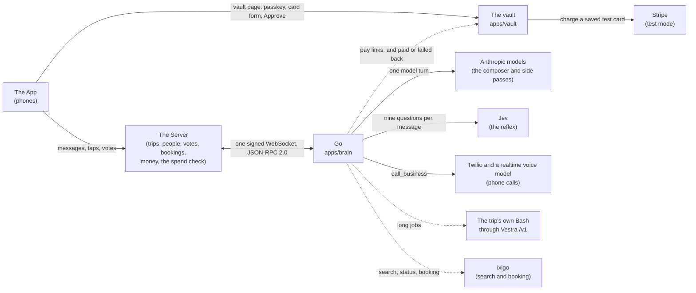

# How Go is put together

Go is one member of a trip's group chat. The App is what people hold, the Server keeps every trip's records, and Go is the AI member. This page shows how the pieces connect, what happens to one message, how money needs two keys, and what runs for real and what is simulated. Every statement here points to the code that does it.

## The parts

Solid lines are done by code in this repo. Dotted lines are fixed by the contract or an interface here, while the code on Go's side of them is not in this repo yet.

- **The socket.** The Server opens one WebSocket to Go at `GET /v1/socket`, signed with a shared secret, and keeps it open; Go accepts each signature once and pings every 20 seconds (`apps/brain/src/door`). Every change in a trip reaches Go as an event; every write Go makes (a message, a reaction, a vote, a record line) is a request back on the same socket, with a `request_id` so the Server does it once. The methods and objects are fixed in [`packages/contract`](../packages/contract) and explained in [`docs/guide`](guide).
- **The vault** is its own service with its own database ([`apps/vault`](../apps/vault)). Cards and payments never pass through the Server or the model: the App opens the vault's page directly.
- **The trip's own Bash and ixigo.** Go's interfaces for them are `apps/brain/src/tasks/tasks.ts` and `apps/brain/src/travel/travel.ts`. Their code is not in this repo yet.

## One message, from the room to Go's reply

1. Someone types in the trip room. The App sends it to the Server, which stores it, gives it the trip's next change number and sends Go `send_event` with a `message.created` event.
2. Go writes the event to its trip log once by `event_id` and answers at once: `{ accepted: true }`, or `duplicate: true` for an event it already has. The work happens after the answer, in change-number order per trip (`apps/brain/src/trips/intake.ts`). Card numbers, CVVs and one-time codes are hidden before anything is stored (`trips/screen.ts`).
3. If the message names Go (an @mention, a reply to Go, or "Go, ..."), Go turns "Go is typing..." on at once, before thinking (`trips/names-go.ts`, `composer/speak.ts`).
4. The reflex reads the message once: one call to Jev with nine closed questions and a 450 ms deadline. Any fault reads "unsure" (`apps/brain/src/reflex`).
5. Lanes see the read message: memory schedules its notes pass, and speaking first looks for an opening or a hush.
6. Unless the reflex is sure it is chatter between friends, the message goes on the desk: due now when the thought is complete, otherwise after 2 seconds, in case the same person adds more (`apps/brain/src/desk`).
7. When it is due, the desk takes the trip's lease and runs one composer turn for everything due in that trip, so a burst of messages gets one answer.
8. The composer builds the prompt cache-first (Go's rules, then the chat in fixed chunks of 25 messages, then "right now" with the trip record and the people talking, then what is new, fenced as data) and runs a direct Anthropic Messages tool loop: at most 4 rounds within 20 seconds, with quick tools such as `recall`, `record`, `open_vote` and `call_business` (`apps/brain/src/composer`).
9. Just before posting, the turn checks for anything new in the room and takes it into the same answer. Then `speak` posts one message (with any cards), with no em dashes, and turns typing off. Every write takes an id from the turn, so a rerun after a crash never posts twice.
10. About 2 seconds after Go posts, the notes pass reads the new lines: a small side model proposes facts and record lines, and code saves only what checks out against the message it came from (`apps/brain/src/memory/notes.ts`, `checker.ts`).

## Money needs two keys

No code path pays on the model's word. A payment needs both:

1. **The Server's key.** The Server runs its spend check and signs a spend approval with its Ed25519 private key: a compact JWS from `server` to `go-vault`, for one trip, one payer, one amount and currency, valid for at most 10 minutes and usable once (`packages/contract/src/spend-approval.ts`).
2. **The payer's key.** The payer opens the vault's pay page from the App and unlocks it with their own passkey (Face ID or a fingerprint).

The vault checks, in order, and refuses at the first failure (`apps/vault/src/pay.ts`): the link is valid and unused; the passkey verifies and is the payer's; the Server's signature checks and the approval has not expired; it is meant for the vault, by the Server, for this trip; it was never used before (one row per approval id, so two pages racing pay once); the person who unlocked is the payer the Server approved; and the amount is within the approval, in the same currency, while the hold still stands. Only then does it charge the saved card, once, with the approval's id as the idempotency key. The vault never sees a card number: a card is added through Stripe's own form, and the vault keeps only Stripe's token, encrypted with a key per item. `GET /internal/both-keys` counts payments without both keys from the vault's own records.

The tests in `apps/vault/src/pay.test.ts` walk every step, each refusing on its own. The simulator signs spend approvals with the contract's test key (`packages/sim/src/test-spend-key.ts`), and the real Server signs with its own key, which is never in a repo.

## What runs for real and what is simulated

| Piece | For real | Simulated, or off by default |
|---|---|---|
| The socket, the trip log and the composer | The real socket to the Server; model turns on Anthropic models (`COMPOSER_MODEL`, `SIDE_MODEL`). | The simulator ([`packages/sim`](../packages/sim)) plays the Server, and the fake Go ([`apps/fake-go`](../apps/fake-go)) plays Go, for building and tests. In tests every model is a scripted fake. |
| The reflex | Jev is called on every person's message when `TYPESAFE_API_KEY` is set, and every answer is logged. | All nine questions run in shadow: a question acts only after its labelled test set passes on recorded answers (`reflex/live-gate.ts`), and none is recorded yet. Code alone decides until then. |
| Memory | Facts with proof, pages, recall, the trip record, "the story so far", forget me, and catch-up. | |
| Speaking first | Timers (votes closing, free cancellation ending, travel day, settle-up, a waiting payer) and openings in the chat, through the bar and the daily budget. | Flight and train watches need a travel layer, which is not in this repo yet. The demo's watch is `POST /admin/watch/fire`, and every card it leads to says "Simulated for the demo". |
| Calls | Real phone calls through Twilio with a realtime voice model, only to numbers on `CALLS_ALLOWLIST` while the `CALLS_MODE` switch says `allowlist`. Go says who it will call and why, and waits 30 seconds for a stop first. | Off by default (`CALLS_MODE=off`). |
| Payments | The vault charges test cards through Stripe test mode, with both keys. | Test cards only: the vault refuses live Stripe keys at boot. `PAY_RAIL=fake` moves no money, and the ixigo rail answers "not ready". Go's side of paying (`apps/brain/src/money`) is an interface here. |
| The proof board | `/board` and `/stats.json` show numbers from the turns Go really ran: time to typing and to the reply, the cache hit, the share of messages that woke the model, and cost per trip. | The bench's numbers on the board come from replays of recorded chats: the fast bench with a scripted model, the live bench with the real models and Jev (`packages/bench`). |
| Travel search and booking, long jobs | | Interfaces only in this repo (`travel/`, `tasks/`). |
