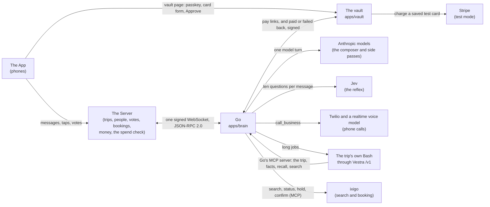

# How Go is put together

Go is one member of a trip's group chat. The App is what people hold, the Server keeps every trip's records, and Go is the AI member. This page shows how the pieces connect, what happens to one message, how money needs two keys, what runs for real and what is simulated, and the decisions behind it. Every statement here points to the code that does it.

## The parts

Go's side of every line is code in this repo; the App's and the Server's sides are built by their teams against the contract.

- **The socket.** The Server opens one WebSocket to Go at `GET /v1/socket`, signed with a shared secret, and keeps it open; Go accepts each signature once and pings every 20 seconds (`apps/brain/src/door`). Every change in a trip reaches Go as an event; every write Go makes (a message, a reaction, a vote, a record line) is a request back on the same socket, with a `request_id` so the Server does it once. The methods and objects are fixed in [`packages/contract`](../packages/contract) and explained in [`docs/guide`](guide).
- **The vault** is its own service with its own database ([`apps/vault`](../apps/vault)). Cards and payments never pass through the Server or the model: the App opens the vault's page directly.
- **The trip's own Bash.** Each trip gets its own computer, a Vestra Bash reached through `/v1` (`apps/brain/src/tasks`). Big jobs (compare villas, read reviews, fill a form) run there for minutes while the room goes on; it never speaks in the room, and it reads the trip through Go's MCP server, locked to that trip by a token (`apps/brain/src/mcp`).
- **ixigo.** Travel search, status and booking go through one layer (`apps/brain/src/travel`): ixigo's MCP server, or the fake ixigo in process.

## One message, from the room to Go's reply

1. Someone types in the trip room. The App sends it to the Server, which stores it, gives it the trip's next change number and sends Go `send_event` with a `message.created` event.
2. Go writes the event to its trip log once by `event_id` and answers at once: `{ accepted: true }`, or `duplicate: true` for an event it already has. The work happens after the answer, in change-number order per trip (`apps/brain/src/trips/intake.ts`). Card numbers, CVVs and one-time codes are hidden before anything is stored (`trips/screen.ts`).
3. If the message names Go (an @mention, a reply to Go, or "Go, ..."), Go turns "Go is typing..." on at once, before thinking (`trips/names-go.ts`, `composer/speak.ts`).
4. The reflex reads the message once: one call to Jev with ten closed questions and a 450 ms deadline. Any fault reads "unsure" (`apps/brain/src/reflex`).
5. Lanes see the read message: memory schedules its notes pass, and speaking first looks for an opening or a hush.
6. Unless the reflex is sure it is chatter between friends, the message goes on the desk: due now when the thought is complete (the reflex is sure, or a message to Go, or the last line of a burst that named Go, plainly ends with ?, ., ! or an emoji), otherwise after 2 seconds, in case the same person adds more (`apps/brain/src/desk`).
7. When it is due, the desk takes the trip's lease and runs one composer turn for everything due in that trip, so a burst of messages gets one answer.
8. The composer builds the prompt cache-first (Go's rules, then the chat in fixed chunks of 25 messages, then "right now" with the trip record and the people talking, then what is new, fenced as data) and runs a direct Anthropic Messages tool loop: at most 4 rounds within 20 seconds, with quick tools such as `recall`, `search_flights`, `start_task`, `open_vote` and `call_business` (`apps/brain/src/composer`).
9. Just before posting, the turn checks for anything new in the room and takes it into the same answer. Then `speak` posts one message (with any cards), with no em dashes, and turns typing off. Every write takes an id from the turn, so a rerun after a crash never posts twice.
10. About 2 seconds after Go posts, the notes pass reads the new lines: a small side model proposes facts and record lines, and code saves only what checks out against the message it came from (`apps/brain/src/memory/notes.ts`, `checker.ts`).

## Money needs two keys

No code path pays on the model's word. A payment needs both:

1. **The Server's key.** The Server runs its spend check and signs a spend approval with its Ed25519 private key: a compact JWS from `server` to `go-vault`, for one trip, one payer, one amount and currency, valid for at most 10 minutes and usable once (`packages/contract/src/spend-approval.ts`).
2. **The payer's key.** The payer opens the vault's pay page from the App and unlocks it with their own passkey (Face ID or a fingerprint).

The flow, from Go's side (`apps/brain/src/money/pay.ts`): the group votes; the payer taps "Yes, book it" on the mandate card; Go holds the voted offer and asks the Server for its spend approval (`request_spend_approval`); the vault checks the approval and gives Go a pay link; Go posts the pay card, with Approve shown only to the payer; the payer taps Approve and opens the vault's page; after the passkey the vault pays and calls Go back, signed; Go then confirms the booking and records the booking, the expense and the ticket card, each once. Any failure on the way cancels the approval and says so in the room. The model has no tool that confirms a booking or reaches a rail: only the vault's signed callback does (`apps/brain/src/money/__tests__/no-path-to-confirm.test.ts`). Stays are booked this way; for a flight, train or bus Go holds nothing and hands over the booking link, because those fares are per person.

The vault checks, in order, and refuses at the first failure (`apps/vault/src/pay.ts`): the link is valid and unused; the passkey verifies and is the payer's; the Server's signature checks and the approval has not expired; it is meant for the vault, by the Server, for this trip; it was never used before (one row per approval id, so two pages racing pay once); the person who unlocked is the payer the Server approved; and the amount is within the approval, in the same currency, while the hold still stands. Only then does it charge the saved card, once, with the approval's id as the idempotency key. The vault never sees a card number: a card is added through Stripe's own form, and the vault keeps only Stripe's token, encrypted with a key per item. `GET /internal/both-keys` counts payments without both keys from the vault's own records.

When the rail gives no clear answer, the payment is never settled as failed: it stays "charging" and the vault asks the rail again with the same id until it knows, or marks it for a person to check (`apps/vault/src/charge.ts`).

The tests in `apps/vault/src/pay.test.ts` walk every step, each refusing on its own, and `apps/brain/src/money/__tests__/attacks.test.ts` tries every way to pay without both keys: a friend's tap, a friend's passkey, a reused link or approval, an expired approval, and an approval for another trip. The simulator signs spend approvals with the contract's test key (`packages/sim/src/test-spend-key.ts`), and the real Server signs with its own key, which is never in a repo.

## What runs for real and what is simulated

| Piece | For real | Simulated, or off by default |
|---|---|---|
| The socket, the trip log and the composer | The real socket to the Server; model turns on Anthropic models (`COMPOSER_MODEL`, `SIDE_MODEL`). | The simulator ([`packages/sim`](../packages/sim)) plays the Server, and the fake Go ([`apps/fake-go`](../apps/fake-go)) plays Go, for building and tests. In tests every model is a scripted fake. |
| The reflex | Jev is called on every person's message when `TYPESAFE_API_KEY` is set, and every answer is logged. | Questions 3 and 9 run in shadow: a question acts only after its labelled test set passes on recorded answers (`reflex/live-gate.ts`), and eight have passed: 1, 2, 4, 5, 6, 7, 8 and 10 ([the Jev evidence](demo/evidence/jev.md)). For the two in shadow, code alone decides. |
| Memory | Facts with proof, pages, recall, the trip record, "the story so far", forget me, and catch-up. | |
| Speaking first | Timers (votes closing, free cancellation ending, travel day, settle-up, a waiting payer), openings in the chat, and flight and train watches through the travel layer's status, all through the bar and the daily budget. | On the fake ixigo, a watched flight's status is the fake's. The demo's watch is `POST /admin/watch/fire`, and every card it leads to says "Simulated for the demo". |
| Calls | Real phone calls through Twilio with a realtime voice model, only to numbers on `CALLS_ALLOWLIST` while the `CALLS_MODE` switch says `allowlist`. Go says who it will call and why, and waits 30 seconds for a stop first. | Off by default (`CALLS_MODE=off`). |
| Payments | Go holds the voted stay, asks the Server for a signed approval and posts the pay card; the vault charges test cards through Stripe test mode, with both keys (`apps/brain/src/money`, `apps/vault`). | Test cards only: the vault refuses live Stripe keys at boot. `PAY_RAIL=fake` moves no money, and the ixigo rail answers "not ready". Flights, trains and buses are not booked by Go: it hands over the booking link. |
| The proof board | `/board` and `/stats.json` show numbers from the turns Go really ran: time to typing and to the reply, the cache hit, the share of messages that woke the model, and cost per trip. | The bench's numbers on the board come from replays of recorded chats: the fast bench with a scripted model, the live bench with the real models and Jev (`packages/bench`). |
| Travel | ixigo's MCP server when `IXIGO_MCP_URL` and its token are set and the `TRAVEL_MODE` switch says `ixigo`. | The fake ixigo answers by default: deterministic flights into Goa, North and South Goa villas, flight status and a two-step booking, everything it sells labelled "ixigo (simulated)". Go's mapping to ixigo's tools is the fake's until ixigo shares its tool list (`travel/ixigo-map.ts`). |
| Long jobs | A real Vestra Bash per trip through `/v1`, when the `/v1` keys are set. | In tests, `/v1` is a fake that streams events like the real one. |

## Architecture decisions

**Each service owns its data.** The Server's database is the source of truth for the trip: its people, messages, votes, bookings and expenses. Go's database holds only Go's working data: facts with proof that cite the Server's messages, the turn log, model spend, the cards Go posted, job state, and the lease that keeps one turn per trip at a time ([`apps/brain/src/db/migrations`](../apps/brain/src/db/migrations)). It is derived, and most of it can be rebuilt by reading the trip again from the Server: Go loads a trip with `read_trip` and catches up with `read_messages` ([`apps/brain/src/trips/pack.ts`](../apps/brain/src/trips/pack.ts#L100)). Neither side reads the other's tables; everything between them goes over the socket.

**A contract-first socket.** The only coupling between the Server and Go is one signed WebSocket and its contract, which is versioned: `/v1/health` answers with `CONTRACT_VERSION` ([`packages/contract/src/index.ts`](../packages/contract/src/index.ts#L2)). The contract is written once in zod ([`packages/contract`](../packages/contract)). The OpenAPI and AsyncAPI files and the Python copy ([`packages/contract-py`](../packages/contract-py)) are generated from it, and CI fails if any of them drifts from it ([`.github/workflows/ci.yml`](../.github/workflows/ci.yml#L46), and [line 58](../.github/workflows/ci.yml#L58) for Python). Go checks the Server's signature before it accepts the socket ([`apps/brain/src/door/door.ts`](../apps/brain/src/door/door.ts#L103)). So each team changes its own tables freely, as long as the contract holds.

**The vault is isolated.** The vault is its own service with its own database ([`apps/vault`](../apps/vault)), so cards and passkeys never sit with chat or AI data. A payment needs the Server's signed approval and the payer's own passkey ([Money needs two keys](#money-needs-two-keys)).

**Hosting.** Go runs on Railway in the project `go`, with two environments, `staging` and `production`, in one US East region, so every hop is short. In each environment Go and the vault each have their own Postgres, reached over Railway's private network, so the vault's data never shares a database with Go's. Every new version, the live smoke and the rehearsals go to staging first; production is never used for drills ([`docs/operations.md`](operations.md), "The Railway project"). The Server's databases are its own: the Supabase project `go` belongs to the Server team and holds nothing of Go's.

**Privacy follows ownership.** "Forget me" runs in each owner's store, through the contract. When someone taps it in the App, the Server clears their join answers and sends Go `forget_person`; Go deletes its facts about them and checks that none are left before it answers ([the guide](guide/05-your-requests.md#forget-me-forget_person), and [`apps/brain/src/memory/people.ts`](../apps/brain/src/memory/people.ts#L110)). Their messages stay with the Server, which owns them and shows them to the rest of the group.
