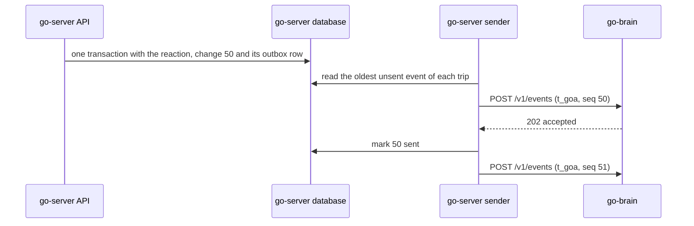

# Events

go-server sends go-brain an event every time something changes in a trip, so that Go knows what happened in the room and on the Trip screens. This page explains what an event is, how go-server sends events so that none are lost and each trip's events arrive in order, and what go-brain does with each of the 20 event types.

Every event goes to one route on go-brain, `POST /v1/events`, signed as described in [Basics](01-basics.md#signing-every-request).

## What an event is

An event tells go-brain about one change to one trip. go-server sends one event per change, whoever made it: a person, Go, or go-server itself. Each change takes the trip's next change number (`seq`), and the event carries that number.

Go's own changes come back as events too. When Go posts a message or records a booking, go-server sends the matching `message.created` or `booking.changed` like it would for anyone else. This way go-brain sees every change number of the trip, in order, from one place.

There is one exception. When Go replaces one of its cards in place (`PUT /brain/v1/trips/{trip_id}/cards/{card_id}`, for example a live call that moved from dialing to talking), nothing new happened in the trip. go-server takes no change number for it and sends no event.

When a person has paused Go, go-server still sends their messages as `message.created`, so the change numbers stay in order. It sets `withheld` to `true` and leaves out the text and the attachments. Go learns that a message was posted, but not what it says.

## The envelope

Every event has the same six fields. Only `data` is different for each type.

| Field | What it is |
|---|---|
| `event_id` | go-server's id for this event, 1 to 64 characters. It stays the same on every retry. go-brain ignores an `event_id` it has already seen. |
| `trip_id` | The trip that changed. |
| `seq` | The trip's change number for this change. Each event of a trip has a number one higher than the event before it. |
| `occurred_at` | When the change happened, in ISO 8601 with an offset. A retry keeps the original time. |
| `type` | What kind of change it was, such as `message.created`. The [table of event types](#all-event-types) lists all 20. |
| `data` | The details of the change. Its fields depend on `type`. |

Every example further down this page is one whole event, exactly as go-server sends it.

## What go-brain answers

go-brain checks the signature, stores the event and answers `202` within 2 seconds. It does the real work (reading the message, replying, saving what it learned) after it has answered, so go-server never waits for Go to think.

The answer is an `EventAccepted` body:

<!-- schema: EventAccepted -->
```json
{ "accepted": true, "duplicate": false }
```

When go-brain has already seen the `event_id`, it does nothing more and answers:

<!-- schema: EventAccepted -->
```json
{ "accepted": true, "duplicate": true }
```

Both answers are a success, and go-server marks the event sent in both cases.

go-brain also answers `202` to an event type it does not know, and skips it. That way go-server can add a new event type within version 1 before go-brain uses it.

Errors use the error body from [Basics](01-basics.md#errors). `401 bad_signature` means the secret or the clock is wrong. `422 invalid` means the event does not match the contract, and the message names the field. go-server does not retry either of them (see the next section).

## Sending events reliably

go-server must never lose an event, never send one for a change that did not happen, and always send each trip's events in change-number order. The outbox pattern does all three. go-server writes each event into an `outbox` table together with the change, and a separate sender sends the table's rows to go-brain.

1. **Write the event in the same transaction as the change.** Take the trip's next change number, store the change, and insert the event into the outbox, all in one database transaction. If the transaction rolls back, there is no change, no change number and no event.
2. **Take the change number from a counter on the trip row.** `update trips set seq = seq + 1 where trip_id = $1 returning seq` gives the next number. It also locks the trip row until the transaction ends, so two changes to the same trip always commit in change-number order.
3. **Send each trip's events in order, one at a time.** The sender sends a trip's next event only after go-brain accepted the one before it. Trips do not wait for each other: a trip whose event is waiting for a retry holds up only its own later events.
4. **Retry on a fixed schedule.** After a timeout, a dropped connection, a `429` or a `5xx`, wait 1 second, 5 seconds, 30 seconds, 2 minutes and 10 minutes, then every 10 minutes. For a `429`, wait as long as the `Retry-After` header says. Give up after 24 hours.
5. **Do not retry any other `4xx`.** A `400` to `499` other than `429` means the event or its signature is wrong, and sending it again will not help. Log it, mark the event failed, and move on to the trip's next event. go-brain notices the missing change number and reads the trip to catch up.



The examples below use Postgres, with `pg` in TypeScript and `psycopg` in Python. The trip row holds the counter, and the outbox holds each event exactly as it will be sent:

```sql
alter table trips add column seq bigint not null default 0;   -- trip.created takes change number 1

create table outbox (
  event_id        text primary key,
  trip_id         text not null references trips (trip_id),
  seq             bigint not null,
  body            jsonb not null,                     -- the whole event
  status          text not null default 'pending',    -- pending, sent or failed
  attempts        int not null default 0,
  next_attempt_at timestamptz not null default now(),
  created_at      timestamptz not null default now(),
  sent_at         timestamptz,
  unique (trip_id, seq)
);
create index outbox_pending on outbox (trip_id, seq) where status = 'pending';
```

### Writing the event with the change

This example stores a reaction and its `reaction.added` event in one transaction. Every change in go-server follows the same three steps: take the next change number, store the change, insert the event. A change to a message (an edit, a delete or a reaction) also sets that message's `updated_seq` to the new change number, so `listMessages` can bring it back after a gap.

**TypeScript**

```ts
import { randomUUID } from 'node:crypto';
import pg from 'pg';
import type { Event } from '@go/contract';

export const db = new pg.Pool({ connectionString: process.env.DATABASE_URL });

export async function addReaction(tripId: string, messageId: string, personId: string, emoji: string): Promise<void> {
  const tx = await db.connect();
  try {
    await tx.query('begin');
    // The next change number. This also locks the trip row until commit.
    const { rows } = await tx.query('update trips set seq = seq + 1 where trip_id = $1 returning seq', [tripId]);
    const seq = Number(rows[0].seq);
    await tx.query(
      'insert into reactions (trip_id, message_id, person_id, emoji) values ($1, $2, $3, $4)',
      [tripId, messageId, personId, emoji],
    );
    // A reaction changes the message, so the message's updated_seq moves too.
    await tx.query('update messages set updated_seq = $1 where message_id = $2', [seq, messageId]);
    const event: Event = {
      event_id: `ev_${randomUUID()}`,
      trip_id: tripId,
      seq,
      occurred_at: new Date().toISOString(),
      type: 'reaction.added',
      data: { message_id: messageId, reaction: { emoji, person_id: personId } },
    };
    await tx.query('insert into outbox (event_id, trip_id, seq, body) values ($1, $2, $3, $4)', [
      event.event_id, tripId, seq, JSON.stringify(event),
    ]);
    await tx.query('commit');
  } catch (err) {
    await tx.query('rollback');
    throw err;
  } finally {
    tx.release();
  }
}
```

**Python**

```python
import uuid
from datetime import datetime, timezone

import psycopg
from go_contract import models


def add_reaction(conn: psycopg.Connection, trip_id: str, message_id: str, person_id: str, emoji: str) -> None:
    with conn.transaction():
        # The next change number. This also locks the trip row until commit.
        (seq,) = conn.execute("update trips set seq = seq + 1 where trip_id = %s returning seq", (trip_id,)).fetchone()
        conn.execute(
            "insert into reactions (trip_id, message_id, person_id, emoji) values (%s, %s, %s, %s)",
            (trip_id, message_id, person_id, emoji),
        )
        # A reaction changes the message, so the message's updated_seq moves too.
        conn.execute("update messages set updated_seq = %s where message_id = %s", (seq, message_id))
        event = models.ReactionAdded(
            event_id=f"ev_{uuid.uuid4().hex}",
            trip_id=trip_id,
            seq=seq,
            occurred_at=datetime.now(timezone.utc),
            type="reaction.added",
            data=models.ReactionAddedData(message_id=message_id, reaction=models.Reaction(emoji=emoji, person_id=person_id)),
        )
        conn.execute(
            "insert into outbox (event_id, trip_id, seq, body) values (%s, %s, %s, %s::jsonb)",
            (event.event_id, trip_id, seq, event.model_dump_json(exclude_none=True)),
        )
```

### The sender

The sender runs on its own, next to go-server's API. Every 200 milliseconds it reads the oldest unsent event of each trip whose turn has come, skips trips that already have an event on the way, and sends each of those events without waiting for the others. The TypeScript version uses `callBrain` from [Basics](01-basics.md#signing-a-request-you-send).

**TypeScript**

```ts
import { db } from './outbox.js';
import { callBrain } from './brain-client.js';

const RETRY_AFTER_SECONDS = [1, 5, 30, 120, 600]; // then every 10 minutes
const GIVE_UP_AFTER_MS = 24 * 60 * 60 * 1000;

// The oldest unsent event of each trip, if it is due, leaving out trips already being sent.
const DUE = `
  select * from (
    select distinct on (trip_id) event_id, trip_id, body, attempts, created_at, next_attempt_at
    from outbox where status = 'pending'
    order by trip_id, seq
  ) oldest
  where next_attempt_at <= now() and trip_id <> all($1::text[])`;

interface Row { event_id: string; trip_id: string; body: unknown; attempts: number; created_at: Date }

const sending = new Set<string>(); // trips with an event on the way

export async function runSender(): Promise<never> {
  for (;;) {
    const { rows } = await db.query<Row>(DUE, [[...sending]]);
    for (const row of rows) {
      sending.add(row.trip_id);
      void sendOne(row).catch(console.error).finally(() => sending.delete(row.trip_id));
    }
    await new Promise((resolve) => setTimeout(resolve, 200));
  }
}

async function sendOne(row: Row): Promise<void> {
  let res: Response | undefined;
  try {
    res = await callBrain('POST', '/v1/events', row.body);
  } catch {
    // A timeout or a dropped connection: retry below.
  }
  if (res?.ok) {
    await db.query(`update outbox set status = 'sent', sent_at = now() where event_id = $1`, [row.event_id]);
    return;
  }
  const refused = res !== undefined && res.status >= 400 && res.status < 500 && res.status !== 429;
  if (refused || Date.now() - row.created_at.getTime() > GIVE_UP_AFTER_MS) {
    // Not retried. The trip's next event goes next, and go-brain catches up from the gap.
    console.error('event not delivered', row.event_id, res?.status, await res?.text());
    await db.query(`update outbox set status = 'failed' where event_id = $1`, [row.event_id]);
    return;
  }
  const wait = res?.status === 429
    ? Number(res.headers.get('retry-after') ?? 60)
    : RETRY_AFTER_SECONDS[Math.min(row.attempts, RETRY_AFTER_SECONDS.length - 1)];
  await db.query(
    'update outbox set attempts = attempts + 1, next_attempt_at = now() + make_interval(secs => $2) where event_id = $1',
    [row.event_id, wait],
  );
}
```

**Python**

```python
import asyncio
import json
import logging
import os
from datetime import datetime, timedelta, timezone

import httpx
from go_contract import SIGNATURE_HEADER, sign_request
from psycopg.rows import dict_row
from psycopg_pool import AsyncConnectionPool

BRAIN_URL = os.environ["BRAIN_URL"]
SECRET = os.environ["GO_SIGNING_SECRET"]
RETRY_AFTER_SECONDS = [1, 5, 30, 120, 600]  # then every 10 minutes
GIVE_UP_AFTER = timedelta(hours=24)

# The oldest unsent event of each trip, if it is due, leaving out trips already being sent.
DUE = """
  select * from (
    select distinct on (trip_id) event_id, trip_id, body, attempts, created_at, next_attempt_at
    from outbox where status = 'pending'
    order by trip_id, seq
  ) oldest
  where next_attempt_at <= now() and trip_id <> all(%s::text[])"""

log = logging.getLogger("outbox")
pool = AsyncConnectionPool(os.environ["DATABASE_URL"], kwargs={"row_factory": dict_row}, open=False)
sending: dict[str, asyncio.Task] = {}  # trips with an event on the way


async def run_sender() -> None:
    await pool.open()
    async with httpx.AsyncClient(timeout=5) as client:
        while True:
            async with pool.connection() as conn:
                rows = await (await conn.execute(DUE, (list(sending),))).fetchall()
            for row in rows:
                sending[row["trip_id"]] = asyncio.create_task(send_one(client, row))
                sending[row["trip_id"]].add_done_callback(lambda _, trip_id=row["trip_id"]: sending.pop(trip_id, None))
            await asyncio.sleep(0.2)


async def send_one(client: httpx.AsyncClient, row: dict) -> None:
    raw = json.dumps(row["body"]).encode("utf-8")
    headers = {"content-type": "application/json", SIGNATURE_HEADER: sign_request("POST", "/v1/events", raw, SECRET)}
    try:
        res = await client.post(BRAIN_URL + "/v1/events", content=raw, headers=headers)
    except httpx.HTTPError:
        res = None  # a timeout or a dropped connection: retry below
    async with pool.connection() as conn:
        if res is not None and res.is_success:
            await conn.execute("update outbox set status = 'sent', sent_at = now() where event_id = %s", (row["event_id"],))
            return
        refused = res is not None and 400 <= res.status_code < 500 and res.status_code != 429
        if refused or datetime.now(timezone.utc) - row["created_at"] > GIVE_UP_AFTER:
            # Not retried. The trip's next event goes next, and go-brain catches up from the gap.
            log.error("event %s not delivered: %s %s", row["event_id"], res and res.status_code, res and res.text)
            await conn.execute("update outbox set status = 'failed' where event_id = %s", (row["event_id"],))
            return
        if res is not None and res.status_code == 429:
            wait = int(res.headers.get("retry-after", "60"))
        else:
            wait = RETRY_AFTER_SECONDS[min(row["attempts"], len(RETRY_AFTER_SECONDS) - 1)]
        await conn.execute(
            "update outbox set attempts = attempts + 1, next_attempt_at = now() + make_interval(secs => %s) where event_id = %s",
            (wait, row["event_id"]),
        )
```

The Python sender needs `pip install "psycopg[binary,pool]" httpx`.

Good to know:
- Send one event per request. Never put two events in one body.
- A retry sends the same event with the same `event_id`, `seq` and `occurred_at`. Sign it again for every try, because the signature carries the time.
- Run one sender. If you run more than one, split the trips between them, so that one trip's events are always sent by the same sender.
- To send sooner than the next 200 millisecond check, wake the sender with Postgres `NOTIFY` after each commit.
- Alert on failed events. A failed event means a bug on one side, and the person who fixes it needs the log line.

## What go-brain does when an event arrives

go-brain handles each trip's events one at a time, in change-number order, and uses the change numbers to notice anything it missed.

1. It checks the signature, then the `event_id`. A repeat gets `{"accepted": true, "duplicate": true}`, and nothing else happens.
2. It answers `202` and puts the event in that trip's queue.
3. It compares the event's `seq` with the last change number it holds for the trip. If it holds 41 and receives 43, change 42 is missing. go-brain then reads the whole trip (`GET /brain/v1/trips/t_goa`) and every message posted or changed after 41 (`GET /brain/v1/trips/t_goa/messages?after_seq=41`, which also brings back edits, deletes and reactions), and carries on from there.
4. Once a minute it reads every active trip again, as a safety net for anything both sides missed.
5. It skips event types it does not know.

## When Go speaks and what it saves

Most events change what Go knows without making it speak. Go speaks in the room only when one of these is true:

- Someone mentions or names Go, or replies to one of Go's messages.
- Work someone asked for is done.
- A vote closed, or a decision is ready to move.
- Something is wrong or at risk, such as a clash with a booking, a price change, or a deadline coming up.

Otherwise Go stays quiet and takes notes. In each trip, Go speaks without being asked at most once every 30 minutes. When someone mentions Go, it waits about 1.5 seconds for follow-up lines, then answers. While it works, it shows "Go is typing..." (`POST /brain/v1/trips/{trip_id}/typing`) and repeats that every 5 seconds.

After it replies, or after a message it only took notes on, Go saves what it learned in two places:

- **Facts about people** go into go-brain, one current fact per topic for each person, with the message as proof.
- **Agreed, open and doing lines** go into the trip record, through go-server. An agreed line needs two people saying yes (a 👍 reaction counts) or the organizer saying yes, and nobody objecting. Without that, Go writes an open line instead.

Go does not announce each line it writes. People can undo a line in the app, and Go never undoes one. go-server writes the decided and booked lines itself, from votes and bookings.

## All event types

| Type | go-server sends it when | What Go does with it |
|---|---|---|
| `message.created` | Anyone posts in the room, Go included. A paused person's message comes withheld. | Answers if it is asked, otherwise takes notes. |
| `message.edited` | Someone edits a message. | Reads the new text and updates what it saved from the old one. |
| `message.deleted` | Someone deletes a message. | Drops the facts that came from it. |
| `reaction.added` | Someone reacts to a message. | Counts a 👍 as agreeing. |
| `reaction.removed` | Someone takes a reaction back. | Stops counting it. |
| `person.joined` | Someone joins the trip. | Saves their join answers as facts. |
| `person.updated` | Someone changes their details, or pauses or unpauses Go. | Updates what it knows. Stops learning from someone who paused it. |
| `person.left` | Someone leaves the trip. | Stops treating them as part of the group. |
| `trip.created` | Someone creates a trip. | Greets the group and starts. |
| `trip.updated` | The title, destination, dates, vibe, stay, itinerary, status or budget changes. | Reads the trip and warns the room about a clash. |
| `decision.opened` | A vote opens. | Notes the vote and when it closes. |
| `decision.voted` | Someone votes or changes their vote. | Keeps the count, quietly. |
| `decision.closed` | A vote closes. | Announces the result. For a booking vote, sets the mandate. |
| `decision.cancelled` | A vote is called off. | Stops waiting on it. |
| `mandate.set` | Go set what the group allowed for a spend. | Records the change number. |
| `mandate.confirmed` | The payer taps "Yes, book it". | Re-checks the price and asks for a spend approval. |
| `mandate.declined` | The payer taps "Not now". | Does not ask for a spend approval. |
| `record.changed` | A trip record line is added, changed, done or undone. | Keeps its copy of the record. Treats an undone line as no longer settled. |
| `booking.changed` | A booking is added, changed or cancelled. | Checks it against the plan and warns about a clash. |
| `expense.changed` | An expense is added or removed. | Takes note. go-server does the money maths. |

The rest of this page shows each event type with an example from the Goa trip.

## Messages and reactions

These five events cover everything people and Go say in the room, and how people react to it.

### message.created

go-server sends `message.created` when anyone posts in the room: a person, Go, or go-server itself (a message with the author `system`). If the message mentions or names Go, or replies to one of Go's messages, `mentions_go` is `true` and Go answers. Otherwise Go reads the message and saves anything worth keeping.

Priya asks Go for flights. This is change 57, the message from [the front page](README.md#one-message-start-to-finish):

<!-- schema: MessageCreated -->
```json
{
  "event_id": "ev_0057",
  "trip_id": "t_goa",
  "seq": 57,
  "occurred_at": "2026-10-05T06:49:00Z",
  "type": "message.created",
  "data": {
    "message": {
      "message_id": "m_0132",
      "seq": 57,
      "updated_seq": 57,
      "author": { "kind": "person", "person_id": "p_priya" },
      "text": "@Go flights on Friday from Delhi, under 6k?",
      "attachments": [],
      "reply_to": null,
      "about_message_id": null,
      "mentions_go": true,
      "mentions": [],
      "reactions": [],
      "card": null,
      "withheld": false,
      "deleted": false,
      "edited_at": null,
      "sent_at": "2026-10-05T06:49:00Z"
    }
  }
}
```

Go's reply comes back as an event too, with its card. go-brain does not answer its own messages. It uses the event to keep its place in the trip's change numbers.

<!-- schema: MessageCreated -->
```json
{
  "event_id": "ev_0058",
  "trip_id": "t_goa",
  "seq": 58,
  "occurred_at": "2026-10-05T06:49:40Z",
  "type": "message.created",
  "data": {
    "message": {
      "message_id": "m_0133",
      "seq": 58,
      "updated_seq": 58,
      "author": { "kind": "go" },
      "text": "Priya, here are three Friday evening flights from Delhi, all under ₹6k.",
      "attachments": [],
      "reply_to": "m_0132",
      "about_message_id": null,
      "mentions_go": false,
      "mentions": ["p_priya"],
      "reactions": [],
      "card": {
        "kind": "options",
        "card_id": "c_flights_1",
        "fallback_text": "3 flights from Delhi to Goa on Fri 6 Nov, from ₹5,640 per person",
        "title": "Friday flights, Delhi to Goa",
        "option_kind": "flight",
        "checked_at": "2026-10-05T06:49:30Z",
        "options": [
          {
            "option_id": "opt_flight_1",
            "title": "IndiGo 6E 2134",
            "subtitle": "6:10 pm to 8:45 pm, non-stop",
            "price_minor": 592000,
            "currency": "INR",
            "price_note": "per person",
            "highlights": ["Non-stop", "Lands 8:45 pm"],
            "journey": {
              "mode": "flight",
              "origin": { "name": "Delhi", "code": "DEL" },
              "destination": { "name": "Goa", "code": "GOI" },
              "depart_at": "2026-11-06T18:10:00+05:30",
              "arrive_at": "2026-11-06T20:45:00+05:30",
              "carrier_name": "IndiGo",
              "carrier_code": "6E",
              "number": "6E 2134",
              "stops": 0
            }
          },
          {
            "option_id": "opt_flight_2",
            "title": "Air India, 7:45 pm",
            "subtitle": "7:45 pm to 10:20 pm, non-stop",
            "price_minor": 598000,
            "currency": "INR",
            "price_note": "per person",
            "highlights": ["Non-stop"],
            "journey": {
              "mode": "flight",
              "origin": { "name": "Delhi", "code": "DEL" },
              "destination": { "name": "Goa", "code": "GOI" },
              "depart_at": "2026-11-06T19:45:00+05:30",
              "arrive_at": "2026-11-06T22:20:00+05:30",
              "carrier_name": "Air India",
              "carrier_code": "AI",
              "stops": 0
            }
          },
          {
            "option_id": "opt_flight_3",
            "title": "IndiGo, 9:20 pm",
            "subtitle": "9:20 pm to 11:55 pm, non-stop",
            "price_minor": 564000,
            "currency": "INR",
            "price_note": "per person",
            "highlights": ["Cheapest", "Lands late"],
            "journey": {
              "mode": "flight",
              "origin": { "name": "Delhi", "code": "DEL" },
              "destination": { "name": "Goa", "code": "GOI" },
              "depart_at": "2026-11-06T21:20:00+05:30",
              "arrive_at": "2026-11-06T23:55:00+05:30",
              "carrier_name": "IndiGo",
              "carrier_code": "6E",
              "stops": 0
            }
          }
        ],
        "actions": [
          { "action_id": "pick", "label": "I'll take this", "style": "primary", "per_option": true },
          { "action_id": "vote", "label": "Put it to a vote", "style": "secondary" }
        ]
      },
      "withheld": false,
      "deleted": false,
      "edited_at": null,
      "sent_at": "2026-10-05T06:49:40Z"
    }
  }
}
```

A message from someone who paused Go comes with `withheld: true`, no text and no attachments. Kabir paused Go at change 115, so his next message reaches go-brain like this, and Go learns only that change 116 was a message from Kabir:

<!-- schema: MessageCreated -->
```json
{
  "event_id": "ev_0116",
  "trip_id": "t_goa",
  "seq": 116,
  "occurred_at": "2026-10-10T16:04:00Z",
  "type": "message.created",
  "data": {
    "message": {
      "message_id": "m_0231",
      "seq": 116,
      "updated_seq": 116,
      "author": { "kind": "person", "person_id": "p_kabir" },
      "text": null,
      "attachments": [],
      "reply_to": null,
      "about_message_id": null,
      "mentions_go": false,
      "mentions": [],
      "reactions": [],
      "card": null,
      "withheld": true,
      "deleted": false,
      "edited_at": null,
      "sent_at": "2026-10-10T16:04:00Z"
    }
  }
}
```

Good to know:
- In a withheld message, also send `mentions_go: false` and an empty `mentions` list. Go cannot answer words it does not see.
- `about_message_id` is set when someone long-pressed a message and chose "Ask Go about this". Go reads that message as the subject of the question.
- `card` appears only on Go's messages.

### message.edited

go-server sends `message.edited` when someone edits a message. It carries the message as it is now, with `edited_at` set. Go reads the new text and updates anything it saved from the old one.

Arjun corrects when he lands, so Go replaces what it saved about his arrival:

<!-- schema: MessageEdited -->
```json
{
  "event_id": "ev_0054",
  "trip_id": "t_goa",
  "seq": 54,
  "occurred_at": "2026-10-05T04:42:00Z",
  "type": "message.edited",
  "data": {
    "message": {
      "message_id": "m_0126",
      "seq": 53,
      "updated_seq": 54,
      "author": { "kind": "person", "person_id": "p_arjun" },
      "text": "Correction: my flight from Bangalore lands at 10:40 pm, so I'll reach our place around 11",
      "attachments": [],
      "reply_to": null,
      "about_message_id": null,
      "mentions_go": false,
      "mentions": [],
      "reactions": [],
      "card": null,
      "withheld": false,
      "deleted": false,
      "edited_at": "2026-10-05T04:42:00Z",
      "sent_at": "2026-10-05T04:30:00Z"
    }
  }
}
```

### message.deleted

go-server sends `message.deleted` when someone deletes a message. It carries only the `message_id`. Go drops every fact it saved from that message.

Kabir deleted a message he sent by mistake:

<!-- schema: MessageDeleted -->
```json
{
  "event_id": "ev_0055",
  "trip_id": "t_goa",
  "seq": 55,
  "occurred_at": "2026-10-05T05:00:00Z",
  "type": "message.deleted",
  "data": { "message_id": "m_0129" }
}
```

### reaction.added

go-server sends `reaction.added` when someone reacts to a message. Go counts a 👍 as that person agreeing with the message.

Priya said "North Goa, not South" and Arjun agreed. Rahul, the organizer, adds his 👍 to Priya's message. Nobody objected, so Go writes the agreed line "North Goa, not South" in the trip record:

<!-- schema: ReactionAdded -->
```json
{
  "event_id": "ev_0050",
  "trip_id": "t_goa",
  "seq": 50,
  "occurred_at": "2026-10-05T04:13:00Z",
  "type": "reaction.added",
  "data": {
    "message_id": "m_0122",
    "reaction": { "emoji": "👍", "person_id": "p_rahul" }
  }
}
```

### reaction.removed

go-server sends `reaction.removed` when someone takes a reaction back. Go stops counting it. If Go already wrote a line partly because of that reaction, the line stays, because only people undo lines.

Kabir takes back his 👍 on the message about scuba on Saturday, so Go keeps "Scuba on Saturday?" as an open question for Meher and Kabir:

<!-- schema: ReactionRemoved -->
```json
{
  "event_id": "ev_0080",
  "trip_id": "t_goa",
  "seq": 80,
  "occurred_at": "2026-10-05T10:12:00Z",
  "type": "reaction.removed",
  "data": {
    "message_id": "m_0149",
    "reaction": { "emoji": "👍", "person_id": "p_kabir" }
  }
}
```

## People

These three events tell go-brain who is in the trip and how they want Go to treat them.

### person.joined

go-server sends `person.joined` when someone joins the trip, with their join answers: where they travel from, the earliest they can leave, and anything Go should know. It never includes their budget answer, phone number, email or UPI id. Go saves the answers as facts about the person and stays quiet.

Kabir joins from the invite link:

<!-- schema: PersonJoined -->
```json
{
  "event_id": "ev_0044",
  "trip_id": "t_goa",
  "seq": 44,
  "occurred_at": "2026-10-05T03:40:00Z",
  "type": "person.joined",
  "data": {
    "person": {
      "person_id": "p_kabir",
      "name": "Kabir",
      "photo_url": "https://cdn.go.example/people/p_kabir.jpg",
      "role": "member",
      "joined_at": "2026-10-05T03:40:00Z",
      "from_city": "Delhi",
      "earliest_leave": "Fri evening",
      "know": ["I don't drink"],
      "has_upi": true,
      "go_paused": false
    }
  }
}
```

### person.updated

go-server sends `person.updated` when someone changes their details, or pauses or unpauses Go. It carries the whole person as they are now, and `changed` lists the fields that changed. When `go_paused` becomes `true`, go-server starts withholding that person's messages and Go stops learning from them. When it becomes `false` again, Go reads their new messages as usual.

Kabir pauses Go:

<!-- schema: PersonUpdated -->
```json
{
  "event_id": "ev_0115",
  "trip_id": "t_goa",
  "seq": 115,
  "occurred_at": "2026-10-10T16:00:00Z",
  "type": "person.updated",
  "data": {
    "person": {
      "person_id": "p_kabir",
      "name": "Kabir",
      "photo_url": "https://cdn.go.example/people/p_kabir.jpg",
      "role": "member",
      "joined_at": "2026-10-05T03:40:00Z",
      "from_city": "Delhi",
      "earliest_leave": "Fri evening",
      "know": ["I don't drink"],
      "has_upi": true,
      "go_paused": true
    },
    "changed": ["go_paused"]
  }
}
```

Good to know:
- `has_upi` says only whether someone saved a UPI id. When it changes, go-server sends `changed: ["has_upi"]`. The id itself never leaves go-server.

### person.left

go-server sends `person.left` when someone leaves the trip. It carries only the `person_id`. Go stops treating them as part of the group.

If Kabir left the trip, go-server would send:

<!-- schema: PersonLeft -->
```json
{
  "event_id": "ev_0118",
  "trip_id": "t_goa",
  "seq": 118,
  "occurred_at": "2026-10-11T08:00:00Z",
  "type": "person.left",
  "data": { "person_id": "p_kabir" }
}
```

## The trip

These two events tell go-brain that a trip exists and when its details change.

### trip.created

go-server sends `trip.created` when someone creates a trip. It carries the whole trip, so Go can greet the group and start without reading the trip first.

Rahul has just created "Goa 🌴". He is the only person in it so far, nobody has answered the budget question yet, and there are no votes or bookings:

<!-- schema: TripCreated -->
```json
{
  "event_id": "ev_0001",
  "trip_id": "t_goa",
  "seq": 1,
  "occurred_at": "2026-10-05T02:30:00Z",
  "type": "trip.created",
  "data": {
    "trip": {
      "trip_id": "t_goa",
      "seq": 1,
      "title": "Goa 🌴",
      "status": "planning",
      "created_at": "2026-10-05T02:30:00Z",
      "organizer_person_id": "p_rahul",
      "invite_url": "https://go.example/j/8fK2xQ",
      "destination": { "name": "Goa" },
      "dates": null,
      "vibe": ["beaches", "food", "sunsets"],
      "stay": "villa with a pool",
      "budget": { "lowest": null, "answered": 0, "of": 1 },
      "people": [
        {
          "person_id": "p_rahul",
          "name": "Rahul",
          "photo_url": "https://cdn.go.example/people/p_rahul.jpg",
          "role": "organizer",
          "joined_at": "2026-10-05T02:30:00Z",
          "from_city": "Delhi",
          "earliest_leave": "Fri after 6 pm",
          "know": [],
          "has_upi": true,
          "go_paused": false
        }
      ],
      "decisions": [],
      "bookings": [],
      "expenses": [],
      "money": { "currency": "INR", "plan_minor": null, "spent_minor": 0, "by_category": [], "transfers": [] },
      "itinerary": [],
      "record": []
    }
  }
}
```

### trip.updated

go-server sends `trip.updated` when the trip's title, destination, dates, vibe, stay, itinerary, status or budget changes. It carries who made the change (`by`) and which fields changed, but not the new values, so Go reads the trip to see them. Go then checks the change against the plan and warns the room if something clashes, such as new dates that no longer match a booking.

The group agreed on North Goa, so Go changed the destination from "Goa" to "North Goa":

<!-- schema: TripUpdated -->
```json
{
  "event_id": "ev_0052",
  "trip_id": "t_goa",
  "seq": 52,
  "occurred_at": "2026-10-05T04:14:30Z",
  "type": "trip.updated",
  "data": {
    "by": { "kind": "go" },
    "changed": ["destination"]
  }
}
```

Good to know:
- When someone answers the budget question, send `changed: ["budget"]` with `by: {"kind": "system"}`. If `by` named the person, Go could work out their answer from how the lowest band moved.

## Votes

These four events follow a vote from the moment it opens until it closes or is called off.

### decision.opened

go-server sends `decision.opened` when a vote opens, whether Go or a person opened it. It carries the whole vote and who opened it. Go notes the question, the options and the closing time, and waits for the result.

Go opened "Where do we stay?" with the three villas it found:

<!-- schema: DecisionOpened -->
```json
{
  "event_id": "ev_0064",
  "trip_id": "t_goa",
  "seq": 64,
  "occurred_at": "2026-10-05T07:30:00Z",
  "type": "decision.opened",
  "data": {
    "decision": {
      "decision_id": "d_villa",
      "question": "Where do we stay?",
      "kind": "choice",
      "anonymous": false,
      "status": "open",
      "opened_by_person_id": null,
      "options": [
        {
          "label": "Villa Sol",
          "image_url": "https://brain.go.example/img/villa-sol.jpg",
          "price_minor": 5420000,
          "currency": "INR",
          "option_ref": "ixigo:stay:villa-sol-anjuna",
          "note": "3 nights, private pool, Anjuna"
        },
        {
          "label": "Casa Azul",
          "image_url": "https://brain.go.example/img/casa-azul.jpg",
          "price_minor": 6180000,
          "currency": "INR",
          "option_ref": "ixigo:stay:casa-azul-assagao",
          "note": "3 nights, pool, Assagao"
        },
        {
          "label": "The Palms",
          "image_url": "https://brain.go.example/img/the-palms.jpg",
          "price_minor": 5850000,
          "currency": "INR",
          "option_ref": "ixigo:stay:the-palms-vagator",
          "note": "3 nights, pool, near Vagator beach"
        }
      ],
      "closes_at": "2026-10-05T12:30:00Z",
      "voted": 0,
      "of": 5,
      "tally": [0, 0, 0],
      "votes": [],
      "result_index": null,
      "mandate": null,
      "opened_at": "2026-10-05T07:30:00Z",
      "closed_at": null
    },
    "by": { "kind": "go" }
  }
}
```

### decision.voted

go-server sends `decision.voted` when someone votes or changes their vote. It carries how many have voted (`voted` of `of`) and the `tally` per option, in option order. Go keeps the count and stays quiet.

Priya votes for Villa Sol, the third of five votes:

<!-- schema: DecisionVoted -->
```json
{
  "event_id": "ev_0067",
  "trip_id": "t_goa",
  "seq": 67,
  "occurred_at": "2026-10-05T07:52:00Z",
  "type": "decision.voted",
  "data": {
    "decision_id": "d_villa",
    "person_id": "p_priya",
    "option_index": 0,
    "voted": 3,
    "of": 5,
    "tally": [2, 1, 0]
  }
}
```

Good to know:
- In an anonymous vote, go-server leaves out `person_id` and `option_index`, so nobody learns who voted for what, Go included.

### decision.closed

go-server sends `decision.closed` when a vote closes, with the vote as it ended and the `reason`: the time ran out (`time`), everyone voted (`everyone_voted`), a person closed it (`closed_by_person`), or Go closed it (`closed_by_go`). Go announces the result in the room. When the vote was about something to book, Go then sets the mandate (`PUT /brain/v1/trips/{trip_id}/decisions/{decision_id}/mandate`) and posts a mandate card for the payer.

Everyone has voted on the villa, and Villa Sol won 4 to 1:

<!-- schema: DecisionClosed -->
```json
{
  "event_id": "ev_0070",
  "trip_id": "t_goa",
  "seq": 70,
  "occurred_at": "2026-10-05T08:45:00Z",
  "type": "decision.closed",
  "data": {
    "decision": {
      "decision_id": "d_villa",
      "question": "Where do we stay?",
      "kind": "choice",
      "anonymous": false,
      "status": "closed",
      "opened_by_person_id": null,
      "options": [
        {
          "label": "Villa Sol",
          "image_url": "https://brain.go.example/img/villa-sol.jpg",
          "price_minor": 5420000,
          "currency": "INR",
          "option_ref": "ixigo:stay:villa-sol-anjuna",
          "note": "3 nights, private pool, Anjuna"
        },
        {
          "label": "Casa Azul",
          "image_url": "https://brain.go.example/img/casa-azul.jpg",
          "price_minor": 6180000,
          "currency": "INR",
          "option_ref": "ixigo:stay:casa-azul-assagao",
          "note": "3 nights, pool, Assagao"
        },
        {
          "label": "The Palms",
          "image_url": "https://brain.go.example/img/the-palms.jpg",
          "price_minor": 5850000,
          "currency": "INR",
          "option_ref": "ixigo:stay:the-palms-vagator",
          "note": "3 nights, pool, near Vagator beach"
        }
      ],
      "closes_at": "2026-10-05T12:30:00Z",
      "voted": 5,
      "of": 5,
      "tally": [4, 1, 0],
      "votes": [
        { "person_id": "p_rahul", "option_index": 0 },
        { "person_id": "p_arjun", "option_index": 1 },
        { "person_id": "p_priya", "option_index": 0 },
        { "person_id": "p_meher", "option_index": 0 },
        { "person_id": "p_kabir", "option_index": 0 }
      ],
      "result_index": 0,
      "mandate": null,
      "opened_at": "2026-10-05T07:30:00Z",
      "closed_at": "2026-10-05T08:45:00Z"
    },
    "reason": "everyone_voted"
  }
}
```

Good to know:
- go-server also writes a decided line for the result in the trip record. That line arrives as its own `record.changed` event.

### decision.cancelled

go-server sends `decision.cancelled` when a vote is called off before it closes. It carries the vote's id and who called it off. Go stops waiting on that vote: it will not announce a result or set a mandate for it.

Rahul called off a vote he had opened about which beach to spend Sunday on:

<!-- schema: DecisionCancelled -->
```json
{
  "event_id": "ev_0101",
  "trip_id": "t_goa",
  "seq": 101,
  "occurred_at": "2026-10-06T11:00:00Z",
  "type": "decision.cancelled",
  "data": {
    "decision_id": "d_beach",
    "by": { "kind": "person", "person_id": "p_rahul" }
  }
}
```

## The mandate

These three events cover what the group allowed for a spend and the payer's answer. [Money and the vault](07-money-and-the-vault.md) explains the whole payment.

### mandate.set

go-server sends `mandate.set` after Go sets what the group allowed for a spend: the choice, the cap, whether it must be refundable, and who pays. It is Go's own change coming back, so go-brain only records the change number. Go posts the mandate card for the payer right after it sets the mandate.

Go allowed Villa Sol for up to ₹55,000, refundable only, with Rahul paying:

<!-- schema: MandateSet -->
```json
{
  "event_id": "ev_0072",
  "trip_id": "t_goa",
  "seq": 72,
  "occurred_at": "2026-10-05T08:46:00Z",
  "type": "mandate.set",
  "data": {
    "decision_id": "d_villa",
    "mandate": {
      "choice_index": 0,
      "cap_minor": 5500000,
      "currency": "INR",
      "refundable_only": true,
      "payer_person_id": "p_rahul",
      "set_at": "2026-10-05T08:46:00Z",
      "confirmed_at": null,
      "declined_at": null
    }
  }
}
```

Good to know:
- Setting a new mandate for the same vote replaces the old one and clears the payer's earlier "Yes, book it" or "Not now".

### mandate.confirmed

go-server sends `mandate.confirmed` when the payer taps "Yes, book it" on the mandate card. Those buttons belong to go-server, which records the time as the mandate's `confirmed_at`. Go re-checks the price, asks go-server for a spend approval (`POST /brain/v1/trips/{trip_id}/spend-approvals`), and then posts a pay card for the payer.

Rahul says yes to the villa:

<!-- schema: MandateConfirmed -->
```json
{
  "event_id": "ev_0074",
  "trip_id": "t_goa",
  "seq": 74,
  "occurred_at": "2026-10-05T08:58:00Z",
  "type": "mandate.confirmed",
  "data": { "decision_id": "d_villa", "person_id": "p_rahul" }
}
```

### mandate.declined

go-server sends `mandate.declined` when the payer taps "Not now" on the mandate card. go-server records the time as the mandate's `declined_at`. Go does not ask for a spend approval, and go-server's spend check would refuse one with the reason `payer_declined`.

If Rahul had tapped "Not now" instead, go-server would have sent:

<!-- schema: MandateDeclined -->
```json
{
  "event_id": "ev_0074",
  "trip_id": "t_goa",
  "seq": 74,
  "occurred_at": "2026-10-05T08:58:00Z",
  "type": "mandate.declined",
  "data": { "decision_id": "d_villa", "person_id": "p_rahul" }
}
```

## The trip record, bookings and money

These three events cover the trip's shared memory and what the group booked and spent.

### record.changed

go-server sends `record.changed` when a trip record line is added, changed, marked done or undone, by anyone. Go's own lines come back this way, and so do the decided and booked lines go-server writes from votes and bookings. When a person undoes a line, Go treats it as no longer settled. Go never undoes a line itself.

Go wrote the agreed line "North Goa, not South", with Priya's and Arjun's messages as proof:

<!-- schema: RecordChanged -->
```json
{
  "event_id": "ev_0051",
  "trip_id": "t_goa",
  "seq": 51,
  "occurred_at": "2026-10-05T04:14:00Z",
  "type": "record.changed",
  "data": {
    "line": {
      "line_id": "r_north",
      "kind": "agreed",
      "text": "North Goa, not South",
      "status": "active",
      "proof": [
        { "message_id": "m_0122", "person_id": "p_priya" },
        { "message_id": "m_0124", "person_id": "p_arjun" }
      ],
      "person_ids": ["p_priya", "p_arjun", "p_rahul"],
      "due_at": null,
      "decision_id": null,
      "booking_id": null,
      "source": "go",
      "created_at": "2026-10-05T04:14:00Z",
      "updated_at": "2026-10-05T04:14:00Z"
    },
    "change": "added",
    "by": { "kind": "go" }
  }
}
```

### booking.changed

go-server sends `booking.changed` when a booking is added, changed or cancelled. Go's own bookings come back this way, with the `approval_id` when Go paid through the vault, and so do bookings people add in the app. Go checks a new or changed booking against the plan and speaks only if something clashes, such as a flight that lands after the stay's check-in closes. When a booking is cancelled, Go warns the room about anything that depended on it.

Go booked Villa Sol after Rahul approved the payment:

<!-- schema: BookingChanged -->
```json
{
  "event_id": "ev_0076",
  "trip_id": "t_goa",
  "seq": 76,
  "occurred_at": "2026-10-05T09:03:00Z",
  "type": "booking.changed",
  "data": {
    "booking": {
      "booking_id": "b_villa",
      "kind": "stay",
      "status": "confirmed",
      "title": "Villa Sol, 3 nights",
      "vendor": "ixigo",
      "ref": "IXG-7Q2K9",
      "amount_minor": 5420000,
      "currency": "INR",
      "payer_person_id": "p_rahul",
      "for_person_ids": ["p_rahul", "p_priya", "p_arjun", "p_meher", "p_kabir"],
      "refundable_until": "2026-11-01T18:29:59Z",
      "starts_at": "2026-11-06T14:00:00+05:30",
      "ends_at": "2026-11-09T11:00:00+05:30",
      "journey": null,
      "place": {
        "name": "Villa Sol",
        "address": "Anjuna, North Goa",
        "photo_url": "https://brain.go.example/img/villa-sol.jpg"
      },
      "image_url": "https://brain.go.example/img/villa-sol.jpg",
      "decision_id": "d_villa",
      "approval_id": "ap_01JA7Q3V8Z",
      "added_by_person_id": null,
      "created_at": "2026-10-05T09:03:00Z"
    },
    "change": "added",
    "by": { "kind": "go" }
  }
}
```

### expense.changed

go-server sends `expense.changed` when an expense is added or removed. go-server does all the money maths, so when Go needs to know who owes whom, it reads `money` from the trip. Go takes note and stays quiet.

Kabir paid ₹3,400 for the airport cab and split it between all five:

<!-- schema: ExpenseChanged -->
```json
{
  "event_id": "ev_0112",
  "trip_id": "t_goa",
  "seq": 112,
  "occurred_at": "2026-10-09T13:20:00Z",
  "type": "expense.changed",
  "data": {
    "expense": {
      "expense_id": "e_cab",
      "paid_by_person_id": "p_kabir",
      "amount_minor": 340000,
      "currency": "INR",
      "note": "Airport cab",
      "category": "getting_around",
      "split_person_ids": ["p_rahul", "p_priya", "p_arjun", "p_meher", "p_kabir"],
      "booking_id": null,
      "added_by_person_id": "p_kabir",
      "created_at": "2026-10-09T13:20:00Z"
    },
    "change": "added",
    "by": { "kind": "person", "person_id": "p_kabir" }
  }
}
```
