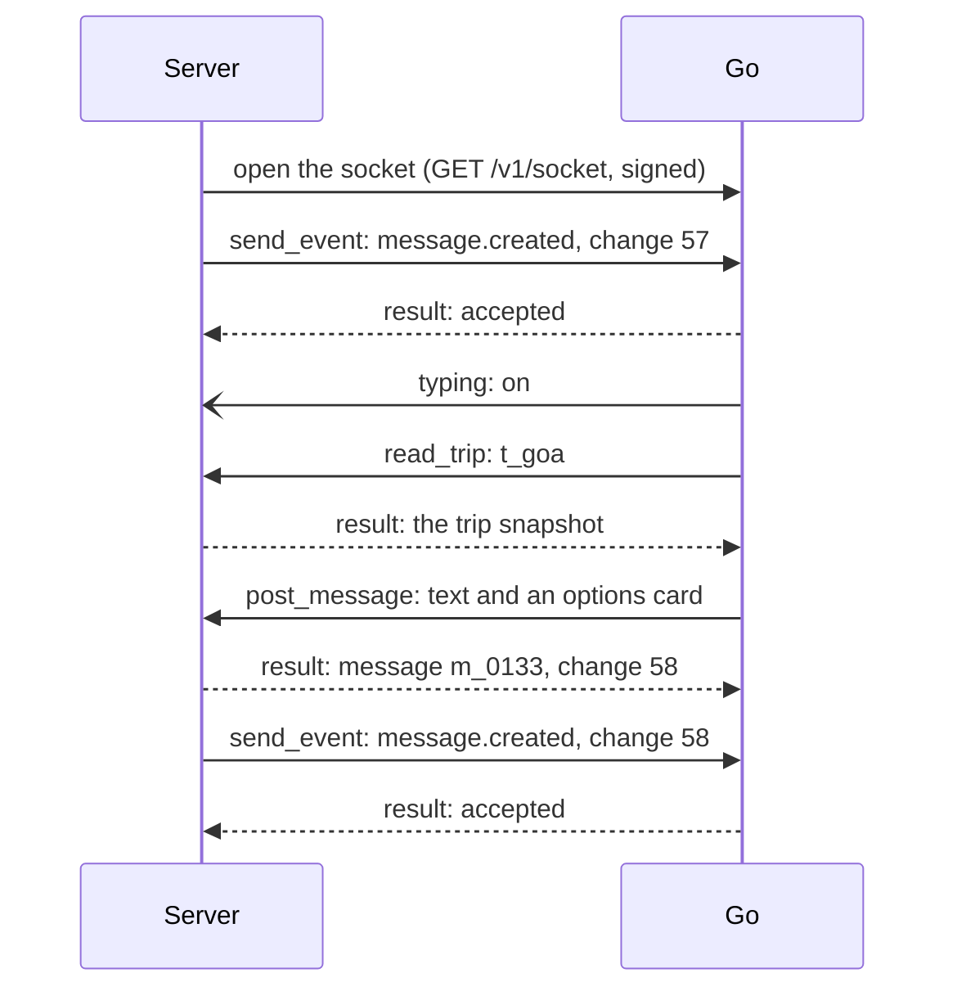

# The socket

The server and Go talk over one WebSocket that the server opens to Go and keeps open. This page explains how to open it with a signature, the four kinds of frame that travel on it, every method in both directions, how to keep it alive and reconnect, and what happens when it drops. It ends with a complete client for the server in TypeScript and Python, and the test vectors that prove your signing code.

Read [Basics](01-basics.md) first: it covers the ids, money, time, errors and time limits that every frame on the socket follows.

## What the socket is

The socket is the only connection between the server and Go. The server opens it to `wss://brain.go.example/v1/socket` and keeps it open. Everything the server and Go say to each other travels on it, in both directions, as JSON-RPC 2.0 text frames:

- **The server to Go:** what happened in a trip (events, sent with `send_event`), and questions that need an answer straight away, such as a tap on one of Go's cards.
- **Go to the server:** its messages, typing and reactions, and its requests to read the trip or change it. The server answers each one from its own database.

There is one socket, not one in each direction, for three reasons:

1. **The contract is Go's.** Go exposes it, and the server builds on it. The server serves no routes for Go, and Go never calls the server over HTTP. Go has no setting for the server's address at all.
2. **The trip still lives in the server's database.** When Go needs the trip, it sends `read_trip` on the socket and the server answers from its database. Nothing about the trip moves to Go.
3. **Both sides can speak at any moment.** The server sends each change the moment it happens, and Go can show "Go is typing...", react to a message or post a reply the moment it is ready, all without polling.

A side effect: the server dials out, so a server running on a laptop needs no tunnel to work with Go.

Here is Priya's question from [the front page](README.md#one-message-start-to-finish) as it travels on the socket. Solid arrows are requests, dashed arrows are answers, and open arrows are notifications, which get no answer.



## Connecting

The server opens the socket with a WebSocket upgrade request, `GET /v1/socket`, that carries an `x-go-signature` header. Go checks the header before it upgrades. If the header is missing, malformed, stale or wrong, Go answers `401` and the socket does not open: check the secret and the clock.

The header looks like this:

```
x-go-signature: t=1791190800,v1=b9172ac3ec0ddeb439920c43622a4850408a3626de94d9df544da07bfd824ab3
```

`t` is the time in Unix seconds. `v1` is the HMAC-SHA256 of a signing string, made with `GO_SIGNING_SECRET` and written as lowercase hex. The signing string is four parts joined by a newline (`\n`):

```
<t>
GET
<target>
<raw body>
```

- The method is `GET`.
- `target` is the path plus the query string, exactly as sent: `/v1/socket`, or `/v1/socket?instance=server-1` if you add a query string.
- The upgrade has no body, so the raw body is empty and the string ends with the newline after the target.

Go refuses a signature more than 300 seconds old or ahead, so keep your server's clock synced (every cloud host does this for you). Go also accepts each signature only once: a second upgrade with the same `t` and `v1` is refused with `401`, even within the 300 seconds. So make a new signature every time you connect. A header made when the process started does not work for the next reconnect.

When Go refuses the upgrade, the `401` has this body:

<!-- schema: ErrorBody -->
```json
{ "error": { "code": "bad_signature", "message": "signature already used" } }
```

`signRequest` in `@go/contract` and `sign_request` in `go_contract` make the header. This is the smallest possible connection: it opens the socket and prints every frame Go sends.

**TypeScript**

```ts
import WebSocket from 'ws';
import { SIGNATURE_HEADER, SOCKET_PATH, signRequest } from '@go/contract';

const url = process.env.GO_URL!.replace(/^http/, 'ws') + SOCKET_PATH; // wss://brain.go.example/v1/socket
const signature = signRequest({ method: 'GET', target: SOCKET_PATH, body: '' }, process.env.GO_SIGNING_SECRET!);

const ws = new WebSocket(url, { headers: { [SIGNATURE_HEADER]: signature } });
ws.on('open', () => console.log('connected'));
ws.on('message', (data) => console.log(data.toString()));
ws.on('error', (err) => console.error(err.message)); // "Unexpected server response: 401" when the signature fails
```

**Python**

```python
import asyncio
import os

import websockets
from go_contract import SIGNATURE_HEADER, sign_request

URL = os.environ["GO_URL"].replace("http", "ws", 1) + "/v1/socket"  # wss://brain.go.example/v1/socket


async def main() -> None:
    signature = sign_request("GET", "/v1/socket", b"", os.environ["GO_SIGNING_SECRET"])
    # Raises websockets.exceptions.InvalidStatus when Go answers 401.
    async with websockets.connect(URL, additional_headers={SIGNATURE_HEADER: signature}) as ws:
        print("connected")
        async for frame in ws:
            print(frame)


asyncio.run(main())
```

Good to know:
- `GO_URL` is Go's `https://` base URL. The socket is on the same host with `wss://` (or `ws://` for `http://localhost`), plus `/v1/socket`.
- The TypeScript examples use the [`ws`](https://www.npmjs.com/package/ws) package. The Python examples use [`websockets`](https://websockets.readthedocs.io/) 14 or later. On older versions of `websockets`, the argument is `extra_headers=` instead of `additional_headers=`.
- If you add a query string, sign the full target with it. A signature for `/v1/socket` does not work for `/v1/socket?instance=server-1`.
- Two server instances that connect in the same second with the same target make the same signature, and Go refuses the second one. Give each instance its own query string, such as `?instance=server-1`, so their signatures differ (see [More than one server instance](#more-than-one-server-instance)).
- Treat the header like the secret: do not log it. Because each signature works only once, a header copied from a log cannot open a second socket.

## The frames

Every frame is one JSON object sent as one WebSocket text frame. Neither side sends a frame larger than 1 MB (1,048,576 bytes). The one answer that could grow past that is `read_messages`: when 200 messages with their cards would not fit, the server sends fewer, with `has_more: true`, and Go asks again from where the page ended. There are four kinds of frame, and you can tell them apart by their fields.

| Frame | Fields | Sent by | Answered? |
|---|---|---|---|
| Request | `jsonrpc`, `id`, `method`, `params` | Either side | Always, exactly once, with a result or an error that has the same `id` |
| Result | `jsonrpc`, `id`, `result` | The side that received the request, when it worked | No |
| Error | `jsonrpc`, `id`, `error` | The side that received the request, when it did not work | No |
| Notification | `jsonrpc`, `method`, `params` (no `id`) | Go, only for its typing | Never |

`jsonrpc` is always `"2.0"`. `params` and `result` are always JSON objects. In this guide, the ids of the server's requests start with `gs_` and the ids of Go's requests start with `go_`, only to make examples easy to read. Any string of 1 to 64 characters works.

### Request

A request asks the other side to do something and answer. Here Go adds a quiet ✅ to Priya's message `m_0122`, after it wrote "North Goa, not South" into the trip record, instead of announcing the line in the room:

<!-- schema: SocketRequest -->
```json
{
  "jsonrpc": "2.0",
  "id": "go_2207",
  "method": "add_reaction",
  "params": { "request_id": "rq_3c71d2", "trip_id": "t_goa", "message_id": "m_0122", "emoji": "✅" }
}
```

`params` is one value of the method's params schema, here `AddReaction`. [Go's requests](04-gos-requests.md) and [Your requests](05-your-requests.md) show the params of every method.

### Result

A result answers a request that worked. It has the request's `id`, and `result` is one value of the method's result schema. The server stored Go's reaction as change 53 and answers:

<!-- schema: SocketResult -->
```json
{ "jsonrpc": "2.0", "id": "go_2207", "result": { "seq": 53 } }
```

Then the server sends the matching `reaction.added` event for change 53, as it does for every change Go makes.

### Error

An error answers a request that did not work. `error.code` says what went wrong, `error.message` says it in words (at most 500 characters), and `error.data.code` names the code. The [error table in Basics](01-basics.md#errors) lists every code and whether to send the request again.

Here Go asked to close the villa vote, but someone had already closed it:

<!-- schema: SocketError -->
```json
{
  "jsonrpc": "2.0",
  "id": "go_2214",
  "error": { "code": 409, "message": "decision d_villa is already closed", "data": { "code": "conflict" } }
}
```

A `429` also says how long to wait, in `error.data.retry_after_seconds`. Here Go asks the server to wait 5 seconds before asking for Meher's catch-up again:

<!-- schema: SocketError -->
```json
{
  "jsonrpc": "2.0",
  "id": "gs_1187",
  "error": { "code": 429, "message": "too many catch-up requests for t_goa", "data": { "code": "rate_limited", "retry_after_seconds": 5 } }
}
```

Two codes come from JSON-RPC itself and have no `data`. A frame that cannot be read is answered with `-32700` and an `id` of `null`. A method the receiver does not know is answered with `-32601`:

<!-- schema: SocketError -->
```json
{ "jsonrpc": "2.0", "id": "go_2230", "error": { "code": -32601, "message": "unknown method add_sticker" } }
```

### Notification

A notification tells the other side something and gets no answer. Notifications are used only for Go's typing: the `typing` method, which Go sends to show or hide "Go is typing..." in a room. Go shows it in the Goa room:

<!-- schema: SocketNotification -->
```json
{ "jsonrpc": "2.0", "method": "typing", "params": { "trip_id": "t_goa", "on": true } }
```

An "on" lasts 10 seconds. Go sends it again every 5 seconds while it works, and sends `"on": false` when it stops. The server also hides it as soon as Go's next message lands. A lost "off" just runs out after 10 seconds.

The server does not tell Go when people are typing. Go handles that on its own: after a message for Go, it waits about 2 seconds in case the same person sends more (unless the message plainly ends with a question mark, a full stop, an exclamation mark or an emoji), and just before it posts, it checks for anything new for it in the room and answers that too.

Good to know:
- A frame with `result` or `error` is always the answer to a request you sent. Match it to your request by `id`.
- The two sides choose their ids separately, so the same `id` can appear in both directions at once. That causes no confusion, because an answer only ever goes back to the side that sent the request.
- An `id` only has to be unique among the sender's own unanswered requests. A random id per request does that.
- Ignore fields you do not know, in frames as everywhere else.

## The methods

Every method has a name, a params schema and, unless it is a notification, a result schema and a time limit for the answer. `packages/contract/socket/methods.json` has the same table in JSON, and `SOCKET_METHODS` (TypeScript) and `go_contract.METHODS` (Python) have it in code.

### Your requests: Server sends, Go answers

| Method | Params | Result | Answer within | What it is for |
|---|---|---|---|---|
| [`send_event`](03-events.md) | `Event` (`MessageCreated`, `DecisionClosed` and the other 18) | `EventAccepted` | 2 seconds | Something changed in a trip. One event per change, in change-number order for each trip. |
| [`card_tap`](05-your-requests.md) | `CardTap` | `CardActionResult` (`ActionDone`, `ActionOpen` or `ActionRefused`) | 3 seconds | Someone tapped a button on one of Go's cards. Go answers what the app should do. |
| [`catch_up`](05-your-requests.md) | `CatchUpRequest` | `CatchUp` | 3 seconds | Someone came back to the room after a while. Go answers what they missed. |
| [`get_person`](05-your-requests.md) | `GetPerson` | `PersonPage` | 2 seconds | What Go knows about a person, with where each fact came from. |
| [`update_person`](05-your-requests.md) | `UpdatePerson` | `Ok` | 2 seconds | Turn carry-over on or off for a person. |
| [`delete_fact`](05-your-requests.md) | `DeleteFact` | `Ok` | 2 seconds | Remove one thing Go knows about a person. |
| [`forget_person`](05-your-requests.md) | `ForgetPerson` | `ForgetResult` | 2 seconds | Forget me, in one trip or everywhere. |
| [`vault_link`](05-your-requests.md) | `CreateLink` | `Link` | 2 seconds | A short-lived link to the person's vault page, to open in the system browser sheet. |

### Go's requests: Go sends, Server answers

Every one of Go's requests names its trip with `trip_id`, and every write carries a `request_id` (see [Basics](01-basics.md#doing-things-once)). The last column is the event the server sends after it does the write, like it would for a change made by anyone else.

| Method | Params | Result | Answer within | Event the server then sends |
|---|---|---|---|---|
| [`read_trip`](04-gos-requests.md) | `ReadTrip` | `TripSnapshot` | 2 seconds | none |
| [`read_messages`](04-gos-requests.md) | `ReadMessages` | `MessagesPage` | 2 seconds | none |
| [`post_message`](04-gos-requests.md) | `PostMessage` | `PostMessageResult` | 2 seconds | `message.created` |
| [`replace_card`](04-gos-requests.md) | `ReplaceCard` | `ReplaceCardResult` | 2 seconds | none (not a change to the trip) |
| [`typing`](04-gos-requests.md) (notification) | `GoTyping` | none | no answer | none |
| [`add_reaction`](04-gos-requests.md) | `AddReaction` | `WriteResult` | 2 seconds | `reaction.added` |
| [`remove_reaction`](04-gos-requests.md) | `RemoveReaction` | `WriteResult` | 2 seconds | `reaction.removed` |
| [`update_trip`](04-gos-requests.md) | `UpdateTrip` | `WriteResult` | 2 seconds | `trip.updated` |
| [`open_vote`](04-gos-requests.md) | `OpenDecision` | `OpenDecisionResult` | 2 seconds | `decision.opened` |
| [`close_vote`](04-gos-requests.md) | `CloseDecision` | `CloseDecisionResult` | 2 seconds | `decision.closed` |
| [`set_mandate`](04-gos-requests.md) | `SetMandate` | `WriteResult` | 2 seconds | `mandate.set` |
| [`add_record_line`](04-gos-requests.md) | `AddRecordLine` | `AddRecordLineResult` | 2 seconds | `record.changed` |
| [`update_record_line`](04-gos-requests.md) | `UpdateRecordLine` | `WriteResult` | 2 seconds | `record.changed` |
| [`add_booking`](04-gos-requests.md) | `AddBooking` | `AddBookingResult` | 2 seconds | `booking.changed` |
| [`update_booking`](04-gos-requests.md) | `UpdateBooking` | `WriteResult` | 2 seconds | `booking.changed` |
| [`add_expense`](04-gos-requests.md) | `AddExpense` | `AddExpenseResult` | 2 seconds | `expense.changed` |
| [`update_expense`](04-gos-requests.md) | `UpdateExpense` | `WriteResult` | 2 seconds | `expense.changed` |
| [`request_spend_approval`](04-gos-requests.md) | `RequestSpendApproval` | `SpendApprovalResult` (`SpendApproved` or `SpendDenied`) | 2 seconds | none |
| [`cancel_spend_approval`](04-gos-requests.md) | `CancelSpendApproval` | `Ok` | 2 seconds | none |

### Methods and event types added later

Within version 1, new methods and new event types can be added, and either side may ship one before the other supports it. Two rules keep that safe:

- **A method the receiver does not know** is answered with the error `-32601`. The sender skips what it wanted to do. For example, if Go sends a new method that the server does not handle yet, Go carries on without it.
- **An event type Go does not know** is still answered `{ "accepted": true, "duplicate": false }`, before Go checks the rest of the event, and Go skips it. The server marks it sent and moves on to the trip's next event.

## Keeping it alive

The socket stays open for as long as both sides run, so each side needs to notice when the other has gone quiet. Three rules do that.

1. **Go pings every 20 seconds.** These are WebSocket ping control frames, not JSON-RPC frames. Both `ws` and `websockets` answer a ping with a pong by themselves, so your code does nothing for it.
2. **Either side closes the socket after 40 seconds of silence.** Silence means no frame, ping or pong from the other side. A socket that stays silent that long is dead even if the network has not said so yet.
3. **The server reconnects with a growing wait.** After the socket closes or a connect fails, the server waits 1 second, then 2, 5 and 10 seconds, then 30 seconds before every later try, until it is connected again. After a connect that works, the next wait starts from 1 second again.

Good to know:
- A deploy of Go closes the socket. The server reconnects within a second or two, and the requests that were waiting go out again (see [When the socket drops](#when-the-socket-drops)).
- `RECONNECT_BACKOFF_SECONDS`, `PING_INTERVAL_SECONDS`, `IDLE_CLOSE_SECONDS` and `MAX_FRAME_BYTES` in `@go/contract` hold these numbers.

## Answering Go's requests

The server answers every request Go sends, on the socket it arrived on, within 2 seconds. A request always gets exactly one answer: a result when it worked, an error when it did not. Handle each request in this order:

1. **Read the frame.** If it is not JSON, or not a JSON-RPC frame, answer `-32700` with an `id` of `null`.
2. **Find the method.** If you do not handle that method, answer `-32601`. Go then skips what it wanted to do, which is how a new method can arrive within version 1 before the server supports it.
3. **Check the params** against the method's params schema: `parseParams(method, params)` in TypeScript, `METHODS[method].params.model_validate(params)` in Python. If they do not match, answer `422` with the data code `invalid`, and say which field in the message.
4. **Do the work once.** A write with a `request_id` you have already done gets the first answer again, with the same ids (see [Doing each write once](04-gos-requests.md)).
5. **Answer** with a result frame, or with an error frame from the [error table](01-basics.md#errors), such as `404` when the trip does not exist or `409` when the request clashes with the trip as it is now.

A notification (`typing`) gets none of this. Show or hide "Go is typing..." and send nothing back, even when the params are wrong.

Good to know:
- When your own code fails, still answer: `500` with the data code `internal`. A request with no answer leaves Go waiting until its time limit.
- After a write, send the event in the last column of [the table above](#gos-requests-go-sends-server-answers) from your outbox, as for any other change (see [Events](03-events.md)).
- Go checks the result you send against the method's result schema, just as you check its params.
- Checking the params drops fields the contract does not know yet. Store a card from the params exactly as they arrived, not from the checked copy, so a card field Go adds later reaches the app (see [the client below](#a-complete-client-for-the-server)).

## Sending your requests

The server sends a request when it has something to tell Go or a question to ask. Each request gets a new `id`, waits for the answer with that `id`, and gives up after the method's time limit.

- **Time limits.** Go answers `card_tap` and `catch_up` within 3 seconds, and every other request within 2 seconds. Wait a little longer for the network, then treat the request as unanswered.
- **Matching answers.** Keep each request until its answer arrives. An answer with an `id` you are no longer waiting for belongs to a request you gave up on: ignore it.
- **Errors.** [Basics](01-basics.md#errors) says which errors are worth sending again. After a `429`, wait at least `retry_after_seconds`. `send_event` follows the outbox's retry schedule in [Events](03-events.md). The other requests are not sent again on their own, because a person is waiting: show them it did not work and let them try again.
- **Card taps.** Give every tap its own `tap_id` when the app sends it to the server, and keep that id if you send the tap again. Go acts on each `tap_id` once, so a resend after a reconnect or a double tap does nothing twice.

## When the socket drops

A socket can close at any moment: a deploy, a network change, 40 seconds of silence. These rules make sure nothing is lost or done twice.

- **Unanswered requests are sent again.** After reconnecting, each side sends again every request that had no answer when the socket closed, with the same JSON-RPC `id`. Requests that change something carry their own id (`event_id`, `request_id` or `tap_id`), so the receiver does each one once: Go ignores an `event_id` or `tap_id` it has already seen, and the server answers a repeated `request_id` with its first answer. The other requests only read or are safe to repeat, so they are simply answered again.
- **Lost answers are fine.** If the request arrived but the answer was lost, the request comes again and gets the same answer.
- **Notifications are dropped.** Go's typing is never sent again after a reconnect. An "on" runs out after 10 seconds on its own, so a lost "off" does no harm.
- **Events keep their order.** The outbox sender sends a trip's next event only after Go has answered the one before it. While the socket is down, events wait in the outbox. When it is back, the sender carries on from the oldest unsent event of each trip.
- **Go also catches up on its own.** If it holds change 61 and receives change 63, it sends `read_trip` and `read_messages` to fill the gap. It also reads every active trip again once a minute, as a safety net.

What makes a request happen once is its `event_id`, `request_id` or `tap_id`, not its JSON-RPC `id`. If the server restarts, its outbox sends the event again in a new frame with a new `id`, and Go still recognises the `event_id`.

## More than one server instance

The server may run as several instances, and each one opens its own socket to Go with its own signature. Go sends each of its requests on one of the open sockets, so every instance must be able to answer any of Go's requests, for any trip.

In practice this means:

- Answer Go's requests from the shared database, never from one instance's memory.
- Make what Go does visible to everyone, whichever instance they are connected to. Go's message, "Go is typing..." and Go's reactions reach people through the app's live connection, so publish them through something all instances share (for example, Supabase Realtime or Postgres `LISTEN`/`NOTIFY`).
- Answer on the socket the request arrived on. Go waits for the answer there.
- Send each trip's events from one sender at a time, in change-number order, whichever instance's socket carries them. [Events](03-events.md) shows a sender that does this.

Good to know:
- Name each instance in the query string, such as `/v1/socket?instance=server-1`. Go accepts each signature once, so two instances that connect in the same second need different targets to get different signatures. Sign the full target.
- Give every instance the same `server` name as well, one name for the whole deployment, such as `/v1/socket?instance=server-1&server=vestra-staging`. Keep it the same across restarts and deploys, and use a different one for staging and production. Go keeps one ixigo browser, and one ixigo login, per `server` and trip organizer, so a person logs in once whichever instance brought their trip. A socket with no `server` is keyed by its `instance`, which gives each instance its own browser and its own login for the same person.
- Go sends a trip's requests to the instance that first sent that trip's events, while it has a socket open. When that socket closes, Go sends them at once on another instance of the same Server (the same `server` name), which answers from your shared database. Go never sends a trip's requests to another Server's socket. A Server that sends no `server` has only that one instance for its trips: Go waits up to 15 seconds for it to connect again.
- Go marks a trip gone only when the instance that first sent its events answers a read of it with `not_found`. A `not_found` from another instance changes nothing.

## A complete client for the server

This is a complete client for the server's end of the socket, in about a hundred lines of each language. It connects with a fresh signature, reconnects with the waits above, answers Go's requests through a table of handlers, and sends your own requests with `request(method, params)`, which waits for the answer up to a time limit. Copy it into your server. The other pages of this guide use it as `go-socket.ts` and `go_socket.py`.

What it does:

- `request(method, params)` sends a request and gives you the `result` object. On an error frame it fails with `SocketCallError`, which has `code`, `message`, the data code (`dataCode` / `data_code`) and, after a `429`, the wait (`retryAfterSeconds` / `retry_after_seconds`). When no answer arrives in time, it fails with `SocketTimeoutError` in TypeScript and `asyncio.TimeoutError` in Python. The time limit is 2 seconds unless you pass another.
- If the socket drops while a request waits, the request stays waiting. The client sends it again with the same `id` as soon as it reconnects, so the caller just keeps waiting until the answer or its time limit.
- `notify(method, params)` sends a notification, and drops it while the socket is down. The server sends no notifications today. It is there for notifications added later in version 1.
- `handlers` maps each of Go's methods to an async function, `handler(params, raw)`. `params` is the checked params (a pydantic model in Python), and `raw` is the frame's `params` object exactly as it arrived. A handler returns the result. To answer with an error, it throws (or raises) `SocketCallError(code, message, dataCode, retryAfterSeconds)`. The last two are optional. A method with no handler is answered with `-32601`, and anything else that goes wrong is answered with `500`.

**TypeScript**

```ts
// go-socket.ts: the server's end of the socket to Go.
import { randomUUID } from 'node:crypto';
import WebSocket from 'ws';
import { IDLE_CLOSE_SECONDS, MAX_FRAME_BYTES, RECONNECT_BACKOFF_SECONDS, SIGNATURE_HEADER, parseParams, signRequest } from '@go/contract';

export class SocketCallError extends Error {
  constructor(
    readonly code: number,
    message: string,
    readonly dataCode?: string,
    readonly retryAfterSeconds: number | undefined = undefined,
  ) {
    super(message);
  }
}
export class SocketTimeoutError extends Error {}

type Handler = (params: any, raw: Record<string, unknown>) => Promise<object | void>;
interface Pending { frame: string; resolve: (result: object) => void; reject: (err: Error) => void }

export class GoSocket {
  private ws: WebSocket | null = null;
  private attempt = 0;
  private readonly pending = new Map<string, Pending>();

  constructor(private readonly opts: { url: string; secret: string; handlers: Record<string, Handler> }) {}

  start(): void {
    const { pathname, search } = new URL(this.opts.url);
    const signature = signRequest({ method: 'GET', target: pathname + search, body: '' }, this.opts.secret);
    const ws = new WebSocket(this.opts.url, { headers: { [SIGNATURE_HEADER]: signature }, maxPayload: MAX_FRAME_BYTES });
    let idle: NodeJS.Timeout | undefined;
    const heard = () => {
      clearTimeout(idle);
      idle = setTimeout(() => ws.terminate(), IDLE_CLOSE_SECONDS * 1000);
    };
    ws.on('open', () => {
      this.ws = ws;
      this.attempt = 0;
      heard();
      for (const p of this.pending.values()) ws.send(p.frame); // unanswered requests go again, same ids
    });
    ws.on('ping', heard);
    ws.on('message', (data) => {
      heard();
      void this.onFrame(ws, data.toString());
    });
    ws.on('error', () => {}); // 'close' always follows
    ws.on('close', () => {
      clearTimeout(idle);
      if (this.ws === ws) this.ws = null;
      const wait = RECONNECT_BACKOFF_SECONDS[Math.min(this.attempt++, RECONNECT_BACKOFF_SECONDS.length - 1)];
      setTimeout(() => this.start(), wait * 1000);
    });
  }

  request(method: string, params: object, { timeoutMs = 2000 } = {}): Promise<object> {
    const id = `gs_${randomUUID()}`;
    const frame = JSON.stringify({ jsonrpc: '2.0', id, method, params });
    return new Promise((resolve, reject) => {
      const timer = setTimeout(() => {
        this.pending.delete(id);
        reject(new SocketTimeoutError(`${method}: no answer within ${timeoutMs} ms`));
      }, timeoutMs);
      const settle = () => (clearTimeout(timer), this.pending.delete(id));
      this.pending.set(id, { frame, resolve: (r) => (settle(), resolve(r)), reject: (e) => (settle(), reject(e)) });
      this.ws?.send(frame); // while disconnected, 'open' sends it
    });
  }

  notify(method: string, params: object): void {
    this.ws?.send(JSON.stringify({ jsonrpc: '2.0', method, params })); // dropped while disconnected
  }

  private async onFrame(ws: WebSocket, raw: string): Promise<void> {
    let frame: any;
    try {
      frame = JSON.parse(raw);
    } catch {
      return ws.send(JSON.stringify({ jsonrpc: '2.0', id: null, error: { code: -32700, message: 'cannot read the frame' } }));
    }
    if (typeof frame.method !== 'string') { // the answer to one of your requests
      const p = this.pending.get(frame.id);
      if (!frame.error) return p?.resolve(frame.result);
      const { code, message, data } = frame.error;
      return p?.reject(new SocketCallError(code, message, data?.code, data?.retry_after_seconds ?? undefined));
    }
    const handler = this.opts.handlers[frame.method];
    const check = parseParams(frame.method, frame.params);
    if (frame.id === undefined) { // a notification: never answered
      if (handler && check.ok) await handler(check.params, frame.params).catch(() => {});
      return;
    }
    const answer = (body: object) => ws.send(JSON.stringify({ jsonrpc: '2.0', id: frame.id, ...body }));
    try {
      if (!handler) throw new SocketCallError(-32601, `unknown method ${frame.method}`);
      if (!check.ok) throw new SocketCallError(422, check.message, 'invalid');
      answer({ result: await handler(check.params, frame.params) });
    } catch (err) {
      const e = err instanceof SocketCallError ? err : new SocketCallError(500, 'internal error', 'internal');
      const data = e.dataCode ? { data: { code: e.dataCode, retry_after_seconds: e.retryAfterSeconds } } : {};
      answer({ error: { code: e.code, message: e.message.slice(0, 500), ...data } });
    }
  }
}
```

**Python**

```python
# go_socket.py: the server's end of the socket to Go.
import asyncio
import contextlib
import json
import logging
import uuid
from typing import Any, Awaitable, Callable
from urllib.parse import urlsplit

import websockets
from go_contract import METHODS, SIGNATURE_HEADER, sign_request
from pydantic import ValidationError
from websockets.exceptions import ConnectionClosed, WebSocketException

BACKOFF = [1, 2, 5, 10, 30]  # seconds before each reconnect, then 30 every time
log = logging.getLogger("go_socket")


class SocketCallError(Exception):
    def __init__(self, code: int, message: str, data_code: str | None = None, retry_after_seconds: int | None = None):
        super().__init__(message)
        self.code, self.message = code, message
        self.data_code, self.retry_after_seconds = data_code, retry_after_seconds

    def answer(self, id: str | None) -> dict:
        error = {"code": self.code, "message": self.message[:500]}
        if self.data_code:
            error["data"] = {"code": self.data_code, "retry_after_seconds": self.retry_after_seconds}
        return {"jsonrpc": "2.0", "id": id, "error": error}


class GoSocket:
    def __init__(self, url: str, secret: str, handlers: dict[str, Callable[[Any, dict], Awaitable[dict | None]]]):
        self.url, self.secret, self.handlers = url, secret, handlers
        self.ws = None
        self.pending: dict[str, tuple[str, asyncio.Future]] = {}
        self.tasks: set[asyncio.Task] = set()

    async def run(self) -> None:
        attempt = 0
        while True:
            parts = urlsplit(self.url)
            target = parts.path + (f"?{parts.query}" if parts.query else "")
            headers = {SIGNATURE_HEADER: sign_request("GET", target, b"", self.secret)}
            try:
                async with websockets.connect(
                    self.url, additional_headers=headers, max_size=1_048_576, ping_interval=20, ping_timeout=20
                ) as ws:
                    self.ws, attempt = ws, 0
                    for frame, _ in list(self.pending.values()):
                        await ws.send(frame)  # unanswered requests go again, same ids
                    async for raw in ws:
                        task = asyncio.create_task(self.on_frame(ws, raw))
                        self.tasks.add(task)
                        task.add_done_callback(self.tasks.discard)
            except (OSError, TimeoutError, WebSocketException) as e:
                log.warning("socket to Go closed: %r", e)
            self.ws = None
            await asyncio.sleep(BACKOFF[min(attempt, len(BACKOFF) - 1)])
            attempt += 1

    async def request(self, method: str, params: dict, timeout: float = 2.0) -> dict:
        id = f"gs_{uuid.uuid4().hex}"
        frame = json.dumps({"jsonrpc": "2.0", "id": id, "method": method, "params": params})
        waiter = asyncio.get_running_loop().create_future()
        self.pending[id] = (frame, waiter)
        try:
            if self.ws:  # while disconnected, run() sends it after reconnecting
                with contextlib.suppress(ConnectionClosed):
                    await self.ws.send(frame)
            answer = await asyncio.wait_for(waiter, timeout)
        finally:
            self.pending.pop(id, None)
        if "error" in answer:
            e, data = answer["error"], answer["error"].get("data") or {}
            raise SocketCallError(e["code"], e["message"], data.get("code"), data.get("retry_after_seconds"))
        return answer["result"]

    async def notify(self, method: str, params: dict) -> None:
        if self.ws:  # dropped while disconnected
            with contextlib.suppress(ConnectionClosed):
                await self.ws.send(json.dumps({"jsonrpc": "2.0", "method": method, "params": params}))

    async def on_frame(self, ws, raw: str | bytes) -> None:
        try:
            frame = json.loads(raw)
        except ValueError:
            frame = None
        if not isinstance(frame, dict):
            return await self.send(ws, SocketCallError(-32700, "cannot read the frame").answer(None))
        if "method" not in frame:  # the answer to one of your requests
            _, waiter = self.pending.get(frame.get("id"), (None, None))
            if waiter and not waiter.done():
                waiter.set_result(frame)
            return
        method, handler = METHODS.get(frame["method"]), self.handlers.get(frame["method"])
        if "id" not in frame:  # a notification: never answered
            if method and handler:
                with contextlib.suppress(Exception):
                    await handler(method.params.model_validate(frame.get("params")), frame.get("params"))
            return
        try:
            if not (method and handler):
                raise SocketCallError(-32601, f"unknown method {frame['method']}")
            try:
                params = method.params.model_validate(frame.get("params"))
            except ValidationError as e:
                raise SocketCallError(422, str(e), "invalid")
            answer = {"jsonrpc": "2.0", "id": frame["id"], "result": await handler(params, frame["params"])}
        except SocketCallError as e:
            answer = e.answer(frame["id"])
        except Exception:
            log.exception("handler for %s failed", frame["method"])
            answer = SocketCallError(500, "internal error", "internal").answer(frame["id"])
        await self.send(ws, answer)

    async def send(self, ws, frame: dict) -> None:
        with contextlib.suppress(ConnectionClosed):
            await ws.send(json.dumps(frame))
```

The server keeps one `GoSocket` for the whole process and starts it once. The other pages import it as `go`, from `go.ts` and `go.py`. The handlers below show three of Go's methods. A Python handler gets the params as a checked pydantic model and returns a plain `dict`, so dump a model with `model_dump(mode="json", exclude_none=True)` before returning it.

Store the card from `raw`, not from `params`. Checking the params drops any field the contract does not know yet, so a card rebuilt from `params` would lose a field Go adds later in version 1. The server stores `raw.card` as one JSON value (a `jsonb` column, for example) and sends it to the app unchanged. That way a new card field reaches the app without a server update. Use `params` for everything the server reads itself, such as `request_id` and `trip_id`.

**TypeScript**

```ts
// go.ts: the one socket the server keeps open to Go.
import { SOCKET_PATH } from '@go/contract';
import { GoSocket } from './go-socket.js';
import { postGoMessage, readTripSnapshot, showGoTyping } from './trips.js'; // your own code

export const go = new GoSocket({
  url: process.env.GO_URL!.replace(/^http/, 'ws') + SOCKET_PATH,
  secret: process.env.GO_SIGNING_SECRET!,
  handlers: {
    read_trip: async ({ trip_id }) => readTripSnapshot(trip_id),
    // Once per request_id. Stores raw.card as it arrived; answers { message_id, seq }.
    post_message: async (params, raw) => postGoMessage(params, raw.card),
    typing: async ({ trip_id, on }) => showGoTyping(trip_id, on),
    // ...one handler for each of Go's methods in the table above
  },
});
go.start();

// Anywhere in the server:
//   const accepted = await go.request('send_event', event);
//   const answer = await go.request('card_tap', tap, { timeoutMs: 3500 });
```

**Python**

```python
# go.py: the one socket the server keeps open to Go.
import os

from go_socket import GoSocket
from trips import post_go_message, read_trip_snapshot, show_go_typing  # your own code


async def read_trip(params, raw) -> dict:
    return (await read_trip_snapshot(params.trip_id)).model_dump(mode="json", exclude_none=True)


async def post_message(params, raw) -> dict:
    # Once per request_id. Stores raw["card"] as it arrived; returns {"message_id": ..., "seq": ...}.
    return await post_go_message(params, raw.get("card"))


async def typing(params, raw) -> None:
    await show_go_typing(params.trip_id, params.on)


go = GoSocket(
    os.environ["GO_URL"].replace("http", "ws", 1) + "/v1/socket",
    os.environ["GO_SIGNING_SECRET"],
    {"read_trip": read_trip, "post_message": post_message, "typing": typing},  # ...one per method of Go's
)

# At startup:          asyncio.create_task(go.run())
# Anywhere in the server:
#   accepted = await go.request("send_event", event)
#   answer = await go.request("card_tap", tap, timeout=3.5)
```

Good to know:
- The Python client needs `pip install websockets` (14 or later), and the TypeScript client needs `npm install ws` (and `@types/ws`).
- Python's `websockets` sends its own ping every 20 seconds and closes the socket when no pong comes back within 20 seconds. Together with Go's pings, that closes a dead socket within 40 seconds. The TypeScript client does the same with its `heard` timer.
- The clients do not check results against the result schema. When you need the typed value, parse it: `EventAccepted.parse(result)` in TypeScript, `models.EventAccepted.model_validate(result)` in Python.
- Python handles each frame in its own task, so a slow `read_trip` does not hold up other frames. Each trip's events stay in order because the outbox sends a trip's next event only after the answer to the one before.

## Proving your signing code

`packages/contract/test-vectors/signing.json` holds a secret, a time and three requests, each with the exact `x-go-signature` header it must produce. Your signing code is right when it reproduces all three. The helpers in `@go/contract` and `go_contract` already pass this file in CI. If you write your own signing code, make it pass first.

| Case | Method | Target | Body |
|---|---|---|---|
| Opening the socket | `GET` | `/v1/socket` | empty |
| Opening the socket with a query string | `GET` | `/v1/socket` with a query string | empty |
| A body with non-ASCII characters | `POST` | `/v1/example` | JSON with `₹` and an emoji |

The socket upgrade never has a body. The third case is there to prove that your code signs the body's UTF-8 bytes, so the same code works for any signed request with a body.

Run this from the root of this repo:

**TypeScript**

```ts
import { readFileSync } from 'node:fs';
import { signRequest } from '@go/contract';

const v = JSON.parse(readFileSync('packages/contract/test-vectors/signing.json', 'utf8'));
for (const c of v.cases) {
  console.log(signRequest(c, v.secret, v.t) === c.header ? 'ok  ' : 'FAIL', c.name);
}
```

**Python**

```python
import json

from go_contract import sign_request

v = json.load(open("packages/contract/test-vectors/signing.json"))
for c in v["cases"]:
    ok = sign_request(c["method"], c["target"], c["body"], v["secret"], now=v["t"]) == c["header"]
    print("ok  " if ok else "FAIL", c["name"])
```
