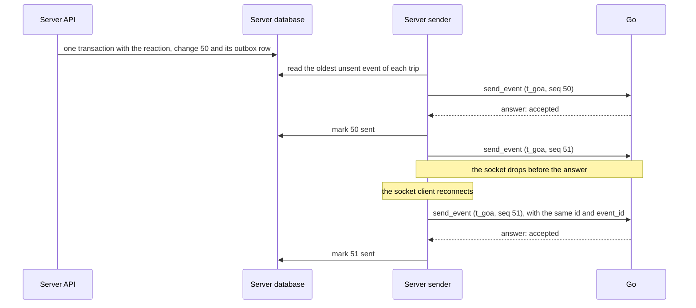

# Events

The server sends Go an event every time something changes in a trip, so that Go knows what happened in the room and on the Trip screens. This page explains what an event is, how the server sends events so that none are lost and each trip's events arrive in order, and what Go does with each of the 20 event types.

The server sends every event as a `send_event` request on the socket it keeps open to Go (see [The socket](02-the-socket.md)). The event is the request's `params`, and Go answers each one.

## What an event is

An event tells Go about one change to one trip. The server sends one event per change, whoever made it: a person, Go, or the server itself. Each change takes the trip's next change number (`seq`), and the event carries that number.

Go's own changes come back as events too. When Go posts a message, reacts to a message or records a booking, the server sends the matching `message.created`, `reaction.added` or `booking.changed` like it would for anyone else. This way Go sees every change number of the trip, in order, from one place. A reaction Go made has no `person_id`, because no person made it.

There is one exception. When Go replaces one of its cards in place (`replace_card`, for example for a live call that moved from dialing to talking), nothing new happened in the trip. The server takes no change number for it and sends no event.

Typing is not an event either. "Go is typing..." travels from Go to the server as the `typing` notification, which takes no change number and is not sent again if the socket drops. People's typing never reaches Go, so the server sends nothing to Go while someone types.

When a person has paused Go, the server still sends their messages as `message.created`, so the change numbers stay in order. It sets `withheld` to `true` and leaves out the text, the attachments and what the message replies to (`reply_to` is null). Go learns that a message was posted, but not what it says.

## The envelope

Every event has the same six fields. Only `data` is different for each type.

| Field | What it is |
|---|---|
| `event_id` | The server's id for this event, 1 to 64 characters. It stays the same every time the event is sent again. Go ignores an `event_id` it has already seen. |
| `trip_id` | The trip that changed. |
| `seq` | The trip's change number for this change. Each event of a trip has a number one higher than the event before it. |
| `occurred_at` | When the change happened, in ISO 8601 with an offset. A retry keeps the original time. |
| `type` | What kind of change it was, such as `message.created`. The [table of event types](#all-event-types) lists all 20. |
| `data` | The details of the change. Its fields depend on `type`. |

Every example further down this page is one whole event, exactly as the server puts it in the `params` of a `send_event` request.

## What Go answers

Go stores the event and answers the `send_event` request within 2 seconds. It does the real work (reading the message, replying, saving what it learned) after it has answered, so the server never waits for Go to think.

Here is one whole request frame. It carries Rahul's 👍 on Priya's message, which is change 50. The `id` is the JSON-RPC id that the server's socket client chose for this request:

<!-- schema: SocketRequest -->
```json
{
  "jsonrpc": "2.0",
  "id": "gs_1042",
  "method": "send_event",
  "params": {
    "event_id": "ev_0050",
    "trip_id": "t_goa",
    "seq": 50,
    "occurred_at": "2026-10-05T04:13:00Z",
    "type": "reaction.added",
    "data": {
      "message_id": "m_0122",
      "reaction": { "emoji": "👍", "person_id": "p_rahul" }
    }
  }
}
```

Go answers with a result frame that has the same `id`:

<!-- schema: SocketResult -->
```json
{ "jsonrpc": "2.0", "id": "gs_1042", "result": { "accepted": true, "duplicate": false } }
```

The result is an `EventAccepted`:

<!-- schema: EventAccepted -->
```json
{ "accepted": true, "duplicate": false }
```

When Go has already seen the `event_id`, it does nothing more and answers:

<!-- schema: EventAccepted -->
```json
{ "accepted": true, "duplicate": true }
```

Both answers are a success, and the server marks the event sent in both cases.

Go also answers `{"accepted": true}` to an event type it does not know, and skips it. It looks at `type` before it checks the rest of the event, so an unknown type is never answered `422 invalid`. That way the server can add a new event type within version 1 before Go uses it, and the server has nothing special to do.

When Go cannot take the event, it answers with an error frame instead (see [The socket](02-the-socket.md)). `422 invalid` means the event does not match the contract, and the message names the field. The server does not send that event again (see the next section). `503 unavailable` means Go is restarting, and `429 rate_limited` means the server is sending too fast. The server sends the event again later in both cases, and for a `429` it waits as many seconds as `data.retry_after_seconds` says.

<!-- schema: SocketError -->
```json
{
  "jsonrpc": "2.0",
  "id": "gs_1042",
  "error": { "code": 422, "message": "data.reaction.emoji must be 1 to 16 characters", "data": { "code": "invalid" } }
}
```

A `429` answer says how long to wait:

<!-- schema: SocketError -->
```json
{
  "jsonrpc": "2.0",
  "id": "gs_1043",
  "error": { "code": 429, "message": "too many events, slow down", "data": { "code": "rate_limited", "retry_after_seconds": 30 } }
}
```

## Sending events reliably

The server must never lose an event, never send one for a change that did not happen, and always send each trip's events in change-number order. The outbox pattern does all three. The server writes each event into an `outbox` table together with the change, and a separate sender sends the table's rows to Go as `send_event` requests on the socket.

1. **Write the event in the same transaction as the change.** Take the trip's next change number, store the change, and insert the event into the outbox, all in one database transaction. If the transaction rolls back, there is no change, no change number and no event.
2. **Take the change number from a counter on the trip row.** `update trips set seq = seq + 1 where trip_id = $1 returning seq` gives the next number. It also locks the trip row until the transaction ends, so two changes to the same trip always commit in change-number order.
3. **Send each trip's events in order, one at a time.** The sender sends one `send_event` for a trip and waits for Go's answer before it sends that trip's next event. Trips do not wait for each other: a trip whose event is waiting for a retry holds up only its own later events.
4. **Keep waiting across a reconnect.** If the socket drops before the answer arrives, the socket client reconnects and sends the unanswered request again, with the same JSON-RPC `id` and the same event, so the same `event_id`. Go handles an `event_id` only once, so the event is never handled twice.
5. **Retry on a fixed schedule.** When there is no answer within 2 seconds, or Go answers `429`, `500` or `503`, send the same event again after 1 second, 5 seconds, 30 seconds, 2 minutes and 10 minutes, then every 10 minutes. For a `429`, wait as many seconds as the error's `data.retry_after_seconds` says instead, and use the schedule only when it is missing. Give up after 24 hours.
6. **Do not retry any other error.** Any other error, such as `422 invalid`, means the event itself is wrong, and sending it again will not help. Log it, mark the event failed, and move on to the trip's next event. Go notices the missing change number and reads the trip to catch up.



The examples below use Postgres, with `pg` in TypeScript and `psycopg` in Python. The trip row holds the counter, and the outbox holds each event exactly as it will be sent:

```sql
alter table trips add column seq bigint not null default 0;   -- trip.created takes change number 1

create table outbox (
  event_id        text primary key,
  trip_id         text not null references trips (trip_id),
  seq             bigint not null,
  body            jsonb not null,                     -- the whole event
  status          text not null default 'pending',    -- pending, sent or failed
  attempts        int not null default 0,
  next_attempt_at timestamptz not null default now(),
  created_at      timestamptz not null default now(),
  sent_at         timestamptz,
  unique (trip_id, seq)
);
create index outbox_pending on outbox (trip_id, seq) where status = 'pending';
```

### Writing the event with the change

This example stores a reaction and its `reaction.added` event in one transaction. Every change in the server follows the same three steps: take the next change number, store the change, insert the event. A change to a message (an edit, a delete or a reaction) also sets that message's `updated_seq` to the new change number, so `read_messages` can bring it back after a gap. When Go reacts (`add_reaction`), the server runs the same code with no person: `person_id` is `null`.

**TypeScript**

```ts
import { randomUUID } from 'node:crypto';
import pg from 'pg';
import type { Event } from '@go/contract';

export const db = new pg.Pool({ connectionString: process.env.DATABASE_URL });

export async function addReaction(tripId: string, messageId: string, personId: string | null, emoji: string): Promise<void> {
  const tx = await db.connect();
  try {
    await tx.query('begin');
    // The next change number. This also locks the trip row until commit.
    const { rows } = await tx.query('update trips set seq = seq + 1 where trip_id = $1 returning seq', [tripId]);
    const seq = Number(rows[0].seq);
    await tx.query(
      'insert into reactions (trip_id, message_id, person_id, emoji) values ($1, $2, $3, $4)',
      [tripId, messageId, personId, emoji],
    );
    // A reaction changes the message, so the message's updated_seq moves too.
    await tx.query('update messages set updated_seq = $1 where message_id = $2', [seq, messageId]);
    const event: Event = {
      event_id: `ev_${randomUUID()}`,
      trip_id: tripId,
      seq,
      occurred_at: new Date().toISOString(),
      type: 'reaction.added',
      data: { message_id: messageId, reaction: { emoji, person_id: personId } },
    };
    await tx.query('insert into outbox (event_id, trip_id, seq, body) values ($1, $2, $3, $4)', [
      event.event_id, tripId, seq, JSON.stringify(event),
    ]);
    await tx.query('commit');
  } catch (err) {
    await tx.query('rollback');
    throw err;
  } finally {
    tx.release();
  }
}
```

**Python**

```python
import uuid
from datetime import datetime, timezone

import psycopg
from go_contract import models


def add_reaction(conn: psycopg.Connection, trip_id: str, message_id: str, person_id: str | None, emoji: str) -> None:
    with conn.transaction():
        # The next change number. This also locks the trip row until commit.
        (seq,) = conn.execute("update trips set seq = seq + 1 where trip_id = %s returning seq", (trip_id,)).fetchone()
        conn.execute(
            "insert into reactions (trip_id, message_id, person_id, emoji) values (%s, %s, %s, %s)",
            (trip_id, message_id, person_id, emoji),
        )
        # A reaction changes the message, so the message's updated_seq moves too.
        conn.execute("update messages set updated_seq = %s where message_id = %s", (seq, message_id))
        event = models.ReactionAdded(
            event_id=f"ev_{uuid.uuid4().hex}",
            trip_id=trip_id,
            seq=seq,
            occurred_at=datetime.now(timezone.utc),
            type="reaction.added",
            data=models.ReactionAddedData(message_id=message_id, reaction=models.Reaction(emoji=emoji, person_id=person_id)),
        )
        conn.execute(
            "insert into outbox (event_id, trip_id, seq, body) values (%s, %s, %s, %s::jsonb)",
            (event.event_id, trip_id, seq, event.model_dump_json(exclude_none=True)),
        )
```

### The sender

The sender runs on its own, next to the server's API. Every 200 milliseconds it reads the oldest unsent event of each trip whose turn has come, skips trips that already have an event on the way, and sends each of those events without waiting for the others. It sends them with `go.request('send_event', event)`, using the `GoSocket` client from [The socket](02-the-socket.md), which the server keeps connected to Go.

**TypeScript**

```ts
import { db } from './outbox.js';
import { go } from './go.js'; // the one GoSocket the server keeps open, from The socket
import { SocketCallError } from './go-socket.js';

const RETRY_AFTER_SECONDS = [1, 5, 30, 120, 600]; // then every 10 minutes
const GIVE_UP_AFTER_MS = 24 * 60 * 60 * 1000;
const RETRY_CODES = new Set([429, 500, 503]); // a timeout is retried too

// The oldest unsent event of each trip, if it is due, leaving out trips already being sent.
const DUE = `
  select * from (
    select distinct on (trip_id) event_id, trip_id, body, attempts, created_at, next_attempt_at
    from outbox where status = 'pending'
    order by trip_id, seq
  ) oldest
  where next_attempt_at <= now() and trip_id <> all($1::text[])`;

interface Row { event_id: string; trip_id: string; body: Record<string, unknown>; attempts: number; created_at: Date }

const sending = new Set<string>(); // trips with an event on the way

export async function runSender(): Promise<never> {
  for (;;) {
    const { rows } = await db.query<Row>(DUE, [[...sending]]);
    for (const row of rows) {
      sending.add(row.trip_id);
      void sendOne(row).catch(console.error).finally(() => sending.delete(row.trip_id));
    }
    await new Promise((resolve) => setTimeout(resolve, 200));
  }
}

async function sendOne(row: Row): Promise<void> {
  let failure: unknown = null;
  try {
    // Waits for Go's answer. If the socket drops first, the client sends this same request again after it reconnects.
    await go.request('send_event', row.body, { timeoutMs: 2000 });
  } catch (err) {
    failure = err; // a SocketCallError, or a SocketTimeoutError when there was no answer in time
  }
  if (failure === null) {
    await db.query(`update outbox set status = 'sent', sent_at = now() where event_id = $1`, [row.event_id]);
    return;
  }
  const refused = failure instanceof SocketCallError && !RETRY_CODES.has(failure.code);
  if (refused || Date.now() - row.created_at.getTime() > GIVE_UP_AFTER_MS) {
    // Not retried. The trip's next event goes next, and Go catches up from the gap.
    console.error('event not delivered', row.event_id, failure);
    await db.query(`update outbox set status = 'failed' where event_id = $1`, [row.event_id]);
    return;
  }
  // A 429 says how long to wait. Otherwise, and when it does not say, follow the schedule.
  const asked = failure instanceof SocketCallError && failure.code === 429 ? failure.retryAfterSeconds : undefined;
  const wait = asked ?? RETRY_AFTER_SECONDS[Math.min(row.attempts, RETRY_AFTER_SECONDS.length - 1)];
  await db.query(
    'update outbox set attempts = attempts + 1, next_attempt_at = now() + make_interval(secs => $2) where event_id = $1',
    [row.event_id, wait],
  );
}
```

**Python**

```python
import asyncio
import logging
import os
from datetime import datetime, timedelta, timezone

from psycopg.rows import dict_row
from psycopg_pool import AsyncConnectionPool

from go import go  # the one GoSocket the server keeps open, from The socket
from go_socket import SocketCallError

RETRY_AFTER_SECONDS = [1, 5, 30, 120, 600]  # then every 10 minutes
RETRY_CODES = {429, 500, 503}  # a timeout is retried too
GIVE_UP_AFTER = timedelta(hours=24)

# The oldest unsent event of each trip, if it is due, leaving out trips already being sent.
DUE = """
  select * from (
    select distinct on (trip_id) event_id, trip_id, body, attempts, created_at, next_attempt_at
    from outbox where status = 'pending'
    order by trip_id, seq
  ) oldest
  where next_attempt_at <= now() and trip_id <> all(%s::text[])"""

log = logging.getLogger("outbox")
pool = AsyncConnectionPool(os.environ["DATABASE_URL"], kwargs={"row_factory": dict_row}, open=False)
sending: dict[str, asyncio.Task] = {}  # trips with an event on the way


async def run_sender() -> None:
    await pool.open()
    while True:
        async with pool.connection() as conn:
            rows = await (await conn.execute(DUE, (list(sending),))).fetchall()
        for row in rows:
            sending[row["trip_id"]] = asyncio.create_task(send_one(row))
            sending[row["trip_id"]].add_done_callback(lambda _, trip_id=row["trip_id"]: sending.pop(trip_id, None))
        await asyncio.sleep(0.2)


async def send_one(row: dict) -> None:
    failure: Exception | None = None
    try:
        # Waits for Go's answer. If the socket drops first, the client sends this same request again after it reconnects.
        await go.request("send_event", row["body"], timeout=2.0)
    except (SocketCallError, asyncio.TimeoutError) as err:
        failure = err
    async with pool.connection() as conn:
        if failure is None:
            await conn.execute("update outbox set status = 'sent', sent_at = now() where event_id = %s", (row["event_id"],))
            return
        refused = isinstance(failure, SocketCallError) and failure.code not in RETRY_CODES
        if refused or datetime.now(timezone.utc) - row["created_at"] > GIVE_UP_AFTER:
            # Not retried. The trip's next event goes next, and Go catches up from the gap.
            log.error("event %s not delivered: %r", row["event_id"], failure)
            await conn.execute("update outbox set status = 'failed' where event_id = %s", (row["event_id"],))
            return
        # A 429 says how long to wait. Otherwise, and when it does not say, follow the schedule.
        asked = failure.retry_after_seconds if isinstance(failure, SocketCallError) and failure.code == 429 else None
        wait = asked or RETRY_AFTER_SECONDS[min(row["attempts"], len(RETRY_AFTER_SECONDS) - 1)]
        await conn.execute(
            "update outbox set attempts = attempts + 1, next_attempt_at = now() + make_interval(secs => %s) where event_id = %s",
            (wait, row["event_id"]),
        )
```

The Python sender needs `pip install "psycopg[binary,pool]"`, plus `websockets` for the socket client.

Good to know:
- Send one event per `send_event` request. Never put two events in one frame.
- A retry sends the same event with the same `event_id`, `seq` and `occurred_at`. After a timeout, the retry is a new request with a new JSON-RPC `id`, and Go still handles the event once, because the `event_id` is the same.
- Requests on the socket are not signed one by one. The server signed once, when it opened the socket.
- A frame is at most 1 MB. The biggest event, `trip.created`, carries the whole trip and stays well under that.
- Run one sender, even when several server instances keep a socket open to Go. If you run more than one sender, split the trips between them, so that one trip's events are always sent by the same sender.
- To send sooner than the next 200 millisecond check, wake the sender with Postgres `NOTIFY` after each commit.
- Alert on failed events. A failed event means a bug on one side, and the person who fixes it needs the log line.

## What Go does when an event arrives

Go handles each trip's events one at a time, in change-number order, and uses the change numbers to notice anything it missed.

1. It checks the `event_id`. A repeat gets `{"accepted": true, "duplicate": true}`, and nothing else happens.
2. It answers `accepted` and puts the event in that trip's queue.
3. It compares the event's `seq` with the last change number it holds for the trip. If it holds 41 and receives 43, change 42 is missing. Go then sends the server two requests on the same socket: `read_trip` for the whole trip, and `read_messages` with `after_seq` 41 for every message posted or changed after change 41 (which also brings back edits, deletes and reactions). Then it carries on from there.
4. Once a minute it reads every active trip again with `read_trip`, as a safety net for anything both sides missed.
5. It answers `{"accepted": true}` to an event type it does not know, without checking the rest of the event, and skips it.

These are the two requests Go sends to catch up after the gap in step 3:

<!-- schema: ReadTrip -->
```json
{ "trip_id": "t_goa" }
```

<!-- schema: ReadMessages -->
```json
{ "trip_id": "t_goa", "after_seq": 41 }
```

The server answers them from its database. [Go's requests](04-gos-requests.md) shows both answers.

## When Go speaks and what it saves

Most events change what Go knows without making it speak. Go speaks in the room only when one of these is true:

- Someone mentions or names Go, or replies to one of Go's messages.
- Work someone asked for is done.
- A vote closed, or a decision is ready to move.
- Something is wrong or at risk, such as a clash with a booking, a price change, or a deadline coming up.

Otherwise Go stays quiet and takes notes. In each trip, Go speaks without being asked at most once every 30 minutes.

After a message for Go, Go waits about 2 seconds in case the same person sends more, unless the message plainly ends with a question mark, a full stop, an exclamation mark or an emoji. Just before it posts its answer, it checks for anything new for it in the room (events that arrived while it worked) and answers that too. This is Go's own behaviour, and the server has nothing to do for it. While it works, Go shows "Go is typing..." by sending the `typing` notification, and repeats it every 5 seconds.

After it replies, or after a message it only took notes on, Go saves what it learned in two places:

- **Facts about people** stay with Go, one current fact per topic for each person, with the message as proof.
- **Agreed, open and doing lines** go into the trip record, through the server (`add_record_line`). An agreed line needs two people saying yes (a 👍 reaction counts) or the organizer saying yes, and nobody objecting. Without that, Go writes an open line instead.

Go does not announce each line it writes. Instead, it may add a quiet ✅ reaction to the message the line came from (`add_reaction`), so the room can see that Go noted it. People can undo a line in the app, and Go never undoes one. The server writes the decided and booked lines itself, from votes and bookings.

## All event types

| Type | The server sends it when | What Go does with it |
|---|---|---|
| `message.created` | Anyone posts in the room, Go included. A paused person's message comes withheld. | Answers if it is asked, otherwise takes notes. |
| `message.edited` | Someone edits a message. | Reads the new text and updates what it saved from the old one. |
| `message.deleted` | Someone deletes a message. | Drops the facts that came from it. |
| `reaction.added` | Someone reacts to a message, Go included. | Counts a 👍 from a person as agreeing. Go's own reaction only moves the change number. |
| `reaction.removed` | Someone takes a reaction back, Go included. | Stops counting it. |
| `person.joined` | Someone joins the trip. | Saves their join answers as facts. |
| `person.updated` | Someone changes their details, or pauses or unpauses Go. | Updates what it knows. Stops learning from someone who paused it. |
| `person.left` | Someone leaves the trip. | Stops treating them as part of the group. |
| `trip.created` | Someone creates a trip. | Sets the trip up (memory, people, its queue, and its own computer in the background), then greets the group and starts. |
| `trip.updated` | The title, destination, dates, vibe, stay, itinerary, status or budget changes. | Reads the trip and warns the room about a clash. |
| `decision.opened` | A vote opens. | Notes the vote and when it closes. |
| `decision.voted` | Someone votes or changes their vote, says they are flexible, or takes their vote back (1.1). | Keeps the count, quietly. |
| `decision.closed` | A vote closes. | Announces the result. For a booking vote, sets the mandate. |
| `decision.cancelled` | A vote is called off. | Stops waiting on it. |
| `decision.options_added` | (1.3) Go added options to an open vote, from "See more". | Adds them to its copy of the vote, after the last option. |
| `mandate.set` | Go set what the group allowed for a spend. | Records the change number. |
| `mandate.confirmed` | The payer taps "Yes, book it". | Re-checks the price and asks for a spend approval. |
| `mandate.declined` | The payer taps "Not now". | Does not ask for a spend approval. |
| `record.changed` | A trip record line is added, changed, done or undone. | Keeps its copy of the record. Treats an undone line as no longer settled. |
| `booking.changed` | A booking is added, changed or cancelled. | Checks it against the plan and warns about a clash. |
| `expense.changed` | An expense is added or removed, or (1.1) someone it is split between approves or disputes it. | Takes note. The server does the money maths. |
| `settlement.recorded` | (1.1) Someone paid someone back, and the one paid confirmed it. | Reads the trip's money again. |

The rest of this page shows each event type with an example from the Goa trip.

## Messages and reactions

These five events cover everything people and Go say in the room, and how people react to it.

### message.created

The server sends `message.created` when anyone posts in the room: a person, Go, or the server itself (a message with the author `system`). If the message mentions or names Go, or replies to one of Go's messages, `mentions_go` is `true` and Go answers. Otherwise Go reads the message and saves anything worth keeping.

Priya asks Go for flights. This is change 57, the message from [the front page](README.md):

<!-- schema: MessageCreated -->
```json
{
  "event_id": "ev_0057",
  "trip_id": "t_goa",
  "seq": 57,
  "occurred_at": "2026-10-05T06:49:00Z",
  "type": "message.created",
  "data": {
    "message": {
      "message_id": "m_0132",
      "seq": 57,
      "updated_seq": 57,
      "author": { "kind": "person", "person_id": "p_priya" },
      "text": "@Go flights on Friday from Delhi, under 6k?",
      "attachments": [],
      "reply_to": null,
      "about_message_id": null,
      "mentions_go": true,
      "mentions": [],
      "reactions": [],
      "card": null,
      "withheld": false,
      "deleted": false,
      "edited_at": null,
      "sent_at": "2026-10-05T06:49:00Z"
    }
  }
}
```

Go's reply comes back as an event too, with its card. Go does not answer its own messages. It uses the event to keep its place in the trip's change numbers.

<!-- schema: MessageCreated -->
```json
{
  "event_id": "ev_0058",
  "trip_id": "t_goa",
  "seq": 58,
  "occurred_at": "2026-10-05T06:49:40Z",
  "type": "message.created",
  "data": {
    "message": {
      "message_id": "m_0133",
      "seq": 58,
      "updated_seq": 58,
      "author": { "kind": "go" },
      "text": "Priya, here are three Friday evening flights from Delhi, all under ₹6k.",
      "attachments": [],
      "reply_to": "m_0132",
      "about_message_id": null,
      "mentions_go": false,
      "mentions": ["p_priya"],
      "reactions": [],
      "card": {
        "kind": "options",
        "card_id": "c_flights_1",
        "fallback_text": "3 flights from Delhi to Goa on Fri 6 Nov, from ₹5,640 per person",
        "title": "Friday flights, Delhi to Goa",
        "option_kind": "flight",
        "checked_at": "2026-10-05T06:49:30Z",
        "options": [
          {
            "option_id": "opt_flight_1",
            "title": "IndiGo 6E 2134",
            "subtitle": "6:10 pm to 8:45 pm, non-stop",
            "price_minor": 592000,
            "currency": "INR",
            "price_note": "per person",
            "highlights": ["Non-stop", "Lands 8:45 pm"],
            "journey": {
              "mode": "flight",
              "origin": { "name": "Delhi", "code": "DEL" },
              "destination": { "name": "Goa", "code": "GOI" },
              "depart_at": "2026-11-06T18:10:00+05:30",
              "arrive_at": "2026-11-06T20:45:00+05:30",
              "carrier_name": "IndiGo",
              "carrier_code": "6E",
              "number": "6E 2134",
              "stops": 0
            }
          },
          {
            "option_id": "opt_flight_2",
            "title": "Air India, 7:45 pm",
            "subtitle": "7:45 pm to 10:20 pm, non-stop",
            "price_minor": 598000,
            "currency": "INR",
            "price_note": "per person",
            "highlights": ["Non-stop"],
            "journey": {
              "mode": "flight",
              "origin": { "name": "Delhi", "code": "DEL" },
              "destination": { "name": "Goa", "code": "GOI" },
              "depart_at": "2026-11-06T19:45:00+05:30",
              "arrive_at": "2026-11-06T22:20:00+05:30",
              "carrier_name": "Air India",
              "carrier_code": "AI",
              "stops": 0
            }
          },
          {
            "option_id": "opt_flight_3",
            "title": "IndiGo, 9:20 pm",
            "subtitle": "9:20 pm to 11:55 pm, non-stop",
            "price_minor": 564000,
            "currency": "INR",
            "price_note": "per person",
            "highlights": ["Cheapest", "Lands late"],
            "journey": {
              "mode": "flight",
              "origin": { "name": "Delhi", "code": "DEL" },
              "destination": { "name": "Goa", "code": "GOI" },
              "depart_at": "2026-11-06T21:20:00+05:30",
              "arrive_at": "2026-11-06T23:55:00+05:30",
              "carrier_name": "IndiGo",
              "carrier_code": "6E",
              "stops": 0
            }
          }
        ],
        "actions": [
          { "action_id": "pick", "label": "I'll take this", "style": "primary", "per_option": true },
          { "action_id": "vote", "label": "Put it to a vote", "style": "secondary" }
        ]
      },
      "withheld": false,
      "deleted": false,
      "edited_at": null,
      "sent_at": "2026-10-05T06:49:40Z"
    }
  }
}
```

A message from someone who paused Go comes with `withheld: true`, no text, no attachments and no `reply_to`. Kabir paused Go at change 115, so his next message reaches Go like this, and it learns only that change 116 was a message from Kabir:

<!-- schema: MessageCreated -->
```json
{
  "event_id": "ev_0116",
  "trip_id": "t_goa",
  "seq": 116,
  "occurred_at": "2026-10-10T16:04:00Z",
  "type": "message.created",
  "data": {
    "message": {
      "message_id": "m_0231",
      "seq": 116,
      "updated_seq": 116,
      "author": { "kind": "person", "person_id": "p_kabir" },
      "text": null,
      "attachments": [],
      "reply_to": null,
      "about_message_id": null,
      "mentions_go": false,
      "mentions": [],
      "reactions": [],
      "card": null,
      "withheld": true,
      "deleted": false,
      "edited_at": null,
      "sent_at": "2026-10-10T16:04:00Z"
    }
  }
}
```

Good to know:
- In a withheld message, also send `mentions_go: false` and an empty `mentions` list. Go cannot answer words it does not see.
- `about_message_id` is set when someone long-pressed a message and chose "Ask Go about this". Go reads that message as the subject of the question.
- `card` appears only on Go's messages.

### message.edited

The server sends `message.edited` when someone edits a message. It carries the message as it is now, with `edited_at` set. Go reads the new text and updates anything it saved from the old one.

Arjun corrects when he lands, so Go replaces what it saved about his arrival:

<!-- schema: MessageEdited -->
```json
{
  "event_id": "ev_0055",
  "trip_id": "t_goa",
  "seq": 55,
  "occurred_at": "2026-10-05T04:42:00Z",
  "type": "message.edited",
  "data": {
    "message": {
      "message_id": "m_0126",
      "seq": 54,
      "updated_seq": 55,
      "author": { "kind": "person", "person_id": "p_arjun" },
      "text": "Correction: my flight from Bangalore lands at 10:40 pm, so I'll reach our place around 11",
      "attachments": [],
      "reply_to": null,
      "about_message_id": null,
      "mentions_go": false,
      "mentions": [],
      "reactions": [],
      "card": null,
      "withheld": false,
      "deleted": false,
      "edited_at": "2026-10-05T04:42:00Z",
      "sent_at": "2026-10-05T04:30:00Z"
    }
  }
}
```

### message.deleted

The server sends `message.deleted` when someone deletes a message. It carries only the `message_id`. Go drops every fact it saved from that message.

Kabir deleted a message he sent by mistake:

<!-- schema: MessageDeleted -->
```json
{
  "event_id": "ev_0056",
  "trip_id": "t_goa",
  "seq": 56,
  "occurred_at": "2026-10-05T05:00:00Z",
  "type": "message.deleted",
  "data": { "message_id": "m_0129" }
}
```

### reaction.added

The server sends `reaction.added` when someone reacts to a message, and when Go does. Go counts a 👍 from a person as that person agreeing with the message.

Priya said "North Goa, not South" and Arjun agreed. Rahul, the organizer, adds his 👍 to Priya's message. Nobody objected, so Go writes the agreed line "North Goa, not South" in the trip record:

<!-- schema: ReactionAdded -->
```json
{
  "event_id": "ev_0050",
  "trip_id": "t_goa",
  "seq": 50,
  "occurred_at": "2026-10-05T04:13:00Z",
  "type": "reaction.added",
  "data": {
    "message_id": "m_0122",
    "reaction": { "emoji": "👍", "person_id": "p_rahul" }
  }
}
```

Go's own reactions come back the same way. After writing the agreed line, and after changing the destination to North Goa (change 52), Go added a quiet ✅ to Priya's message instead of announcing the line (`add_reaction`). Go made this reaction, so `person_id` is `null`:

<!-- schema: ReactionAdded -->
```json
{
  "event_id": "ev_0053",
  "trip_id": "t_goa",
  "seq": 53,
  "occurred_at": "2026-10-05T04:14:40Z",
  "type": "reaction.added",
  "data": {
    "message_id": "m_0122",
    "reaction": { "emoji": "✅", "person_id": null }
  }
}
```

Good to know:
- A reaction with `person_id` left out or `null` is Go's. Go never counts its own reaction as anyone agreeing. It uses the event to keep its place in the change numbers.
- When Go takes a reaction back (`remove_reaction`), the server sends `reaction.removed`, again with no `person_id`.

### reaction.removed

The server sends `reaction.removed` when someone takes a reaction back. Go stops counting it. If Go already wrote a line partly because of that reaction, the line stays, because only people undo lines.

Kabir takes back his 👍 on the message about scuba on Saturday, so Go keeps "Scuba on Saturday?" as an open question for Meher and Kabir:

<!-- schema: ReactionRemoved -->
```json
{
  "event_id": "ev_0080",
  "trip_id": "t_goa",
  "seq": 80,
  "occurred_at": "2026-10-05T10:12:00Z",
  "type": "reaction.removed",
  "data": {
    "message_id": "m_0149",
    "reaction": { "emoji": "👍", "person_id": "p_kabir" }
  }
}
```

## People

These three events tell Go who is in the trip and how each person wants to be treated.

### person.joined

The server sends `person.joined` when someone joins the trip, with their join answers: where they travel from, the earliest they can leave, and anything Go should know. It never includes their budget answer, phone number, email or UPI id. Go saves the answers as facts about the person and stays quiet.

Kabir joins from the invite link:

<!-- schema: PersonJoined -->
```json
{
  "event_id": "ev_0044",
  "trip_id": "t_goa",
  "seq": 44,
  "occurred_at": "2026-10-05T03:40:00Z",
  "type": "person.joined",
  "data": {
    "person": {
      "person_id": "p_kabir",
      "name": "Kabir",
      "photo_url": "https://cdn.go.example/people/p_kabir.jpg",
      "role": "member",
      "joined_at": "2026-10-05T03:40:00Z",
      "from_city": "Delhi",
      "earliest_leave": "Fri evening",
      "know": ["I don't drink"],
      "has_upi": true,
      "go_paused": false
    }
  }
}
```

### person.updated

The server sends `person.updated` when someone changes their details, or pauses or unpauses Go. It carries the whole person as they are now, and `changed` lists the fields that changed. When `go_paused` becomes `true`, the server starts withholding that person's messages and Go stops learning from them. When it becomes `false` again, Go reads their new messages as usual.

Kabir pauses Go:

<!-- schema: PersonUpdated -->
```json
{
  "event_id": "ev_0115",
  "trip_id": "t_goa",
  "seq": 115,
  "occurred_at": "2026-10-10T16:00:00Z",
  "type": "person.updated",
  "data": {
    "person": {
      "person_id": "p_kabir",
      "name": "Kabir",
      "photo_url": "https://cdn.go.example/people/p_kabir.jpg",
      "role": "member",
      "joined_at": "2026-10-05T03:40:00Z",
      "from_city": "Delhi",
      "earliest_leave": "Fri evening",
      "know": ["I don't drink"],
      "has_upi": true,
      "go_paused": true
    },
    "changed": ["go_paused"]
  }
}
```

Good to know:
- `has_upi` says only whether someone saved a UPI id. When it changes, the server sends `changed: ["has_upi"]`. The id itself never leaves the server.

### person.left

The server sends `person.left` when someone leaves the trip. It carries only the `person_id`. Go stops treating them as part of the group.

If Kabir left the trip, the server would send:

<!-- schema: PersonLeft -->
```json
{
  "event_id": "ev_0118",
  "trip_id": "t_goa",
  "seq": 118,
  "occurred_at": "2026-10-11T08:00:00Z",
  "type": "person.left",
  "data": { "person_id": "p_kabir" }
}
```

## The trip

These two events tell Go that a trip exists and when its details change.

### trip.created

The server sends `trip.created` when someone creates a trip. It carries the whole trip, so Go can greet the group and start without reading the trip first.

Rahul has just created "Goa 🌴". He is the only person in it so far, nobody has answered the budget question yet, and there are no votes or bookings:

<!-- schema: TripCreated -->
```json
{
  "event_id": "ev_0001",
  "trip_id": "t_goa",
  "seq": 1,
  "occurred_at": "2026-10-05T02:30:00Z",
  "type": "trip.created",
  "data": {
    "trip": {
      "trip_id": "t_goa",
      "seq": 1,
      "title": "Goa 🌴",
      "status": "planning",
      "created_at": "2026-10-05T02:30:00Z",
      "organizer_person_id": "p_rahul",
      "invite_url": "https://go.example/j/8fK2xQ",
      "destination": { "name": "Goa" },
      "dates": null,
      "vibe": ["beaches", "food", "sunsets"],
      "stay": "villa with a pool",
      "budget": { "lowest": null, "answered": 0, "of": 1 },
      "people": [
        {
          "person_id": "p_rahul",
          "name": "Rahul",
          "photo_url": "https://cdn.go.example/people/p_rahul.jpg",
          "role": "organizer",
          "joined_at": "2026-10-05T02:30:00Z",
          "from_city": "Delhi",
          "earliest_leave": "Fri after 6 pm",
          "know": [],
          "has_upi": true,
          "go_paused": false
        }
      ],
      "decisions": [],
      "bookings": [],
      "expenses": [],
      "money": { "currency": "INR", "plan_minor": null, "spent_minor": 0, "by_category": [], "transfers": [] },
      "itinerary": [],
      "record": []
    }
  }
}
```

#### How Go sets itself up for a new trip

`trip.created` is the moment Go joins a trip. Go answers `accepted` at once and does the setting up after it has answered, so setting up never holds up the server:

1. **Go's side of the trip, in a few seconds.** Go makes the trip's home: its memory for this trip, a page for each person (someone who was in an earlier trip keeps their page), the queue of things it has to do, and the composer's conversation for this trip. Then Go says hello. If someone has already asked Go something, Go answers that first in the same message. Go opens no vote when it joins: votes come later, when the group is choosing.
2. **Go's computer for the trip, in about a minute, in the background.** Each trip gets its own computer: a Bash from Vestra, which Go uses for longer jobs such as searching many sites, filling in forms or watching a fare. Go asks for it as soon as the trip exists and starts it, so it is ready before anyone asks for a task.

Nobody waits for the computer. Go says hello before it is ready, and a task someone asks for in the first minute starts as soon as it is up.

Setting up is safe to repeat, and Go does not depend on this one event. If any event arrives for a trip Go has not set up (because `trip.created` never arrived, or Go was restored from a backup), Go reads the trip with `read_trip` and sets it up then. A regular check also finishes any setup that stopped halfway.

The server has nothing extra to do: send `trip.created` first (it is change number 1), and show the room without waiting for Go.

### trip.updated

The server sends `trip.updated` when the trip's title, destination, dates, vibe, stay, itinerary, status or budget changes. It carries who made the change (`by`) and which fields changed, but not the new values, so Go reads the trip to see them. Go then checks the change against the plan and warns the room if something clashes, such as new dates that no longer match a booking.

The group agreed on North Goa, so Go changed the destination from "Goa" to "North Goa":

<!-- schema: TripUpdated -->
```json
{
  "event_id": "ev_0052",
  "trip_id": "t_goa",
  "seq": 52,
  "occurred_at": "2026-10-05T04:14:30Z",
  "type": "trip.updated",
  "data": {
    "by": { "kind": "go" },
    "changed": ["destination"]
  }
}
```

Good to know:
- When someone answers the budget question, send `changed: ["budget"]` with `by: {"kind": "system"}`. If `by` named the person, Go could work out their answer from how the lowest band moved.

## Votes

These four events follow a vote from the moment it opens until it closes or is called off.

### decision.opened

The server sends `decision.opened` when a vote opens, whether Go or a person opened it. It carries the whole vote and who opened it. Go notes the question, the options and the closing time, and waits for the result.

Go opened "Where do we stay?" with the three villas it found:

<!-- schema: DecisionOpened -->
```json
{
  "event_id": "ev_0064",
  "trip_id": "t_goa",
  "seq": 64,
  "occurred_at": "2026-10-05T07:30:00Z",
  "type": "decision.opened",
  "data": {
    "decision": {
      "decision_id": "d_villa",
      "question": "Where do we stay?",
      "kind": "choice",
      "anonymous": false,
      "status": "open",
      "opened_by_person_id": null,
      "options": [
        {
          "label": "Villa Sol",
          "image_url": "https://brain.go.example/img/villa-sol.jpg",
          "price_minor": 5420000,
          "currency": "INR",
          "option_ref": "ixigo:stay:villa-sol-anjuna",
          "note": "3 nights, private pool, Anjuna"
        },
        {
          "label": "Casa Azul",
          "image_url": "https://brain.go.example/img/casa-azul.jpg",
          "price_minor": 6180000,
          "currency": "INR",
          "option_ref": "ixigo:stay:casa-azul-assagao",
          "note": "3 nights, pool, Assagao"
        },
        {
          "label": "The Palms",
          "image_url": "https://brain.go.example/img/the-palms.jpg",
          "price_minor": 5850000,
          "currency": "INR",
          "option_ref": "ixigo:stay:the-palms-vagator",
          "note": "3 nights, pool, near Vagator beach"
        }
      ],
      "closes_at": "2026-10-05T12:30:00Z",
      "voted": 0,
      "of": 5,
      "tally": [0, 0, 0],
      "votes": [],
      "result_index": null,
      "mandate": null,
      "opened_at": "2026-10-05T07:30:00Z",
      "closed_at": null
    },
    "by": { "kind": "go" }
  }
}
```

### decision.voted

The server sends `decision.voted` when someone votes or changes their vote. It carries how many have voted (`voted` of `of`) and the `tally` per option, in option order. Go keeps the count and stays quiet.

Priya votes for Villa Sol, the third of five votes:

<!-- schema: DecisionVoted -->
```json
{
  "event_id": "ev_0067",
  "trip_id": "t_goa",
  "seq": 67,
  "occurred_at": "2026-10-05T07:52:00Z",
  "type": "decision.voted",
  "data": {
    "decision_id": "d_villa",
    "person_id": "p_priya",
    "option_index": 0,
    "voted": 3,
    "of": 5,
    "tally": [2, 1, 0]
  }
}
```

Good to know:
- In an anonymous vote, the server leaves out `person_id` and `option_index`, so nobody learns who voted for what, Go included.

### decision.closed

The server sends `decision.closed` when a vote closes, with the vote as it ended and the `reason`: the time ran out (`time`), everyone voted (`everyone_voted`), a person closed it (`closed_by_person`), or Go closed it (`closed_by_go`). Go announces the result in the room. When the vote was about something to book, Go then sets the mandate (`set_mandate`) and posts a mandate card for the payer (`post_message`).

Everyone has voted on the villa, and Villa Sol won 4 to 1:

<!-- schema: DecisionClosed -->
```json
{
  "event_id": "ev_0070",
  "trip_id": "t_goa",
  "seq": 70,
  "occurred_at": "2026-10-05T08:45:00Z",
  "type": "decision.closed",
  "data": {
    "decision": {
      "decision_id": "d_villa",
      "question": "Where do we stay?",
      "kind": "choice",
      "anonymous": false,
      "status": "closed",
      "opened_by_person_id": null,
      "options": [
        {
          "label": "Villa Sol",
          "image_url": "https://brain.go.example/img/villa-sol.jpg",
          "price_minor": 5420000,
          "currency": "INR",
          "option_ref": "ixigo:stay:villa-sol-anjuna",
          "note": "3 nights, private pool, Anjuna"
        },
        {
          "label": "Casa Azul",
          "image_url": "https://brain.go.example/img/casa-azul.jpg",
          "price_minor": 6180000,
          "currency": "INR",
          "option_ref": "ixigo:stay:casa-azul-assagao",
          "note": "3 nights, pool, Assagao"
        },
        {
          "label": "The Palms",
          "image_url": "https://brain.go.example/img/the-palms.jpg",
          "price_minor": 5850000,
          "currency": "INR",
          "option_ref": "ixigo:stay:the-palms-vagator",
          "note": "3 nights, pool, near Vagator beach"
        }
      ],
      "closes_at": "2026-10-05T12:30:00Z",
      "voted": 5,
      "of": 5,
      "tally": [4, 1, 0],
      "votes": [
        { "person_id": "p_rahul", "option_index": 0 },
        { "person_id": "p_arjun", "option_index": 1 },
        { "person_id": "p_priya", "option_index": 0 },
        { "person_id": "p_meher", "option_index": 0 },
        { "person_id": "p_kabir", "option_index": 0 }
      ],
      "result_index": 0,
      "mandate": null,
      "opened_at": "2026-10-05T07:30:00Z",
      "closed_at": "2026-10-05T08:45:00Z"
    },
    "reason": "everyone_voted"
  }
}
```

Good to know:
- The server also writes a decided line for the result in the trip record. That line arrives as its own `record.changed` event.

### decision.cancelled

The server sends `decision.cancelled` when a vote is called off before it closes. It carries the vote's id and who called it off. Go stops waiting on that vote: it will not announce a result or set a mandate for it.

Rahul called off a vote he had opened about which beach to spend Sunday on:

<!-- schema: DecisionCancelled -->
```json
{
  "event_id": "ev_0101",
  "trip_id": "t_goa",
  "seq": 101,
  "occurred_at": "2026-10-06T11:00:00Z",
  "type": "decision.cancelled",
  "data": {
    "decision_id": "d_beach",
    "by": { "kind": "person", "person_id": "p_rahul" }
  }
}
```

### decision.options_added

(1.3) The server sends `decision.options_added` after Go's `add_vote_options`: someone tapped "See more" on a stays card that is in a vote, and Go added the stays it showed next. The new options take the next indexes after the last one, with no votes yet; votes already cast stay. A vote has at most 20 options in all.

<!-- schema: DecisionOptionsAdded -->
```json
{
  "event_id": "ev_0118",
  "trip_id": "t_goa",
  "seq": 118,
  "occurred_at": "2026-10-06T11:40:00Z",
  "type": "decision.options_added",
  "data": {
    "decision_id": "d_12",
    "options": [{ "label": "Casa Lua", "option_ref": "opt_14", "price_minor": 4500000, "currency": "INR" }],
    "by": { "kind": "go" }
  }
}
```

## The mandate

These three events cover what the group allowed for a spend and the payer's answer. [Money and the vault](08-money-and-the-vault.md) explains the whole payment.

### mandate.set

The server sends `mandate.set` after Go sets what the group allowed for a spend: the choice, the cap, whether it must be refundable, and who pays. It is Go's own change coming back, so Go only records the change number. Go posts the mandate card for the payer right after it sets the mandate.

Go allowed Villa Sol for up to ₹55,000, refundable only, with Rahul paying:

<!-- schema: MandateSet -->
```json
{
  "event_id": "ev_0072",
  "trip_id": "t_goa",
  "seq": 72,
  "occurred_at": "2026-10-05T08:46:00Z",
  "type": "mandate.set",
  "data": {
    "decision_id": "d_villa",
    "mandate": {
      "choice_index": 0,
      "cap_minor": 5500000,
      "currency": "INR",
      "refundable_only": true,
      "payer_person_id": "p_rahul",
      "set_at": "2026-10-05T08:46:00Z",
      "confirmed_at": null,
      "declined_at": null
    }
  }
}
```

Good to know:
- Setting a new mandate for the same vote replaces the old one and clears the payer's earlier "Yes, book it" or "Not now".

### mandate.confirmed

The server sends `mandate.confirmed` when the payer taps "Yes, book it" on the mandate card. Those buttons belong to the server, which records the time as the mandate's `confirmed_at`. Go re-checks the price, asks the server for a spend approval (`request_spend_approval`), and then posts a pay card for the payer.

Rahul says yes to the villa:

<!-- schema: MandateConfirmed -->
```json
{
  "event_id": "ev_0074",
  "trip_id": "t_goa",
  "seq": 74,
  "occurred_at": "2026-10-05T08:58:00Z",
  "type": "mandate.confirmed",
  "data": { "decision_id": "d_villa", "person_id": "p_rahul" }
}
```

### mandate.declined

The server sends `mandate.declined` when the payer taps "Not now" on the mandate card. The server records the time as the mandate's `declined_at`. Go does not ask for a spend approval, and the server's spend check would refuse one with the reason `payer_declined`.

If Rahul had tapped "Not now" instead, the server would have sent:

<!-- schema: MandateDeclined -->
```json
{
  "event_id": "ev_0074",
  "trip_id": "t_goa",
  "seq": 74,
  "occurred_at": "2026-10-05T08:58:00Z",
  "type": "mandate.declined",
  "data": { "decision_id": "d_villa", "person_id": "p_rahul" }
}
```

### payment.completed (1.3)

For the demo, the server pays a waiting pay card itself. When the payer taps `approve` on it, the tap never reaches Go. The server sets the card to paid, with no buttons, and writes the booking and the expense. In the same transaction it sends `booking.changed`, `record.changed` and `expense.changed`, then `payment.completed`, then its own "booked" and expense lines. No vault and no money are involved (`method: "demo"`).

Go finishes its side by `approval_id`. It marks its payment paid and stops every timer on it. It never sends `add_booking` or `add_expense` for it, because the server has made both. It posts the ticket card (`{ "kind": "ticket", "booking_id": … }`, for that person alone on a person's own ticket) and moves on to the next step. It sends no second "booked" line, because the server has sent it. An `approval_id` Go doesn't know is accepted and ignored, and the same event twice does nothing more.

Rahul taps Pay with ixigo money on the villa's pay card:

<!-- schema: PaymentCompleted -->
```json
{
  "event_id": "ev_0081",
  "trip_id": "t_goa",
  "seq": 81,
  "occurred_at": "2026-10-05T09:02:00Z",
  "type": "payment.completed",
  "data": {
    "approval_id": "ap_01JA7Q3V8Z",
    "card_id": "c_villa_pay",
    "payer_person_id": "p_rahul",
    "amount_minor": 5420000,
    "currency": "INR",
    "merchant": "ixigo: Villa Sol, Anjuna",
    "purpose": "Villa Sol, 3 nights, 6 to 9 Nov",
    "decision_id": "d_villa",
    "booking_id": "bk_villa",
    "expense_id": "ex_villa",
    "method": "demo",
    "paid_at": "2026-10-05T09:02:00Z",
    "by": { "kind": "person", "person_id": "p_rahul" }
  }
}
```

## The trip record, bookings and money

These three events cover the trip's shared memory and what the group booked and spent.

### record.changed

The server sends `record.changed` when a trip record line is added, changed, marked done or undone, by anyone. Go's own lines come back this way, and so do the decided and booked lines the server writes from votes and bookings. When a person undoes a line, Go treats it as no longer settled. Go never undoes a line itself.

Go wrote the agreed line "North Goa, not South", with Priya's and Arjun's messages as proof:

<!-- schema: RecordChanged -->
```json
{
  "event_id": "ev_0051",
  "trip_id": "t_goa",
  "seq": 51,
  "occurred_at": "2026-10-05T04:14:00Z",
  "type": "record.changed",
  "data": {
    "line": {
      "line_id": "r_north",
      "kind": "agreed",
      "text": "North Goa, not South",
      "status": "active",
      "proof": [
        { "message_id": "m_0122", "person_id": "p_priya" },
        { "message_id": "m_0124", "person_id": "p_arjun" }
      ],
      "person_ids": ["p_priya", "p_arjun", "p_rahul"],
      "due_at": null,
      "decision_id": null,
      "booking_id": null,
      "source": "go",
      "created_at": "2026-10-05T04:14:00Z",
      "updated_at": "2026-10-05T04:14:00Z"
    },
    "change": "added",
    "by": { "kind": "go" }
  }
}
```

### booking.changed

The server sends `booking.changed` when a booking is added, changed or cancelled. Go's own bookings come back this way, with the `approval_id` when Go paid through the vault, and so do bookings people add in the app. Go checks a new or changed booking against the plan and speaks only if something clashes, such as a flight that lands after the stay's check-in closes. When a booking is cancelled, Go warns the room about anything that depended on it.

Go booked Villa Sol after Rahul approved the payment:

<!-- schema: BookingChanged -->
```json
{
  "event_id": "ev_0076",
  "trip_id": "t_goa",
  "seq": 76,
  "occurred_at": "2026-10-05T09:03:00Z",
  "type": "booking.changed",
  "data": {
    "booking": {
      "booking_id": "b_villa",
      "kind": "stay",
      "status": "confirmed",
      "title": "Villa Sol, 3 nights",
      "vendor": "ixigo",
      "ref": "IXG-7Q2K9",
      "amount_minor": 5420000,
      "currency": "INR",
      "payer_person_id": "p_rahul",
      "for_person_ids": ["p_rahul", "p_priya", "p_arjun", "p_meher", "p_kabir"],
      "refundable_until": "2026-11-01T18:29:59Z",
      "starts_at": "2026-11-06T14:00:00+05:30",
      "ends_at": "2026-11-09T11:00:00+05:30",
      "journey": null,
      "place": {
        "name": "Villa Sol",
        "address": "Anjuna, North Goa",
        "photo_url": "https://brain.go.example/img/villa-sol.jpg"
      },
      "image_url": "https://brain.go.example/img/villa-sol.jpg",
      "decision_id": "d_villa",
      "approval_id": "ap_01JA7Q3V8Z",
      "added_by_person_id": null,
      "created_at": "2026-10-05T09:03:00Z"
    },
    "change": "added",
    "by": { "kind": "go" }
  }
}
```

### expense.changed

The server sends `expense.changed` when an expense is added or removed. The server does all the money maths, so when Go needs to know who owes whom, it reads `money` from the trip. Go takes note and stays quiet.

Kabir paid ₹3,400 for the airport cab and split it between all five:

<!-- schema: ExpenseChanged -->
```json
{
  "event_id": "ev_0112",
  "trip_id": "t_goa",
  "seq": 112,
  "occurred_at": "2026-10-09T13:20:00Z",
  "type": "expense.changed",
  "data": {
    "expense": {
      "expense_id": "e_cab",
      "paid_by_person_id": "p_kabir",
      "amount_minor": 340000,
      "currency": "INR",
      "note": "Airport cab",
      "category": "getting_around",
      "split_person_ids": ["p_rahul", "p_priya", "p_arjun", "p_meher", "p_kabir"],
      "booking_id": null,
      "added_by_person_id": "p_kabir",
      "created_at": "2026-10-09T13:20:00Z"
    },
    "change": "added",
    "by": { "kind": "person", "person_id": "p_kabir" }
  }
}
```
