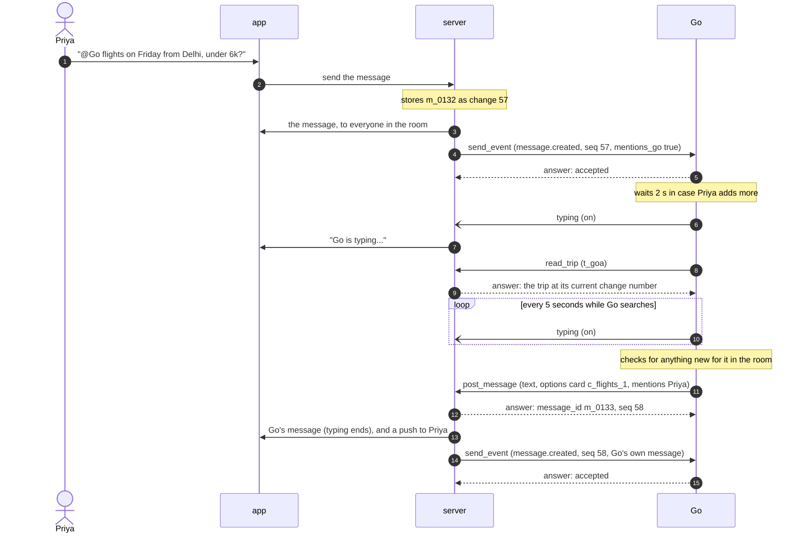
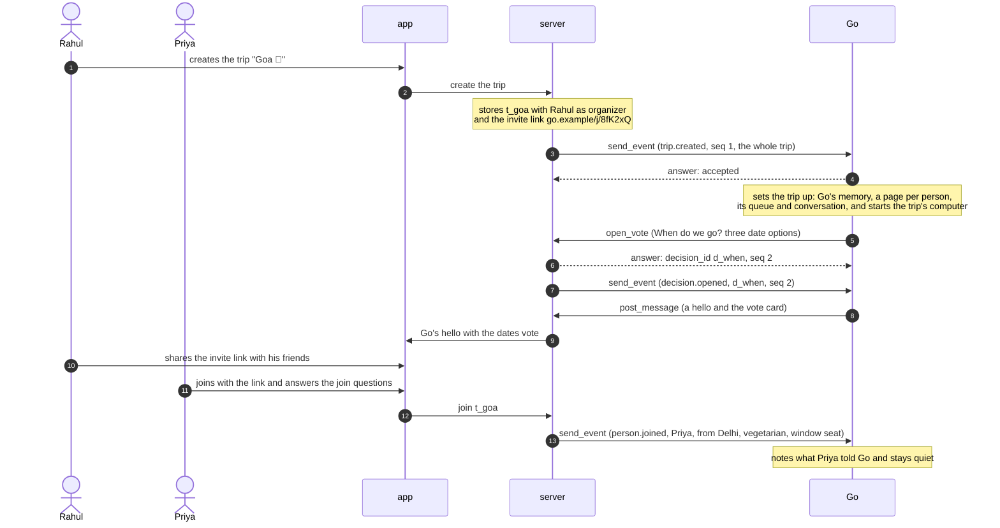
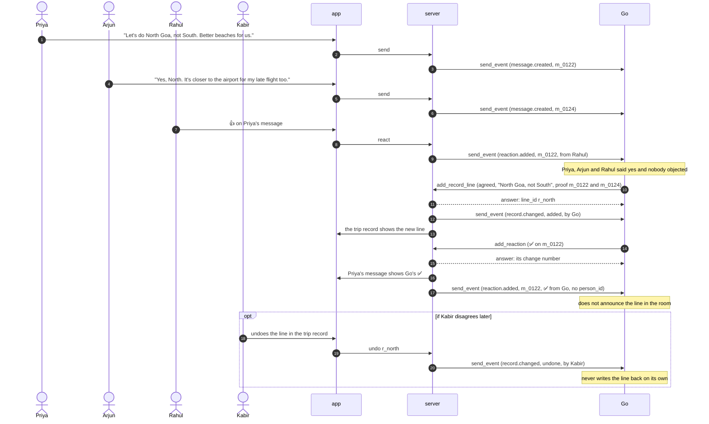
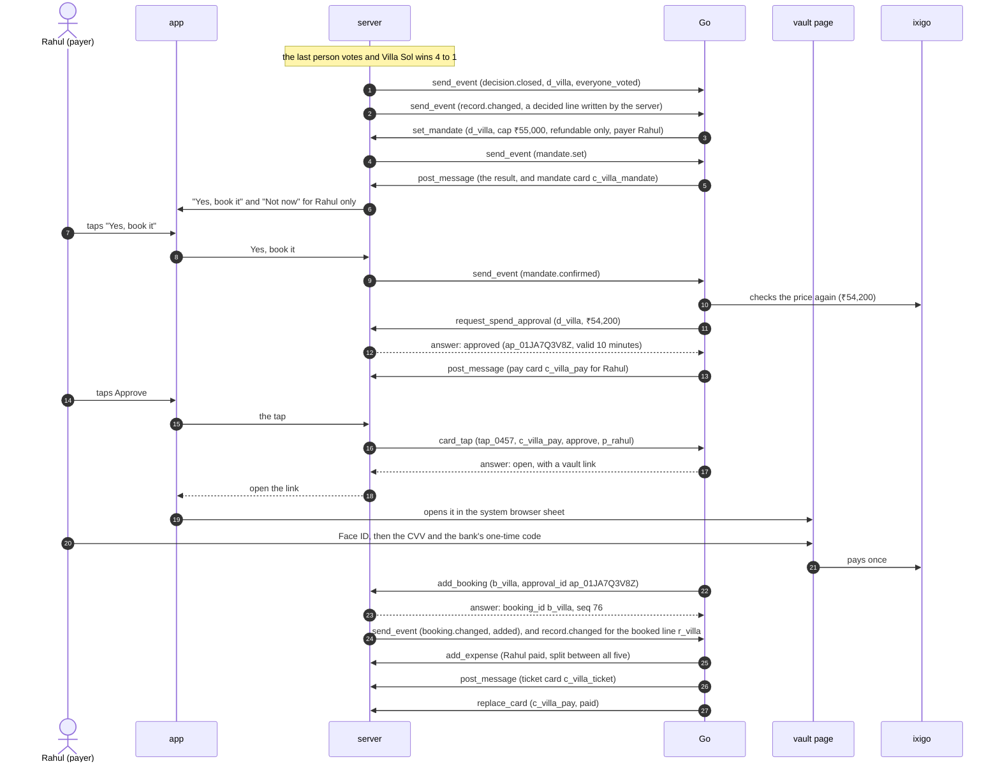
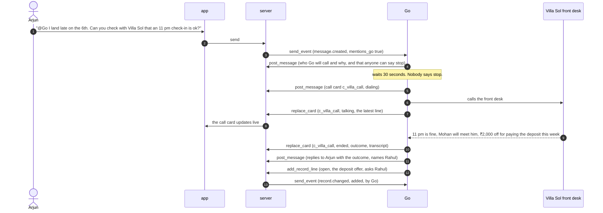
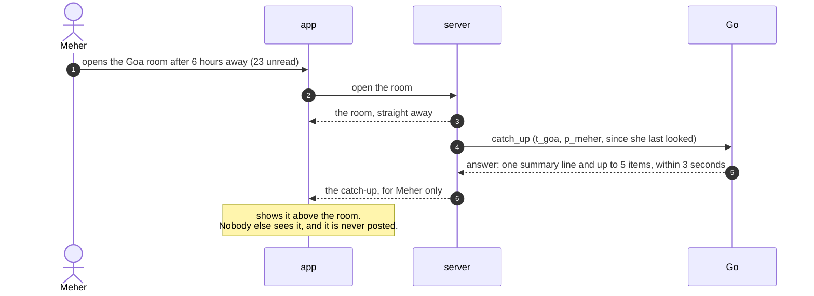
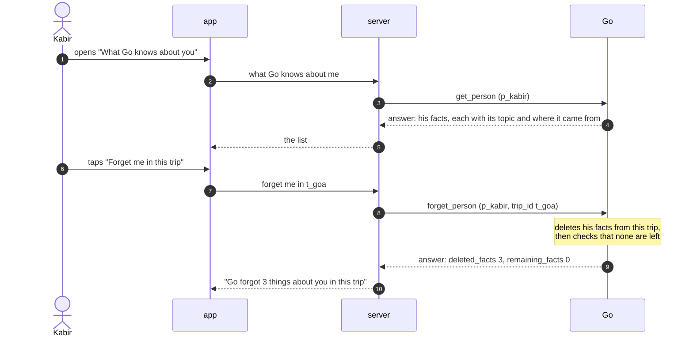
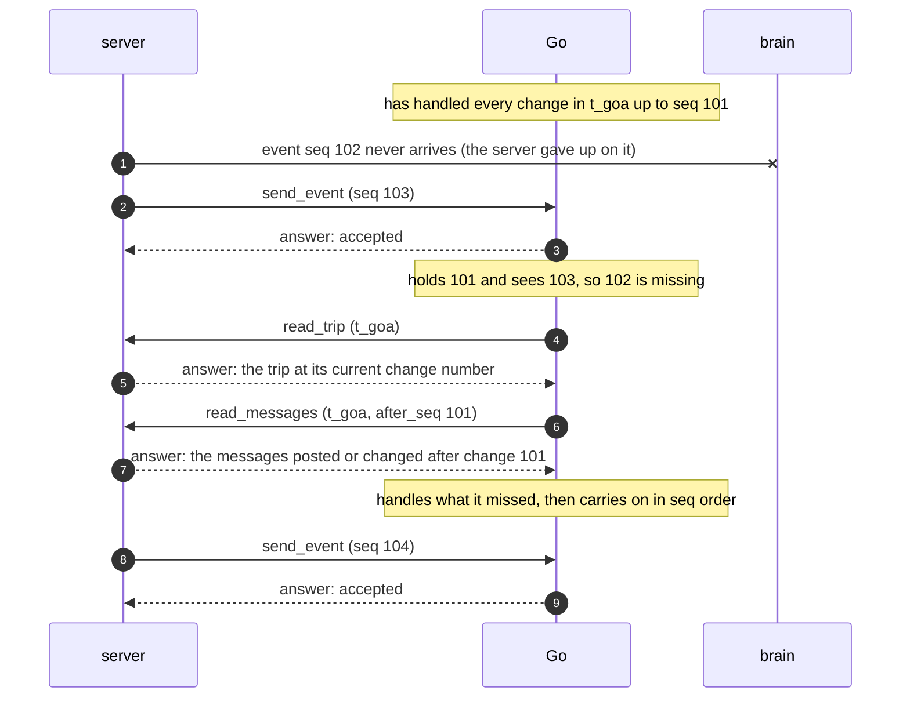

# Flows

This page walks through the big moments of a trip, step by step, as sequence diagrams with a short explanation under each. Use it to see how the requests, notifications and events on the other pages fit together, and to check that your part does its steps in the right order.

Every flow uses the Goa trip (`t_goa`). The participants are the people in the room, the app, the server, Go and, where they take part, the vault or a business.

Every arrow between the server and Go is a frame on the one socket that the server keeps open to Go (see [The socket](02-the-socket.md)). A request, such as `send_event`, `read_trip` or `post_message`, is drawn as a solid arrow, and always gets one answer with the same id, drawn as a dashed arrow back and labelled "answer". `typing`, which shows "Go is typing...", is a notification, drawn as an open arrow, and gets no answer.

Every change Go makes (a message, a reaction, a vote, a record line, a booking) comes back from the server as an event with its own change number. That is how Go learns the change numbers of its own writes. The diagrams show this once, in the first flow, and leave it out after that to stay readable. They also leave out most of Go's answers to `send_event`, which always say `accepted`.

## 1. Go answers a question

This is the most common flow: someone asks Go for something in the room, and Go answers with text and a card.

Priya's message mentions Go, so Go answers. Go answers the `send_event` at once and does the work afterwards. Go waits about 2 seconds in case Priya sends more. Then it sends the `typing` notification, so the room shows "Go is typing...", and repeats it every 5 seconds. It reads the trip with `read_trip` to learn the dates and who flies from Delhi, and searches. Just before it posts, it checks for anything new for it in the room, so a follow-up from Priya or someone else gets answered in the same reply. Then it posts one message with `post_message`: a line of text and an options card with three flights. The server answers with the new message's id and change number, pushes Priya because Go named her, and sends the message back to Go as an event with that change number.

## 2. A trip starts

This flow runs once per trip: the organizer creates the trip, and Go greets the room and opens the first vote.

`trip.created` carries the whole trip, so Go can start without reading anything else. Go answers at once, then sets the trip up: its memory, a page for each person, its queue and the composer's conversation take a few seconds, and the trip's own computer starts in the background so it is ready for the first task (see [How Go sets itself up for a new trip](03-events.md#how-go-sets-itself-up-for-a-new-trip)). Go says hello and opens the first vote. Here it asks about the dates, which are not set yet. It could instead open a yes/no "Who's in?" vote. Opening a vote takes two requests: `open_vote` creates the vote, then `post_message` with a vote card shows it in the room. As friends join through the invite link, the server sends `person.joined` for each of them. Go keeps what they said about themselves and does not post a welcome for every person. When the vote `d_when` closes, the server writes the decided line "6 to 9 Nov" (`r_dates`) itself.

## 3. The group agrees in the chat without a vote

This flow shows how something the group settles in plain conversation ends up in the trip record, how Go shows that it noted it without speaking, and how a person can take it back.

Nobody asked Go anything, so Go stays quiet and takes notes. Priya proposed North Goa, Arjun said yes, and Rahul added a 👍 to Priya's message, which counts as a yes (`reaction.added`). An agreed line needs two people saying yes, or the organizer alone, and nobody objecting. That holds here, so Go writes an agreed line with `add_record_line`, with Priya's and Arjun's messages as proof. If someone had objected, Go would have written an open line instead. Go does not announce the line. Instead, it adds a quiet ✅ to Priya's message with `add_reaction`, so the room can see that Go noted it. That reaction is a change like any other, so the server sends it back as `reaction.added`, with no `person_id` because Go made it. If Kabir disagreed, he could undo the line in the app (the last part of the diagram). In the Goa trip nobody does, so the line stays. Only people can undo a line. Go never undoes one and never writes it back, and if the group settles the question again later, Go writes a new line.

## 4. From a vote to a booking

This flow takes the villa vote all the way to a paid booking. Every check in it is explained in [Money and the vault](08-money-and-the-vault.md), which has a more detailed diagram of the same payment.

The vote closes when the last person votes, and the server writes the decided line itself. A closed vote is a moment Go speaks, so it sets the mandate with `set_mandate` and posts the result together with the mandate card. The mandate says what the group allowed: Villa Sol, at most ₹55,000, refundable only, paid by Rahul. Only Rahul sees "Yes, book it". When he taps it, Go checks the price again and asks the server for a spend approval with `request_spend_approval`. The server runs the spend check and answers with a signed, one-use approval. Go then posts a pay card that only Rahul can approve. His tap reaches Go as `card_tap`, with the server's `tap_id` so that a tap sent twice is acted on once, and Go answers `open` with a link to the vault page, which the app opens in the system browser sheet. There he confirms with Face ID and types his CVV. The vault checks the approval and pays ixigo once. Go records the booking with `add_booking` and the approval's id (the server marks the approval used and writes the booked line), records the expense with `add_expense`, posts the ticket, and turns the pay card to paid with `replace_card`.

## 5. A phone call

This flow shows Go calling a business for the group: it says who it will call, gives the room a chance to stop it, and keeps a live card of the call.

Before it dials, Go tells the room who it will call and what it will ask: "I'll call Villa Sol's front desk to ask if Arjun can check in at 11 pm. Say stop in the next 30 seconds if you'd rather I didn't." Anyone can stop it by replying in that time, and such a reply reaches Go as a message that mentions it. Once the call starts, Go posts a call card (`call_01`) and updates it in place with `replace_card` as the call moves from dialing to talking to ended. Those updates send no events. While it runs, the card's Stop button ends the call. The final card holds the outcome and the transcript, and it is the record of the call. Go replies to Arjun with the outcome: "11 pm check-in is fine. The caretaker, Mohan, will meet Arjun. They offered ₹2,000 off if we pay the deposit this week." The discount needs a decision, so Go also writes an open line in the trip record with `add_record_line` that asks Rahul, the payer.

## 6. Someone opens the room after a while

This flow shows catch-up: a short summary, for one person only, of what happened while they were away.

Meher has been away for more than 3 hours, so the server sends Go a `catch_up` request while it shows her the room. Go answers within 3 seconds with one sentence in Go's voice ("While you were away, the group picked Villa Sol and Go booked it.") and a few items: the vote result, the booking, and the open question about scuba on Saturday, which asks her. The app shows it above the room for Meher alone. Tapping an item scrolls to its message. If Go is slow or fails, Meher simply sees the room without it.

## 7. Forget me

This flow shows a person seeing what Go knows about them and asking Go to forget it.

The app never talks to Go itself. The server takes Kabir's `person_id` from his signed-in session and sends both requests for him: `get_person`, then `forget_person`. Go answers with every fact it holds about him, each with where it came from, so he can see why Go knows it. "Forget me in this trip" sends the `trip_id`, and "Forget me everywhere" leaves it out. Go deletes the facts, checks that none are left, and only then answers, so `remaining_facts` is always 0. The room's messages stay, because the rest of the group can still see them.

## 8. Go misses an event

This flow shows how Go notices a missed event from the change numbers and catches up, so nothing in the trip is lost.

The server sends each trip's events in order, one at a time, so a gap is rare. It can happen when the server gives up on an event, for example after an `invalid` error that it does not retry, or after 24 hours without an answer. It can also happen when Go loses events it had accepted but not yet handled. Go still accepts event 103 straight away. Because it holds 101 and sees 103, it sends the server `read_trip` for the whole trip and `read_messages` for the messages posted or changed after change 101 (`updated_seq` above 101), handles what it missed, and then carries on. Whatever the gap was (a message, a vote, a booking), the trip and the messages cover it.

Good to know:
- Go also reads every active trip once a minute with `read_trip`, so it catches up even when no later event arrives to show the gap.
- A dropped socket is not a gap. The server's socket client sends every unanswered request again after it reconnects, with the same id and the same `event_id`, and Go handles each event once.
- An event that arrives twice is not a gap. Go answers `{"accepted": true, "duplicate": true}` and does nothing.
- Go answers `accepted` to an event type it does not know, and skips it.
