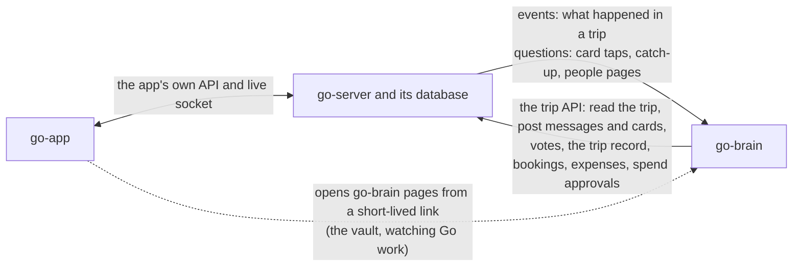

# The Go guide

This guide explains how the three parts of Go talk to each other: the app, go-server and go-brain. It is the contract between the Go team and the Vestra team. If you build any part of Go, start here, then read the pages for your part.

CI checks the guide's examples: every JSON example is validated against the contract in TypeScript and in Python, and the TypeScript and Python helpers must produce the same signatures.

## What Go is

Go is the AI member of a trip group. Friends plan a trip in a group chat inside the Go app, and Go is in that chat with them. Go reads every message, answers when someone asks, opens votes, keeps track of what the group agreed, finds stays and flights, books them, calls hotels, and splits the money. To the people in the room, Go is one member of the group.

## The three parts and who builds them

| Part | Who builds it | What it does |
|---|---|---|
| **go-app** | The Go team (Saket) | The Flutter app people use: the trip room (the group chat), the Trip screens, joining by link, push notifications. |
| **go-server** | The Go team | The app's backend and database. It owns everything about a trip: people, messages, votes, bookings, expenses, the trip record and the spend check. |
| **go-brain** | The Vestra team (Keshav) | Go itself: reading the room, deciding when to speak, memory about people, searching and booking, phone calls, and the vault that holds cards. |

## How the parts talk



There are five rules behind this picture.

1. **go-server is the source of truth for anything shown on a screen.** Trips, people, messages, votes, bookings, expenses and the trip record live in go-server's database. go-brain keeps only what Go knows about people and its own working state, and reads the trip from go-server when it needs it.
2. **The two servers talk over signed HTTPS, in both directions.** go-server sends events and asks questions. go-brain calls the trip API. There is no socket between the servers.
3. **The app talks only to go-server.** The one exception is a go-brain page (the vault, or watching Go work), which the app opens from a short-lived link in the system browser sheet.
4. **Go never pays on its own word.** A payment needs two separate approvals: a signed spend approval from go-server (the group voted, the price is within the cap, the payer said yes) and the payer's own Face ID in the vault.
5. **go-brain never receives contact details or anyone's own budget answer.** It does not see phone numbers, emails or UPI ids. For budgets it gets only the lowest band anyone picked.

## Words used in this guide

These words have one meaning everywhere in the guide.

| Word | Meaning |
|---|---|
| **Trip** | One trip a group is planning, such as "Goa 🌴". Every trip has its own room and its own Go. Id: `trip_id`. |
| **Room** | The trip's group chat in the app. Go is a member of it. |
| **Person** | A human in a trip. `person_id` is go-server's id for that human and stays the same across every trip they join. There is no separate member id. |
| **Go** | The AI member of the room. Go's messages have the author `{ "kind": "go" }`. |
| **Card** | Something richer than text that Go posts in the room: a vote, options with prices, a ticket, a live call. See [Cards](04-cards.md). |
| **Event** | A note from go-server to go-brain that something changed in a trip, such as a new message or a closed vote. See [Events](02-events.md). |
| **Change number** (`seq`) | A counter per trip. go-server adds one for every change to the trip and puts it on the event. go-brain uses it to notice a missed event. |
| **Trip record** | The trip's shared memory: one line per thing the group decided, agreed, booked, still has to settle, or someone is doing. go-server stores it; Go writes most of it. |
| **Vote** (`decision`) | A question the group answers by tapping an option. A vote can be anonymous. |
| **Mandate** | What the group allowed for a spend after a vote: the choice, the most it may cost (the cap), whether it must be refundable, and who pays. |
| **Spend approval** | A short-lived token go-server signs when a payment passes the spend check. The vault will not pay without one. |
| **Vault** | Each person's own store for cards and logins, in go-brain. Only the person can unlock it, with a passkey (Face ID). |

## One message, start to finish

Here is what happens when Priya asks Go for flights.

1. Priya types "@Go flights on Friday from Delhi, under 6k?" in the room. The app sends it to go-server.
2. go-server stores the message as change 57 of the trip, shows it to everyone in the room, and sends go-brain a `message.created` event. go-brain answers `202` straight away.
3. go-brain sees that the message mentions Go. It asks go-server to show "Go is typing...".
4. Go reads the trip, searches flights and picks three.
5. go-brain posts one message to go-server: a line of text and an `options` card with the three flights.
6. go-server stores Go's message, shows it in the room over the app's live socket, and sends a push to Priya because Go mentioned her.

[Flows](08-flows.md) walks through the bigger moments the same way: a vote, a booking with payment, a phone call, and "forget me".

## The pages

| Page | What it covers | Who needs it |
|---|---|---|
| [Basics](01-basics.md) | Addresses and secrets, signing every request, ids, money, time, errors, retries | Everyone building go-server or go-brain |
| [Events](02-events.md) | Every event go-server sends to go-brain, and how to send them reliably | go-server, go-brain |
| [The trip API](03-trip-api.md) | Every call go-brain makes to go-server, and the rules go-server enforces | go-server, go-brain |
| [Cards](04-cards.md) | Every card Go posts, how to draw it, and its buttons | go-app, go-server, go-brain |
| [The brain API](05-brain-api.md) | The questions go-server asks go-brain: card taps, catch-up, people pages, forget me, vault links | go-server, go-brain |
| [The app](06-the-app.md) | What the app must show live, opening go-brain pages, pushes and the "needs you" strip | go-app, go-server |
| [Money and the vault](07-money-and-the-vault.md) | The spend check, spend approvals, the payer's Face ID, and what each side checks | Everyone |
| [Flows](08-flows.md) | Step-by-step diagrams of the big moments | Everyone |
| [Build and test](09-build-and-test.md) | Setting up, the shared test vectors, checking your examples, the fake go-brain, and what done means | Everyone |
| [What changed](changes.md) | What changed from the first draft of the contract, and why | Anyone who read the draft |

## Where the contract lives in this repo

| Path | What it is |
|---|---|
| `packages/contract/src` | The contract in zod (TypeScript). This is the source of truth. Everything else is generated from it or checked against it. |
| `packages/contract/openapi/go-server.json` | OpenAPI 3.1 for the routes go-server serves. Every schema is under `components`. |
| `packages/contract/openapi/go-brain.json` | OpenAPI 3.1 for the routes go-brain serves. |
| `packages/contract-py` | The contract for Python: a pydantic model for every body, plus signing and spend approval helpers. |
| `packages/contract/test-vectors` | Fixed inputs and the exact outputs every signing implementation must produce. |
| `docs/guide` | This guide. |

## Using the contract from your code

**TypeScript.** The package is `@go/contract` in this repo. It has the zod schemas, the TypeScript types, `signRequest`, `verifyRequest` and the spend approval helpers. It needs only `zod` and Node's own `crypto`. Until it is published, depend on it from git or copy `packages/contract/src` into your repo. You can also generate types from the OpenAPI files with any OpenAPI generator.

**Python.** Install the package straight from this repo:

```bash
pip install "go-contract @ git+ssh://git@github.com/vestra-ai/go-brain.git#subdirectory=packages/contract-py"
```

Then:

```python
from go_contract import models, sign_request, verify_request

event = models.Event.model_validate_json(raw_body).root   # a MessageCreated, a DecisionClosed, ...
```

## Changing the contract

The contract is version `1.0.0`. Within version 1, changes only add things: a new optional field, a new event type, a new card kind. Nothing is renamed or removed, so code written today keeps working. Both sides ignore fields they do not know, and skip event types and card kinds they do not know.

To change it:

1. Change the zod schema in `packages/contract/src`.
2. Run `pnpm --filter @go/contract emit-openapi`, then `python scripts/gen_models.py` in `packages/contract-py`.
3. Update the guide and its examples, and run `pnpm --filter @go/contract check-docs`.
4. Open a pull request. Keshav and the go-server lead both approve contract changes.
