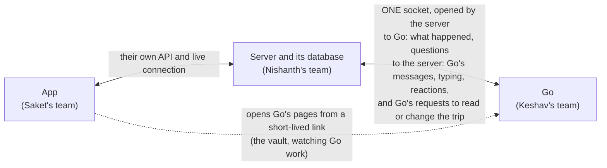

# The Go guide

This guide is the contract that Go exposes. Go is the AI member of a trip group, and the server and the app are built on top of it. The guide says exactly what travels between Go and the server, and what the server and the app must do with it. If you build any part of Go, start here, then read the pages for your part.

CI checks the guide's examples: every JSON example is validated against the contract in TypeScript and in Python, and the TypeScript and Python helpers must produce the same signatures.

## What Go is

Go is the AI member of a trip group. Friends plan a trip in a group chat inside the app, and Go is in that chat with them. Go reads every message, answers when someone asks, opens votes, keeps track of what the group agreed, finds stays and flights, books them, calls hotels, and splits the money. To the people in the room, Go is one member of the group.

## The three parts and who builds them

| Part | Who builds it | What it does |
|---|---|---|
| **Go** | Keshav's team, with Bash and Nami | The AI member itself: reading the room, deciding when to speak, memory about people, searching and booking, phone calls, and the vault that holds cards. It exposes this contract. |
| **Server** | Nishanth's team | The app's backend and its database. It owns everything about a trip: people, messages, votes, bookings, expenses, the trip record and the spend check. It connects to Go and builds on this contract. |
| **App** | Saket's team | The Flutter app people use: the trip room (the group chat), the Trip screens, joining by link, push notifications. It talks to the server. |

All three teams are the Vestra team.

### Inside Go: quick answers and big jobs

Go has two layers, so it answers in seconds and can still take on jobs that need minutes:

- **The composer** is the quick layer. It runs all the time inside Go's own service. It reads every message in the trip (the whole chat, one conversation per trip), remembers people, and decides when to speak. It answers in a second or two, and does the quick things itself: it reads the trip, searches ixigo, opens votes, writes the trip record, reacts and asks to pay.
- **The trip's computer** is for big jobs. Each trip gets its own Bash from Vestra, started when the trip is created. It does slow, many-step work, such as comparing 30 villas across sites, reading reviews, filling in forms or watching a fare. It works for minutes and never speaks in the room. It reports to the composer, which posts the result in place of the "working" card it showed while the job ran.

Payments never go through the computer: the composer pays through Go's vault, with the server's signed approval and the payer's Face ID. None of this changes what the server or the app do. They talk to one Go.

**Why the app talks only to the server, even for messages to Go.** The server keeps the one record of the room: every message is stored once, numbered in order and shown to everyone, and Go reads every message, not only the ones that name it. Go's reply is for the whole group, so it goes back through the server to every phone and push. Passing a message on over the open socket takes a few hundredths of a second; the time people feel is Go thinking. The one exception is the vault: cards and payments never pass through the server, so the app opens Go's vault page directly.

## How the parts talk



There are five rules behind this picture.

1. **The server's database is the source of truth for anything shown on a screen.** Trips, people, messages, votes, bookings, expenses and the trip record live in the server's database. Go keeps only what it knows about people and its own working state. When Go needs the trip, it asks the server, and the server answers from its database.
2. **The server and Go talk over one socket, in both directions.** The server opens one WebSocket to Go and keeps it open. The server sends what happened and asks its questions on it, and Go sends its messages and its requests to read or change the trip on the same socket. Go never calls the server any other way.
3. **The app talks only to the server.** The one exception is one of Go's pages (the vault, or watching Go work), which the app opens from a short-lived link in the system browser sheet.
4. **Go never pays on its own word.** A payment needs two separate approvals: a signed spend approval from the server (the group voted, the price is within the cap, the payer said yes) and the payer's own Face ID in the vault.
5. **Go never receives contact details or anyone's own budget answer.** It does not see phone numbers, emails or UPI ids. For budgets it gets only the lowest band anyone picked.

## Words used in this guide

These words have one meaning everywhere in the guide.

| Word | Meaning |
|---|---|
| **Trip** | One trip a group is planning, such as "Goa 🌴". Every trip has its own room and its own Go. Id: `trip_id`. |
| **Room** | The trip's group chat in the app. Go is a member of it. |
| **Person** | A human in a trip. `person_id` is the server's id for that human and stays the same across every trip they join. There is no separate member id. |
| **Go** | The AI member of the room. Go's messages have the author `{ "kind": "go" }`. |
| **Socket** | The one WebSocket between the server and Go. The server opens it to `wss://brain.go.example/v1/socket` and keeps it open. See [The socket](02-the-socket.md). |
| **Request / notification** | The two kinds of message sent on the socket. A request names a method (such as `read_trip`) and always gets exactly one answer: a result or an error. A notification gets no answer. Notifications are used only for Go's typing ("Go is typing..."). |
| **Card** | Something richer than text that Go posts in the room: a vote, options with prices, a ticket, a live call. See [Cards](06-cards.md). |
| **Event** | A note from the server to Go that something changed in a trip, such as a new message or a closed vote. The server sends each one as a `send_event` request. See [Events](03-events.md). |
| **Change number** (`seq`) | A counter per trip. The server adds one for every change to the trip and puts it on the event. Go uses it to notice a missed event. |
| **Trip record** | The trip's shared memory: one line per thing the group decided, agreed, booked, still has to settle, or someone is doing. The server stores it; Go writes most of it. |
| **Vote** (`decision`) | A question the group answers by tapping an option. A vote can be anonymous. |
| **Mandate** | What the group allowed for a spend after a vote: the choice, the most it may cost (the cap), whether it must be refundable, and who pays. |
| **Spend approval** | A short-lived token the server signs when a payment passes the spend check. The vault will not pay without one. |
| **Vault** | Each person's own store for cards and logins, kept by Go. Only the person can unlock it, with a passkey (Face ID). |

## One message, start to finish

Here is what happens when Priya asks Go for flights. Every step between the server and Go is a frame on the socket.

1. Priya types "@Go flights on Friday from Delhi, under 6k?" in the room. The app sends it to the server.
2. The server stores the message as change 57 of the trip and shows it to everyone in the room. It sends Go a `send_event` request carrying the `message.created` event, and Go answers `{ "accepted": true, "duplicate": false }` straight away.
3. Go sees that the message mentions it. It waits about 2 seconds in case Priya sends more. Then it sends a `typing` notification, and the server shows "Go is typing..." in the room.
4. Go sends `read_trip`, and the server answers with the trip as it is now, from its database. Go searches flights and picks three.
5. Just before it posts, Go checks for anything new for it in the room, so it can answer that too. Then it sends `post_message` with a line of text and an `options` card with the three flights. The server stores Go's message as change 58 and answers with its `message_id` and `seq`.
6. The server shows Go's message in the room over the app's live connection, and sends a push to Priya because Go named her in `mentions`. It also sends the `message.created` event for change 58 back to Go, because Go's own changes come back as events too.

[The socket](02-the-socket.md) shows these frames as a diagram, and [Flows](09-flows.md) walks through the bigger moments the same way: a vote, a booking with payment, a phone call, and "forget me".

## The pages

| Page | What it covers | Who needs it |
|---|---|---|
| [Basics](01-basics.md) | Addresses and secrets, ids, money, time, doing things once, errors, time limits and retries, versions | Everyone building the server or Go |
| [The socket](02-the-socket.md) | Opening the socket with a signature, the four kinds of frame, every method in both directions, keeping it alive, reconnecting, and a complete client | Server, Go |
| [Events](03-events.md) | Every event the server sends with `send_event`, and how to send them reliably from an outbox | Server, Go |
| [Go's requests](04-gos-requests.md) | Every request Go sends the server to read the trip or change it, and the rules the server enforces when it answers | Server, Go |
| [Your requests](05-your-requests.md) | The requests the server sends Go besides events: card taps, catch-up, people pages, forget me and vault links | Server, Go |
| [Cards](06-cards.md) | Every card Go posts, how to draw it, and its buttons | App, Server, Go |
| [The App](07-the-app.md) | What the app must show live, opening Go's pages, pushes and the "needs you" strip | App, Server |
| [Money and the vault](08-money-and-the-vault.md) | The spend check, spend approvals, the payer's Face ID, and what each side checks | Everyone |
| [Flows](09-flows.md) | Step-by-step diagrams of the big moments | Everyone |
| [Build and test](10-build-and-test.md) | Setting up, proving your signing code, connecting by hand, the fake Go, and what done means | Everyone |

## Where the contract lives in this repo

| Path | What it is |
|---|---|
| `packages/contract/src` | The contract in zod (TypeScript). This is the source of truth. Everything else is generated from it or checked against it. `socket.ts` has the frames and the table of methods. |
| `packages/contract/openapi/go.json` | OpenAPI 3.1 for Go's two HTTP routes (`GET /v1/health` and the socket upgrade, `GET /v1/socket`), with every schema under `components`. |
| `packages/contract/asyncapi/socket.json` | AsyncAPI 3.0 for the socket: every method in both directions, described from Go's side ("receive" methods are sent by the server, "send" methods are sent by Go). |
| `packages/contract/socket/methods.json` | The table of methods in plain JSON: each method's name, direction, params schema, result schema, time limit, and the event the server sends after it. |
| `packages/contract-py` | The contract for Python: a pydantic model for every schema, the table of methods as `go_contract.METHODS`, and the signing and spend approval helpers. |
| `packages/contract/test-vectors` | Fixed inputs and the exact outputs every signing implementation must produce. |
| `docs/guide` | This guide. |

## Using the contract from your code

**TypeScript.** The package is `@go/contract` in this repo. It has the zod schemas, the TypeScript types, the table of methods (`SOCKET_METHODS`, `methodByName`), `parseParams` to check a request's params against its method, `signRequest` and `verifyRequest`, the spend approval helpers, and the socket's numbers (`SOCKET_PATH`, `PING_INTERVAL_SECONDS`, `IDLE_CLOSE_SECONDS`, `RECONNECT_BACKOFF_SECONDS`, `MAX_FRAME_BYTES`). It needs only `zod` and Node's own `crypto`. For the socket itself, use a WebSocket client such as `ws`. Until the package is published, depend on it from git or copy `packages/contract/src` into your repo.

```ts
import { parseParams } from '@go/contract';

const check = parseParams(frame.method, frame.params); // a request from Go, such as post_message
if (check.ok) {
  // check.params is a PostMessage, checked against the contract
} else {
  // check.code is -32601 (unknown method) or 422, and check.message says what is wrong
}
```

**Python.** Install the package straight from this repo:

```bash
pip install "go-contract @ git+ssh://git@github.com/vestra-ai/go-brain.git#subdirectory=packages/contract-py"
```

Then:

```python
from go_contract import METHODS, models, sign_request

method = METHODS["post_message"]                       # who sends it, its params and result models, its time limit
params = method.params.model_validate(frame["params"])  # a models.PostMessage
event = models.Event.model_validate(frame["params"]).root  # in a send_event request: a MessageCreated, a DecisionClosed, ...
```

[The socket](02-the-socket.md#a-complete-client-for-the-server) has a complete client for the server in both languages, which connects, reconnects, answers Go's requests and sends yours.

## Changing the contract

The contract is version `1.0.0`. Within version 1, changes only add things: a new optional field, a new event type, a new card kind, a new method. Nothing is renamed or removed, so code written today keeps working. Both sides ignore fields they do not know, and skip event types and card kinds they do not know. A side that receives a request for a method it does not know answers with the error code `-32601`, and the sender skips what it wanted to do. That is how a new method can ship on one side before the other side supports it.

To change it:

1. Change the zod schema in `packages/contract/src`.
2. Run `pnpm --filter @go/contract emit-openapi`, which writes the OpenAPI file, the AsyncAPI file and `socket/methods.json`. Then run `python scripts/gen_models.py` in `packages/contract-py`.
3. Update the guide and its examples, and run `pnpm --filter @go/contract check-docs`.
4. Open a pull request. Keshav and Nishanth both approve contract changes.
